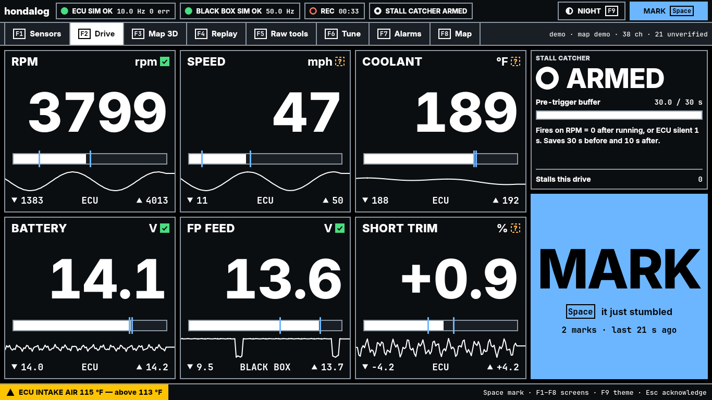
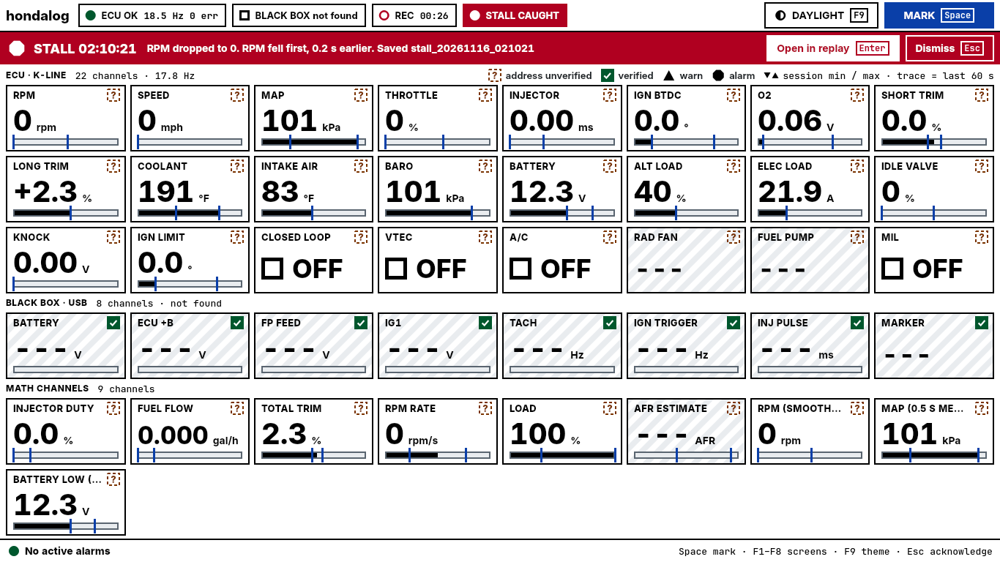
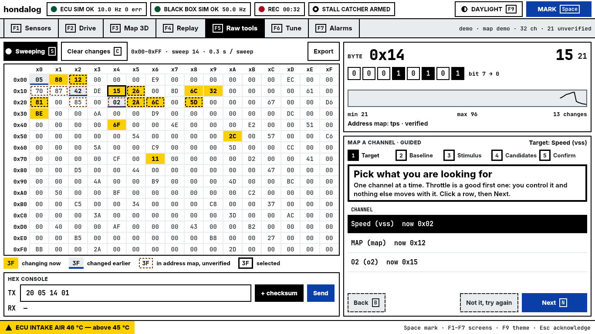
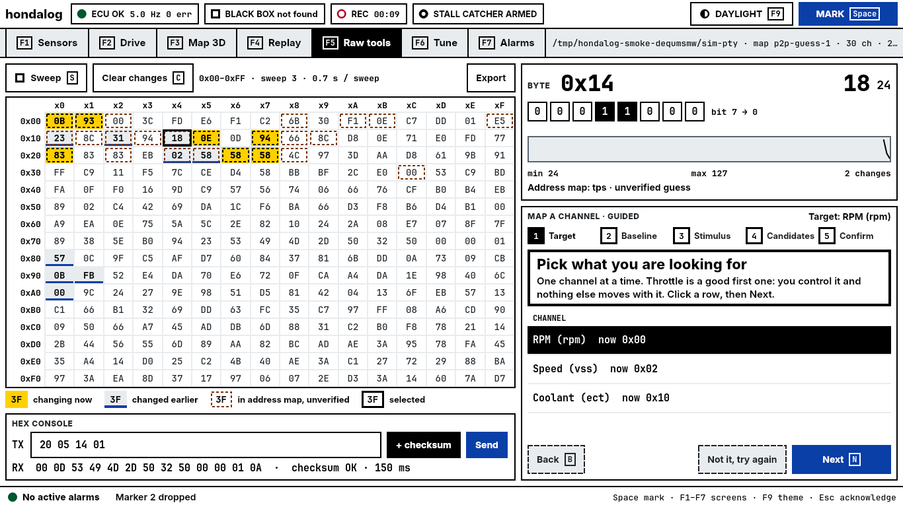
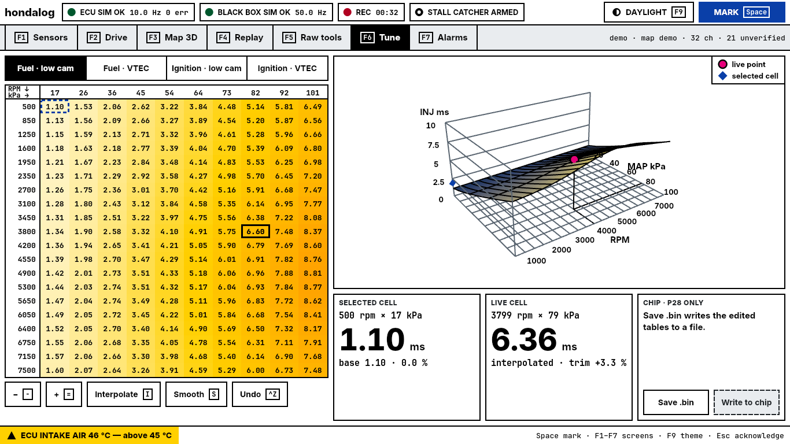
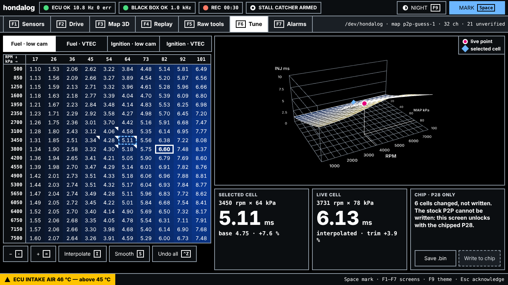
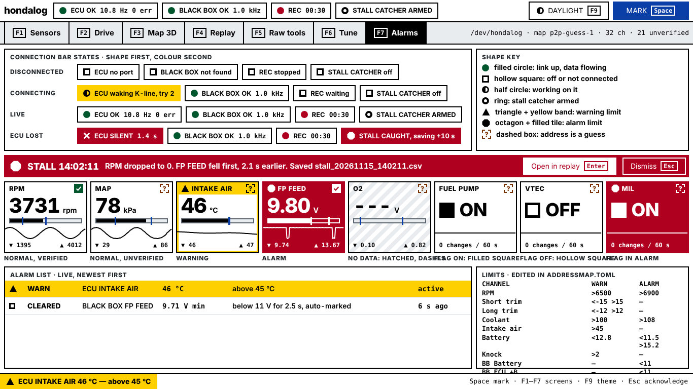

# hondalog

Live data logger for a 2000 Honda Civic EX (D16Y8, OBD2B) over a cheap
KKL 409.1 USB cable (FTDI FT232RL). Linux desktop app: Python, PySide6,
pyqtgraph, pyserial. Built for Debian 13 on an old ThinkPad.

It reads ECU RAM with the Honda diagnostic protocol on the K-line
(`20 05 addr len cksum`, 9600 8N1), shows it, records every drive into one
crash-safe SQLite database (`~/hondalog/hondalog.db`), and marks a capture in
it when the engine stalls or another trigger fires. Drives export to
MegaLogViewer (`.mlg`, `.msl`) and CSV, and you can query them with plain SQL.


*Above: the app on the simulated ECU. Every picture below is the app
itself at 1366x768 (`tools/screenshots.py`, demo data), with the design
mockup it was built from beside it.*

## The 1.0 UI

Designed at the T430's native 1366x768 from the
[interactive design](https://claude.ai/artifact/UZP8DiarTkdK1RWKmk7vSS);
the spec is in [docs/design/HANDOFF.md](docs/design/HANDOFF.md). The
mockups use fake data; the screenshots are the Qt build.

The default is the Daylight theme, black on white, because a TN panel in
sun loses its blacks first. Night is white on true black for dusk and the
garage, and F9 switches between them. All text meets 7:1 contrast or
better. Warning states use a shape as well as a colour, so they read
without colour vision.

### All sensors on one screen: 24 ECU + 8 black-box channels, then math channels

| app | mockup |
|---|---|
|  |  |
|  |  |

### Driving view

| app | mockup |
|---|---|
|  |  |
|  |  |

### 3D observed map: RPM x MAP, live operating point and trail

Built from your own logs, so it works on the stock P2P before any chip.
The other modes are time-in-cell bars and stall approach paths. With a ROM
open (`--rom`), the cells are the fuel table's own cells.

| app | mockup |
|---|---|
|  |  |
|  |  |


### Stall forensics replay: ECU and black box on one timeline

| app | mockup |
|---|---|
|  |  |

A stall caught on the simulated ECU, banner and capture opened in Replay:




### Raw tools and guided memory mapper

| app | mockup |
|---|---|
|  |  |



### Tuning table editor (chipped P28)

| app | mockup |
|---|---|
|  |  |

### Status bar and alarm states

| app | mockup |
|---|---|
|  |  |

**Read this first:** the address map is a guess. It is the kerpz P2T map,
and nobody has checked it on a P2P. Every channel shows an amber `?` until
you mark it verified. Until then, treat the numbers as "probably".

## Quickstart

### 1. Install

```sh
tar xzf hondalog-0.1.0.tar.gz
cd hondalog-0.1.0
./install.sh
```

The installer uses sudo. It installs the Debian packages, copies the app to
`/opt/hondalog`, adds you to the `dialout` group, adds a udev rule so the
cable shows up as `/dev/hondalog`, and adds a launcher to the menu.

**Log out and back in afterwards.** The `dialout` group only applies to new
logins, and without it you cannot open the cable. The simulator works
straight away.

### 2. Try it with the simulator (no car)

Terminal 1:

```sh
hondalog-sim
```

Terminal 2:

```sh
hondalog --port /tmp/hondalog-sim --connect
```

The simulator is a fake ECU on a pseudo-terminal. It echoes like a real
K-line, warms up, idles around 750 rpm and revs every 20 seconds. Keys in
the simulator terminal:

| key | what happens |
|-----|--------------|
| `s` | stall: RPM drops to 0, ECU keeps answering |
| `p` | power cut: ECU goes silent (like a dead main relay) |
| `r` | restart |
| `v` | rev |
| `q` | quit |

`hondalog-sim --stall-after 30` stalls on a timer. `--help` lists the rest.
In a hurry, `hondalog --port sim: --connect` uses the same fake ECU without
the pty (and adds a simulated black box). `hondalog --demo` shows every
screen with a made-up car driving around; nothing is recorded.

### 3. In the car

1. Plug the cable into the laptop. Check that Linux sees it:

   ```sh
   lsusb | grep 0403        # want: 0403:6001 ... FT232 Serial (UART) IC
   sudo dmesg | tail        # want: FTDI USB Serial Device converter now attached to ttyUSB0
   ls -l /dev/hondalog      # the udev link
   ```

2. Plug the other end into the 16-pin OBD2 port under the dash.
3. Key to ON (II). The engine can be off or running.
4. Start `hondalog`. Click the **ECU** chip (top left) and pick
   `/dev/hondalog`. `hondalog --port /dev/hondalog --connect` does the same.
5. The chip shows a filled circle and `ECU OK`, with the poll rate
   (about 17 Hz) and the error count.

If the chip turns red (`ECU SILENT`), run `hondalog-firstcontact` (next section), then go to
Troubleshooting.

### 4. First contact

```sh
hondalog-firstcontact            # or: --port /dev/ttyUSB0, --port sim:
```

Run this the first time the cable is in the car, with the key ON and
hondalog itself disconnected. It takes about 15 seconds and only reads. It
checks the adapter (FTDI or not, clone or not, latency timer), tests the
echo, listens, tries a Honda read with and without the wake-up bytes, tries
other reply framings, reads the ECU id, finds the longest block the ECU
answers, measures its reply time, reads 0x00-0xFF once, and then tries the
standard OBD2 link (ISO 9141-2) for codes, freeze frame and readiness.

It ends with one of five verdicts: `Honda protocol OK`, `ISO only`,
`cable dead`, `ECU silent`, `no port`. Two files land in `~/hondalog/logs/`:
`firstcontact-DATE.md` (verdict, next steps, findings, suggested
`[protocol]` settings) and `firstcontact-DATE.hex.log` (every byte sent and
received, with times). Send both along when asking for help.

`hondalog-firstcontact --udev` prints the udev rule that sets the FTDI
latency timer to 1 ms on every plug-in. `install.sh` installs it.

## Using it

Built for a 1366x768 laptop in a car: every action has a key, nothing needs
the touchpad, and state is shown by shape as well as colour.

| Key | Does |
|-----|------|
| F1 to F7 | Sensors, Drive, Map 3D, Replay, Raw tools, Tune, Alarms |
| F9 | Daylight (black on white, for sun) / Night (white on black) |
| Space | MARK: tag this moment in the log ("it just stumbled") |
| Esc | Acknowledge alarms, dismiss the stall banner |
| Enter | Open the caught stall in Replay (while the banner shows) |
| Ctrl+R | Start / stop recording |
| F11 | Full screen |

**Sensors (F1).** Every channel on one screen. Each tile has the value, a
bar with the session minimum and maximum, the last 60 seconds as a trace,
and a marker: dashed `?` box = the address is a guess, green tick =
verified. A triangle and yellow band is a warning; an octagon on a filled
tile is an alarm; a hatched tile has no data. Click a tile to put it on the
Drive view; right-click for its limits and "mark verified".

**Drive (F2).** Six huge readouts, the stall catcher's state and a MARK
button the size of a hand. Right-click a readout to change what it shows.

**Recording.** Starts on connect (ECU chip menu, "Record on connect").
Every drive goes into one database, `~/hondalog/hondalog.db`, under a name
like `drive_2026_11_16_0712`. Its row holds the ECU id bytes, the address
map it was decoded with, the units and the link counters; next to it are the
markers and every channel with its own timestamps, the K-line reads with the
bytes the ECU sent. It is committed every half second, so a crash or a dead
laptop battery costs at most the last second: the next start shows that
drive as "crashed", with everything up to the last commit in it. A drive
ends when you stop recording or when the ECU has been silent for two minutes
(key off); the next answer starts a new drive. Logs from 0.1.0 (`.csv`) and
MegaLogViewer files are read in with "Import file" or `hondalog-log import`.

**Stall catcher.** While recording, once RPM has been above 400:

- RPM reads 0, or
- the ECU stops answering for 1 second (power loss, cable pulled),

the app marks the 30 seconds before and the 10 seconds after as a capture
named `stall_DATE_TIME` (a row in the database pointing into the drive, not
a copy), shows a red banner over the tabs and beeps. Enter opens the
capture in Replay. Turning the key off with the engine
running counts as a stall too; press Esc for that one.

**Map 3D (F3).** RPM x MAP surface built from what has been logged this
session: height is injector time, ignition or fuel trim; colour is trim or
sample count; grey cells have no samples yet. V switches to time-in-cell
bars or stall approach paths, Z and C change height and colour, arrows
orbit, 1 to 4 are camera presets. Without OpenGL 2.1 it draws the same data
as a 2D heat map (`--no-gl` forces that).

The stall catcher is two rules of a general trigger engine
(`hondalog/triggers/`). A rule is a condition on any channels, a hold time,
and how much to keep before and after, for example
`when = "ect > 105"`, `hold_s = 2`. Rules for low battery, a lean spike and
overheating ship switched off, because they depend on channels that have not
been verified on the car yet.

**Replay (F4).** O opens the drive picker: every drive, its stall captures
under it, black box captures (`.bbx`), a search box over names, notes and
markers, and "Import file" for an old `.csv` or a MegaLogViewer
`.msl`/`.mlg`. With nothing open it follows live data. Stacked lanes with one cursor: click or drag, arrows step 0.1 s
(Shift 1 s), `[` and `]` jump between events, P plays, `+` and `-` zoom, D
drops a second cursor for a time difference. For a stall capture the right
side lists what left its normal range first.

**Raw tools (F5).** S sweeps all 256 bytes and keeps going. Yellow = changed
in the last sweep, underlined = changed earlier, dashed = in the address
map but unverified. Arrows move the selected byte; the inspector shows its
bits and history. The hex console sends raw frames (Enter). It is
read-only: only read requests (`20 05 addr len cksum`) go out, anything
else is refused until you tick **Expert**, and every frame sent that way is
written into the log header. The guided mapper (N next, B back) runs one of
the verification scripts from "Mapping the P2P" on the channel you pick:
it tells you what to do, judges the recorded data, and on a pass writes
`status = "verified"` and the evidence into your address map. When the
check fails it lists the addresses that did behave as expected.

**Tune (F6).** Table grid with a 3D surface beside it. Start with
`hondalog --rom tuned.bin --definition p28.toml` (or `.xdf`) to edit a ROM:
edits go through the ROM session's undo, "Save .bin" writes a new image
with the checksum fixed, and the live cursor follows RPM and MAP. Without
a ROM, or if it cannot be read, the read-only sample tables are shown.

**Alarms (F7).** The shape key, the live alarm list and the limits. The
alarms are the `[[alarm]]` rules in the address map; the black box rails
have fixed limits (below 11 V).

**ECU chip menu.** Port list, record on connect, the link's health (reads
per second per rate class against target, share of the wire used,
timeouts, checksum errors, retries) and, while disconnected, **Run first
contact**: the same sequence as `hondalog-firstcontact`, with the verdict
in the status line and the report in the log folder.

**Sensor tiles.** Right-click, "Mark verified" writes the mark to
`~/.config/hondalog/addressmap.toml` (method "manual"). Rad fan and Fuel
pump are placeholders until the map has channels named `fan` and
`fuel_pump`.

`hondalog --profile` shows frame time, CPU and latency in the bottom bar.
`tools/bench_ui.py` measures the same per screen (see docs/ui-adapters.md).

### Mapping the P2P

Every address starts as a guess. Three tools turn guesses into verified
channels; all of them work from the terminal (`hondalog-map`, also over ssh)
and the logic is in `hondalog/mapping/` for the UI to use.

By hand, in the app:

1. Engine warm and idling. Raw tools (F5), S to sweep.
2. Press C to clear, then change one thing only: blip the throttle,
   switch on the headlights, turn on the A/C.
3. Watch which bytes turn yellow. Compare with the guess in the map
   (RPM at 0x00-0x01, TPS at 0x14, battery at 0x17, and so on).
4. ECU chip menu, "Edit address map" opens
   `~/.config/hondalog/addressmap.toml`. Fix the address or formula, set
   `status = "verified"`, bump `version`, save.
5. Disconnect and connect again to load it.

**1. Guided checks.** `hondalog-map scripts` lists them; `hondalog-map status`
shows which script can prove which channel.

```sh
hondalog-map verify koeo --port /dev/hondalog          # key on, engine off
hondalog-map verify tps_sweep --port /dev/hondalog     # press the pedal slowly
hondalog-map verify idle --port /dev/hondalog          # warm idle; asks for the tach reading
hondalog-map verify steady_3000 --port /dev/hondalog
hondalog-map verify warmup --port /dev/hondalog        # cold start to warm
hondalog-map verify drive --port /dev/hondalog         # passenger types the speedo reading
hondalog-map verify ac_switch --port /dev/hondalog
```

Each script tells you what to do, records the whole time, and gives a verdict
per channel:

- `pass`: a check that can prove the address held (throttle went from under
  5% to over 90% as you pressed; battery within 0.3 V of your meter).
- `plausible`: the value looks sane but that proves nothing (RPM reads 0 with
  the engine off). Not marked unless you insist (`--force`).
- `fail`: it lists where the signal may really live.
- `skip`: no reading was given, or the check does not apply (engine not cold).

Nothing is marked verified until you say yes. Then the map gets
`status = "verified"` and a `[channel.evidence]` table: date, script, what was
measured, the map version and hash, and the name of the evidence file in
`~/hondalog/verification/` (a report plus every raw byte recorded).

**2. The finder.** Sweep while something changes, then rank every address as
a byte and as a 16-bit value in both byte orders:

```sh
hondalog-map find --port /dev/hondalog --channel rpm --seconds 30   # what moves with RPM?
hondalog-map find --port /dev/hondalog --value 12.4 --formula "x / 10.45"   # what reads 12.4 V?
```

In the app: Raw tools, "Sweep continuously", then "Rank addresses". It prints
a suggested formula (least squares) for each hit. Rank against a channel you
have already verified, or the result is only as good as that guess.

**3. Cross-check with standard OBD2 PIDs** (`hondalog/mapping/crosscheck.py`).
Feed it pairs of readings taken under the same steady conditions and it says
agree, scaled (with a corrected formula) or no match for RPM, ECT, IAT, MAP,
TPS, speed, both trims, O2 and timing. It needs the ISO 9141-2 link, which is
still being built; until then it runs on numbers from any scan tool.

**By hand** still works: "Edit address map" opens the file. Changing an
address or formula through the tools resets that channel to unverified and
bumps the version. `hondalog-map diff old.toml new.toml` shows what changed
and whether old logs would decode differently; `hondalog-map hash` prints the
12-digit hash that identifies a map's decoding.

An old (schema 1) map keeps working as it is. `hondalog-map upgrade` adds the
math channels and alarms to it and keeps your comments.

### Math channels and alarms

Both live in the address map, under `[[math]]` and `[[alarm]]`; the file
explains every field. Shipped math channels: injector duty, fuel flow, total
trim, RPM rate, load, a rough AFR estimate and three filtered values. Shipped
alarms: coolant over 105 °C for 2 s (critical), battery low and high, over-rev,
idle collapsing, lean under load. The limits are starting points, not Honda
figures, and every one of them reads channels that are not verified yet (the
alarm text shows a `?` until they are).

Expressions use `[rpm]` or `rpm` for a channel, `[rpm-1]` for its previous
sample, `a ? b : c`, and helpers such as `avg(x, ms)`, `slope(x, ms)`,
`minw(x, ms)`, `maxw(x, ms)`, `smooth(x, n)`. `min(a, b)` and `max(a, b)`
compare two values, so the time-window versions are spelled `minw`/`maxw`.
Nothing in an expression is run as Python: the text is parsed into a small
tree and only the listed functions exist.

Math channels are their own group on the Sensors screen and a `math` stream
in every log. An alarm colours its tile, shows in the bottom strip (Esc
acknowledges) and is written into the log; `"marker"` in its `actions` drops
a marker and `"capture"` saves a capture around it, like a stall.

Trigger rules (`hondalog/triggers/`) use the same expressions, including
the ones with history: `when = "rate(rpm) < -1500 and rpm > 300"`.

Temperatures are in °C, pressure in kPa, speed in km/h in the map and in logs.
`hondalog/units.py` converts for display (°F, psi, inHg, mph, AFR).

## Troubleshooting

**Permission denied on /dev/ttyUSB0.** You are not in `dialout` yet, or you
have not logged out since the installer added you. Check with `groups`.
Fix: `sudo usermod -aG dialout $USER`, then log out and in.

**The cable appears and vanishes; dmesg mentions `brltty`.** The braille
driver grabs FTDI adapters. `sudo apt remove brltty`, then replug.

**lsusb shows nothing new.** Dead cable or dead USB port. Try another port.

**lsusb shows `0403:0000`.** A clone FTDI chip that an old Windows driver
has zeroed. It still works on Linux if you tell the driver about it:

```sh
sudo modprobe ftdi_sio
echo 0403 0000 | sudo tee /sys/bus/usb-serial/drivers/ftdi_sio/new_id
```

It then appears as `/dev/ttyUSB0`. Pick it from the ECU chip menu, or use
"Other port" there (the
`/dev/hondalog` link only matches `0403:6001`).

**lsusb shows `1a86:7523` (CH340) instead of FTDI.** Some "KKL" cables use
that chip. It works the same. Pick its `/dev/ttyUSB0` entry in the ECU chip menu.

**Clone FTDI chips in general** are fine on Linux. The kernel driver does
not care.

**The ECU chip is red (`ECU SILENT`).** Click it: the menu shows the last error.

- *"no bytes at all, not even the echo"*: the cable's car side is dead.
  It is powered from the OBD2 plug (pin 16), so it only echoes when it is
  plugged into the car. Check the plug is fully seated and the car battery
  is connected.
- *"echo only, the ECU did not answer"*: the cable works, the ECU is quiet.
  - Key must be ON (II), not ACC.
  - Try it with the engine running, and with key on, engine off.
  - Check the ECU sticker (passenger footwell, behind the kick panel). This
    was written for a P2P. A different ECU may want different framing.
  - In Raw tools send `20 05 00 10` by hand and look at what comes back.
  - Edit the address map, `[protocol]` section: try `init_sequence = ""`
    (no wake-up bytes), or `reply_timeout_s = 0.5`.
- *"bad checksum"* or *"no reply frame"*: bytes arrive but do not fit the
  expected `00 len+3 data cksum` shape. Copy what the hex console shows.
  The framing constants are all in `hondalog/protocol.py` (class `Framing`)
  and can be overridden in the map's `[protocol]` section.

**ERRORS keeps climbing but data shows.** A few errors are normal on a noisy
line. Lots of them: bad ground or a poor cable. The log's `link` column is 0
for sweeps where nothing valid came back.

**Values look wrong.** Expected, the map is a guess. See "Mapping the P2P".

**Window does not start: `could not load the Qt platform plugin "xcb"`.**
`sudo apt install libxcb-cursor0 qt6-qpa-plugins`.

## Drives from the command line

```sh
hondalog-log record  --port sim: --seconds 30   # record without the window (add --bb PORT)
hondalog-log list    [-q words]           # drives and captures; searches names, notes, markers
hondalog-log info    [DRIVE]              # streams, rates, markers, header (default: the newest)
hondalog-log export  DRIVE out.mlg        # also .msl .csv .npz, or .db (a copy to hand on)
hondalog-log export  DRIVE out.csv --channels rpm,map,stft --filter "ect > 80" --hz 10
hondalog-log compare DRIVE_A DRIVE_B      # channel by channel; --align marker|trigger|crossing
hondalog-log import  old_log.csv          # 0.1.0 CSV, MSL or MLG -> a new drive
hondalog-log report  stall_20261116_071455   # one-page HTML report
hondalog-log redecode DRIVE               # decode the raw bytes with your current map -> a new drive
hondalog-log prune   --days 90 --yes      # delete old drives (those with captures or notes are kept)
hondalog-log vacuum  [--full]             # give freed space back to the disk, check the file
hondalog-log sql     "SELECT ..."         # run a query; without one, the sqlite3 shell
```

DRIVE is a drive name (`drive_2026_11_16_0712`), a capture name
(`stall_20261116_071455`), `last`, `other.db#drive_...` for a drive in another
database, or a CSV/MSL/MLG file. `--db FILE` before the command picks the
database (`compare` can take one drive from each).

## Querying your drives with SQL

The database is ordinary SQLite: `hondalog-log sql`, the `sqlite3` shell or
DB Browser for SQLite open it (also while the app is recording; open it
read-only). Times (`t`) are seconds since the app connected, the same clock
in every table of one drive. What is there:

| name | what |
|---|---|
| `drive_2026_11_16_0712` | one view per drive: a row per RPM read, every channel as a column (slower channels hold their last value, black box channels show their one-second mean), plus `wall_time` |
| `drive_..._blackbox` | the same drive's black box streams, a row per second: `<channel>_min`, `_mean`, `_max` |
| `drive_summary` | a row per drive: when, how long, stalls, markers, status, notes |
| `stalls` | every stall capture of every drive: when, why, the window |
| `readings` | every K-line and math value in long form: drive, channel, t, value |
| `blackbox_1s` | every black box channel per second: min, mean, max |
| `ecu_reads` | the raw bytes of every K-line read, with its latency |
| `markers` | markers, trigger firings and alarms |

The tables under them (`drives`, `channels`, `samples`, `chunks`, `events`,
`alarms`, `captures`) are described in
[docs/ARCHITECTURE.md](docs/ARCHITECTURE.md). The black box rows themselves
are packed (`chunks`); read them at full rate with
`hondalog.data.open_log("drive_...").series("bb_ecub")` or an export.

```sql
-- every drive, newest first
SELECT drive, started, minutes, stalls, markers, status, notes
FROM drive_summary ORDER BY started DESC;

-- the last 5 seconds before every stall: RPM as it was read, and ECU +B
-- from the black box (the lowest value in each second)
SELECT s.name AS stall, 'rpm' AS channel, round(r.t - s.t_trigger, 2) AS seconds, r.value
FROM stalls s JOIN readings r ON r.drive_id = s.drive_id AND r.channel = 'rpm'
WHERE r.t BETWEEN s.t_trigger - 5 AND s.t_trigger
UNION ALL
SELECT s.name, 'ecu +B', b.t - s.t_trigger, b.min
FROM stalls s JOIN blackbox_1s b ON b.drive_id = s.drive_id AND b.channel = 'bb_ecub'
WHERE b.t BETWEEN s.t_trigger - 5 AND s.t_trigger
ORDER BY 1, 2, 3;

-- one drive as a table: where was it lean at a warm idle?
SELECT t, wall_time, rpm, map, o2, stft
FROM drive_2026_11_16_0712
WHERE ect > 80 AND rpm < 1000 AND o2 < 0.2;

-- lowest battery voltage the ECU reported, per drive
SELECT drive, min(value) AS lowest_batt, count(*) AS reads
FROM readings WHERE channel = 'batt' GROUP BY drive;

-- the raw K-line bytes within a second of each marker
SELECT m.drive, m.text, e.t, e.block, e.raw_hex, e.latency_ms
FROM markers m JOIN ecu_reads e ON e.drive_id = m.drive_id
WHERE m.kind = 'marker' AND e.t BETWEEN m.t - 1 AND m.t + 1;
```

Write to the database only through hondalog (notes and tags:
`Library.set_notes`; deleting: `hondalog-log prune`).

MLG files follow EFI Analytics' published MLG 2.0 layout and are checked
byte by byte in the tests. Nobody has opened one in MegaLogViewer from this
project yet. Parquet is not offered: Debian trixie has no `python3-pyarrow`.

`redecode` needs a drive that holds raw bytes. Everything recorded by the
app or by `hondalog-log record` does: every K-line read is stored with its
own timestamp and the bytes the ECU sent. Logs imported from CSV, MSL or
MLG have decoded values only. The header also carries the address map's
version and decode hash, the link's counters, and any frame sent with the
expert unlock.

## Black box (Track B)

A K-line log cannot show a millisecond power dropout: the ECU just stops
answering. The black box is a separate recorder, an ESP32-S3 wired to the
battery, ECU +B (main relay output), fuel pump feed, IG1, tach, ignition
trigger, one injector and a marker button. It keeps the last 30 s in RAM and
writes them, plus 10 s more, to a microSD card when a trigger rule fires. It
works with no laptop in the car.

| what | where |
|------|-------|
| wiring, parts, where to tap, bench tests | `firmware/blackbox/HARDWARE.md` |
| USB protocol | `firmware/blackbox/PROTOCOL.md` |
| file format, reason codes, settings, trigger rules | `firmware/blackbox/FORMAT.md` |
| firmware (PlatformIO, ESP-IDF) | `firmware/blackbox/` |
| laptop side | `hondalog/blackbox/` |

**Try it with no hardware:**

```sh
hondalog-bbsim --fault main_relay --fault-after 15     # terminal 1; keys m i f k b inject faults
hondalog-bb live --port /tmp/hondalog-bbsim            # terminal 2
hondalog-bb fetch --port /tmp/hondalog-bbsim           # copies captures to ~/hondalog/logs
hondalog-bb info ~/hondalog/logs/bb*EV000001.bbx       # order of events and a verdict
```

`hondalog-bb info` prints what fell first, for example:

```
ECU +B dropped while IG1 and battery stayed up  (confidence: high)
       +0.0 ms  ecub      dipped below 6 V and came back (2 times)
     +400.0 ms  ecub      fell below 6 V
     +423.6 ms  tach      first missing pulse
```

**Replay.** Open a `.bbx` file in the Replay tab. If an ECU log was
recording at the time and the laptop was plugged into the box, the two are
merged on one time axis (good to a few ms; the box's clock is set from the
laptop once a second). Without the clock it falls back to shared markers
(about ±50 ms) or to matching RPM (about ±100 ms). Black box channels are
named `bb_...`.

**Build and flash** (needs internet for the first build):

```sh
scripts/build-firmware.sh blackbox                        # host tests, then the build
scripts/build-firmware.sh blackbox --flash /dev/ttyACM0   # ... and flash it
```

The script installs PlatformIO into `~/.hondalog-pio` the first time. If
ESP-IDF 5.3 is already on the machine, name the script that sets it up and
PlatformIO is left out: `HH_IDF_ENV=~/esp/esp-idf/export.sh
scripts/build-firmware.sh blackbox` (it runs `. $HH_IDF_ENV && idf.py -B build
build` in `firmware/blackbox`). For the handheld it also runs the PC simulator
checks (`make -C firmware/handheld/sim lvgl test`, needs `libpng-dev`, which
the script installs) when that folder is in the checkout. Logs go to
`build-logs/`. By hand: `pip install platformio; cd firmware/blackbox && pio
run -t upload`.

**Other commands:** `hondalog-bb list`, `config [--set key=value] [--save]`,
`selftest`, `csv FILE`, `cal RAIL --low METER SHOWN --high METER SHOWN`.

**In the app.** With the box on USB (`/dev/hondalog-bb`, or `--bb PORT`) its
eight live channels are the BLACK BOX group on the Sensors screen, they are
recorded into the same log on the same clock as the ECU reads, MARK goes to
both, and a trigger on either side saves both: the box's own capture on its
SD card and one laptop capture holding the ECU reads and the box's live
frames. `hondalog-log record --port /dev/hondalog --bb /dev/hondalog-bb`
does the same without the window.

**Not done yet:** no Wi-Fi download; captures are fetched with
`hondalog-bb fetch`, not from the app.

## Files

| what | where |
|------|-------|
| every drive and capture | `~/hondalog/hondalog.db` (plus `-wal` and `-shm` beside it while open) |
| exports, reports, black box captures (`.bbx`) | `~/hondalog/logs/` |
| address map (edit this) | `~/.config/hondalog/addressmap.toml` |
| shipped default map | `/opt/hondalog/hondalog/data/addressmap.toml` |
| program | `/opt/hondalog/` |
| udev rule | `/etc/udev/rules.d/99-hondalog.rules` |

To get the shipped map back, delete your copy and start the app.

Code layout: `protocol.py` (framing and checksum, no I/O), `transport.py`
(serial port, built-in simulator, request/reply `Link`), `link/` (read
planner, scheduler, adaptive timing, clocks), `poller.py` (worker thread),
`obd2.py` (ISO 9141-2 and OBD2 services), `diag/` (first contact, probes,
adapter check, DTC text), `addressmap.py`, `expr/` (the safe expression
evaluator), `mathch/`, `alarms/`, `mapping/` (verification, finder, map
editing), `live.py` (math + alarms per sample), `logger.py` (the recorder),
`data/` (native log format, reader, library, retention), `triggers/`
(trigger engine, stall presets), `analysis/` (filters, table histogram,
scatter, cursors, compare, plot decimation), `export/` (MLG, MSL, CSV,
importers), `logtool.py` (`hondalog-log`), `blackbox/` (Track B: reader,
simulator, file parser, alignment), `tuning/` (ROM tools, no Qt), `sim.py`
(fake ECU), `ui/` (Qt). The map of how they fit together is in
`docs/ARCHITECTURE.md`.

## Link: how fast, and how it copes

**Rates.** Each channel has a rate class: fast (rpm, map, tps, inj, ign),
medium (o2, stft, ltft, vss), slow (the rest). Set `rate = "fast"` on a
channel in the address map to override. Targets are 20 / 5 / 1 reads per
second (`rate_fast_hz` etc. in `[protocol]`). The planner merges nearby
addresses into the fewest requests using the measured cost of a request
(5 echo bytes + 3 frame bytes + ECU reply time + gap, about 12 ms, the
same as 12 data bytes), and the scheduler interleaves them.

`python3 tools/bench_link.py` shows the result against the simulator at true
9600-baud byte timing (2 ms ECU reply time, 1 ms USB latency):

| channels | before (v0.1.0) | now |
|---|---|---|
| rpm, map, tps, inj, ign (+ vss, o2, baro in the same reads) | 11.4 Hz | 17.3 Hz |
| stft, ltft | 11.4 Hz | 4.6 Hz (target 5) |
| temperatures, battery, flags, knock | 11.4 Hz | 1.0 Hz (target 1) |
| rpm alone, burst mode | - | 66.7 Hz |

20 Hz on the fast class does not fit on a 9600 baud wire with this map
(it would need 109 % of the wire); the app reports the shortfall per
channel instead of hiding it. A full frame of every channel still arrives
about once a second at worst; lower `rate_fast_hz` or mark more channels
medium if you want it more even.

**Timestamps.** Every value carries the time its reply was complete
(monotonic clock), minus an estimate of how old the data was by then.
Channels from different reads no longer share one timestamp.

**Errors.** Response timeout, inter-byte timeout and the gap between
requests are measured and adapt. A bad reply is retried once after the line
has been drained. Counters (timeouts, checksum failures, echo mismatches,
resyncs, retries) are in `poller.stats`.

**Recovery.** Key off and on again, or the cable pulled and plugged back in:
the app notices within about 0.5 s, keeps trying, and carries on by itself
within about 2-3 s of the ECU or cable coming back. No restart needed.

**Read-only guard.** The hex console sends only read requests
(`20 05 addr len cksum`) and the wake-up bytes. Anything else is refused
until the expert unlock is switched on for the session
(`poller.set_expert_unlock(True)`); what was sent is kept in
`poller.link.unlocked_frames`.

## OBD2 (ISO 9141-2)

Standard OBD2 on the same pin at 10400 baud: 5-baud init at address 0x33
(by break toggling, the FT232 cannot do 5 baud), KWP2000 fast init as a
fallback, supported-PID discovery, live PIDs, stored and pending codes with
Honda P1xxx text, freeze frame, readiness, and clear codes. Clear needs the
literal confirmation `"CLEAR"`, refuses while the engine runs, and resets
the readiness monitors.

Limits:

- It is slow: about 8-10 PIDs per second in the simulator, likely fewer on
  the car. Use it for codes and cross-checks, not for logging.
- The two protocols cannot share the line. `poller.obd2(fn)` pauses Honda
  polling, runs the init (about 2.6 s), runs `fn`, and goes back. No power
  cycle is needed in the simulator: the ECU drops the ISO session after 5 s
  of silence and Honda reads resume. Expect a gap of about 8 s in the log.
  Whether the real P2P behaves the same is not known; if Honda reads do not
  come back, turn the key off and on.
- The ISO session dies after 5 s without a request; the code re-inits by
  itself, which costs another 2.6 s.
- It needs break and baud control, so it works on the real cable and on the
  built-in `sim:` port, not through the `hondalog-sim` pty.
- 10400 baud is non-standard; some clone FTDI chips and most CH340 cables
  get it wrong. If the init fails on a clone, suspect that first.

## Simulator extras

`hondalog-sim --faults flaky` (or `drop=0.01,cksum=0.01,junk=0.01,slow=0.005,
silent=0.005,echo=0.005`), `--seed N` (runs repeat exactly), `--turnaround-ms`,
`--max-read-len`, `--unplug-after SEC --unplug-for SEC`, `--cable-dead`,
`--iso-only`. Key `u` pulls the cable for 3 s. Bytes are paced at true 9600
baud unless `--fast`. In the app, the ports `sim:` and `sim:flaky` are the
same model in-process, with ISO 9141-2.

## ROM tuning tools (chipped P28)

`hondalog/tuning/` edits ROM files for the chipped OBD1 P28. The Tune screen
edits tables (`hondalog --rom FILE --definition FILE`); the command
`hondalog-tune` covers the file work:

```sh
hondalog-tune demo-rom demo.bin                 # a made-up ROM to practise on
hondalog-tune info demo.bin -d demo             # size, layout, hash, checksum
hondalog-tune list -d demo                      # tables in a definition
hondalog-tune show demo.bin -d demo fuel        # print a table
hondalog-tune diff stock.bin tuned.bin -d p28.toml
hondalog-tune convert p28.xdf p28.toml          # TunerPro XDF <-> native
hondalog-tune burn-image tuned.bin -d p28.toml chip.bin
hondalog-tune burn tuned.bin -d p28.toml --dry-run
```

`-d` takes a TunerPro `.xdf`, a native `.toml`, or `demo`.

**No P28 definition ships with hondalog.** The table addresses depend on the
base ROM (stock P28 or a Crome base), and none could be checked. The `demo`
definition is an invented layout: fine for trying the tools, never for
burning. `hondalog/tuning/data/demo.toml` shows the native format.

Safety rules:

- The ROM file you open is never written. Saving goes to a new file, and
  each save also leaves a snapshot in `~/hondalog/roms/snapshots/`.
- The first time a ROM is opened, a read-only copy goes to
  `~/hondalog/roms/backups/`.
- A burn image is refused if the definition says the checksum is wrong, if
  the ROM is blank or the wrong size, or if its signature bytes do not match
  the definition.
- Burning needs `minipro` and a TL866II+ or T48. The sequence is erase,
  blank check, write, verify, read back and compare. The 32 KB ROM goes on
  the 64 KB SST27SF512 twice (`--layout upper` puts it at 0x8000 only).
  Each burn is logged to `~/hondalog/roms/burns.jsonl`.

Not tested on hardware: the burner, the Ostrich 2.0 driver, and any real
P28 ROM. See the module docstrings in `hondalog/tuning/` for what each one
is based on.

## Tests

```sh
cd /opt/hondalog
python3 -m pytest                                   # everything (the black box C core needs gcc and make; skipped without)
python3 -m hondalog.bench.expr_bench                # math/alarm CPU cost against the budget
QT_QPA_PLATFORM=offscreen python3 tools/smoke.py    # full run against the simulator
python3 bench/bench_data.py                         # log write/open/histogram timings
QT_QPA_PLATFORM=offscreen python3 tools/bench_ui.py # UI frame rate, CPU and latency per screen
```

(If the installer had to build a venv, use `/opt/hondalog/.venv/bin/python`
instead of `python3`, and `pip install pytest` into it first.)

## Not verified yet

Everything was tested against the simulator only. Still to be proven on the
real car:

- that a P2P answers `20 05 addr len cksum` with `00 len+3 data cksum`
- whether it needs the wake-up bytes, and whether they do any harm
- every address and formula in the map
- the ECU id location (0x76, 10 bytes)
- the real polling rate: the ECU's reply time is assumed to be 2 ms in the
  simulator; the timing probe measures the real one
- the longest block the ECU answers (assumed 16; the probe tries up to 64)
- ISO 9141-2 on the real ECU: the break-toggled 5-baud init on this cable,
  the key bytes, which PIDs it supports, and whether Honda reads come back
  after an ISO session without cycling the key
- the FTDI latency timer actually reaching 1 ms on the ThinkPad
- unplug/replug recovery with a real cable (tested with the simulator's
  unplug only)
- the verification scripts' limits (idle 550-950 rpm, MAP 20-48 kPa at idle,
  charging 13.2-14.9 V and so on) are ordinary D-series expectations, not
  figures measured on this car
- whether the MIL bit reads 1 during the key-on bulb check
- the alarm limits, the 240 cc/min injector size and the 0.85 VE guess behind
  the fuel flow and AFR estimates
- the ISO PID cross-check against a real ISO 9141-2 session

The black box is further behind:

- the firmware has never been compiled or run on a board (the build tools
  could not be downloaded where it was written). Its logic (`bbcore`) is the
  same C that the tests run on the PC; the ESP32 driver layer
  (`main/hal/hal_esp32s3.c`) is untested
- the ECU pins and wire colours to tap, the signal levels, the hold-up time
  and the SD write speed: see the list at the end of `HARDWARE.md`

## Uninstall

```sh
/opt/hondalog/uninstall.sh
```

Logs, settings and the Debian packages stay.
