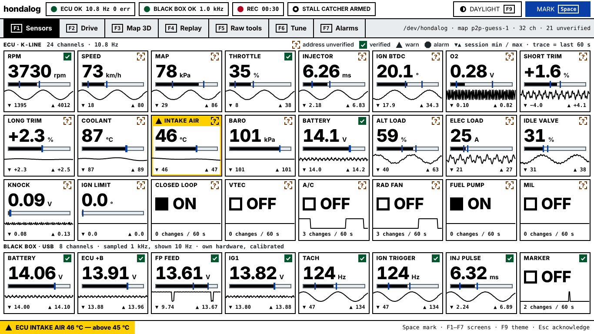
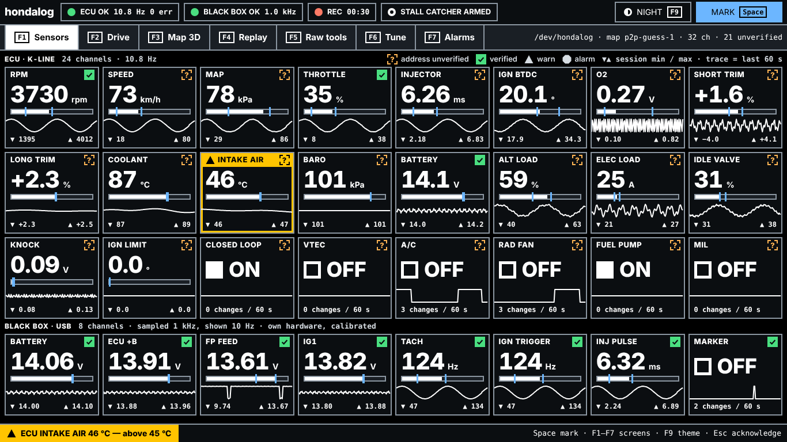
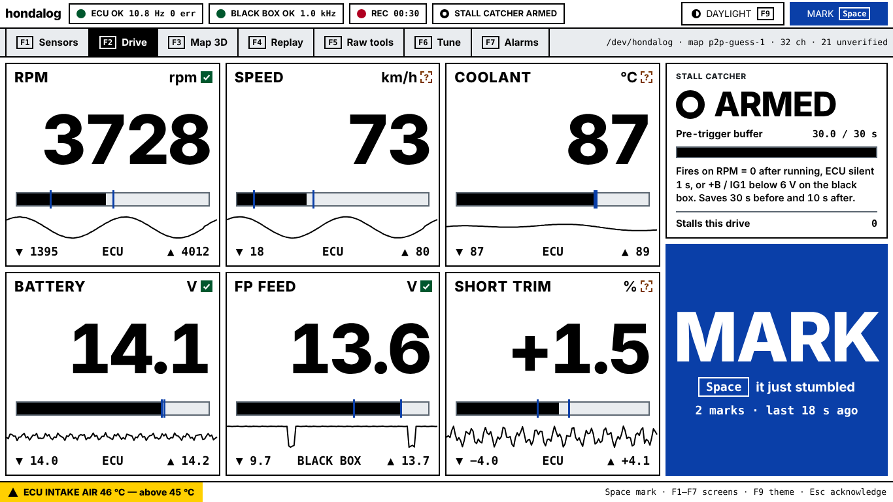
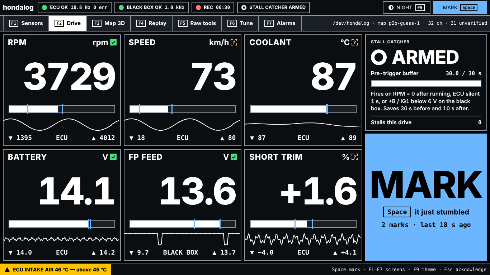
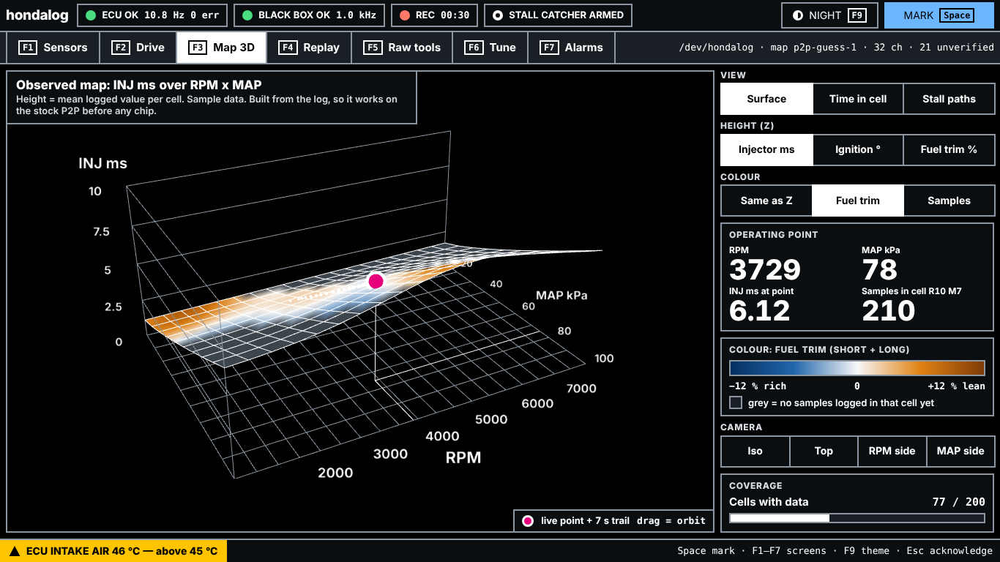
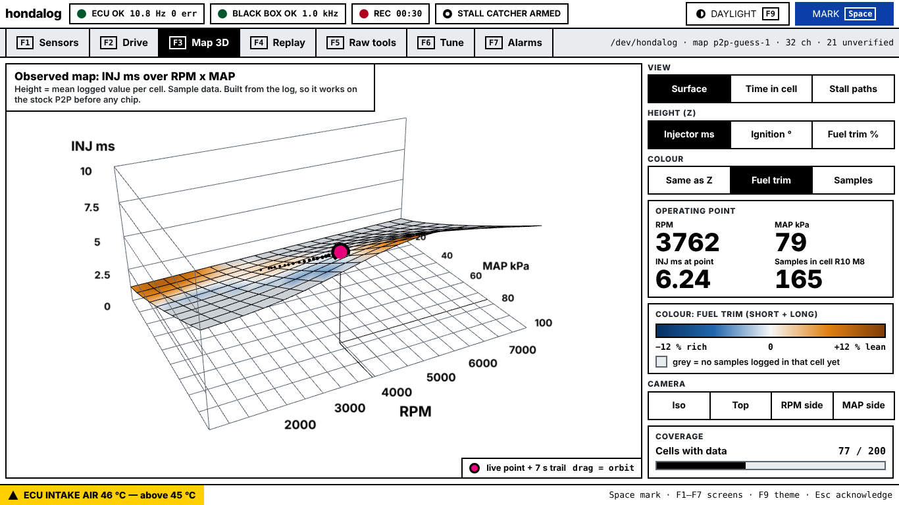
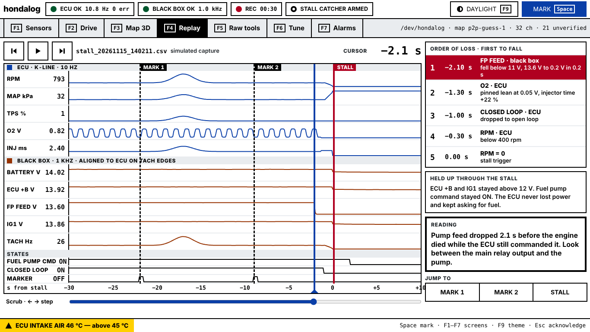
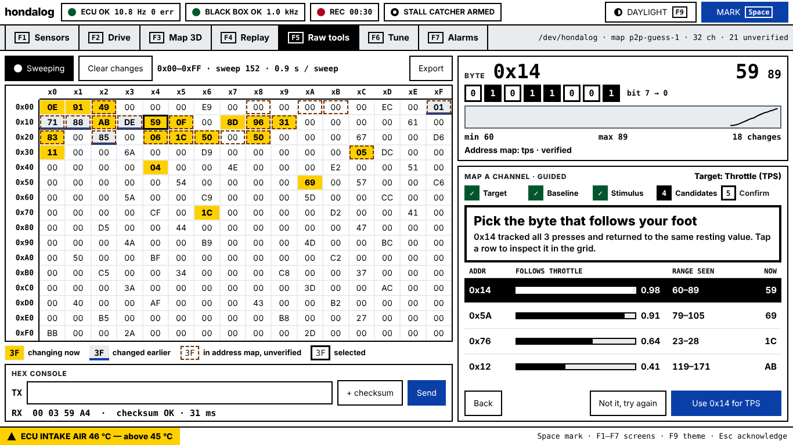

# hondalog

Live data logger for a 2000 Honda Civic EX (D16Y8, OBD2B) over a cheap
KKL 409.1 USB cable (FTDI FT232RL). Linux desktop app: Python, PySide6,
pyqtgraph, pyserial. Built for Debian 13 on an old ThinkPad.

It reads ECU RAM with the Honda diagnostic protocol on the K-line
(`20 05 addr len cksum`, 9600 8N1), shows it, logs it to a crash-safe native
log (`.hlog`), and saves a separate capture when the engine stalls or another
trigger fires. Logs export to MegaLogViewer (`.mlg`, `.msl`) and CSV.


*Above: the working 0.1.0 app. Below: the 1.0 UI design that the rebuild targets.*

## UI design (1.0, in progress)

Mockups at the T430's native 1366x768, rendered from the
[interactive design](https://claude.ai/artifact/UZP8DiarTkdK1RWKmk7vSS)
(fake data). The full spec for the Qt build is in
[docs/design/HANDOFF.md](docs/design/HANDOFF.md).

The default is the Daylight theme, black on white, because a TN panel in
sun loses its blacks first. Night is white on true black for dusk and the
garage, and F9 switches between them. All text meets 7:1 contrast or
better. Warning states use a shape as well as a colour, so they read
without colour vision.

### All sensors on one screen: 24 ECU + 8 black-box channels



### Driving view



### 3D observed map: RPM x MAP, live operating point and trail
Built from your own logs, so it works on the stock P2P before any chip.
The other modes are time-in-cell bars and stall approach paths.



### Stall forensics replay: ECU and black box on one timeline


### Raw tools and guided memory mapper


### Tuning table editor (chipped P28)


### Status bar and alarm states


**Read this first:** the address map is a guess. It is the kerpz P2T map,
and nobody has checked it on a P2P. Every channel shows an amber `?` until
you mark it verified. Until then, treat the numbers as "probably".

## Quickstart

### 1. Install

```sh
tar xzf hondalog-0.1.0.tar.gz
cd hondalog-0.1.0
./install.sh
```

The installer uses sudo. It installs the Debian packages, copies the app to
`/opt/hondalog`, adds you to the `dialout` group, adds a udev rule so the
cable shows up as `/dev/hondalog`, and adds a launcher to the menu.

**Log out and back in afterwards.** The `dialout` group only applies to new
logins, and without it you cannot open the cable. The simulator works
straight away.

### 2. Try it with the simulator (no car)

Terminal 1:

```sh
hondalog-sim
```

Terminal 2:

```sh
hondalog --port /tmp/hondalog-sim --connect
```

The simulator is a fake ECU on a pseudo-terminal. It echoes like a real
K-line, warms up, idles around 750 rpm and revs every 20 seconds. Keys in
the simulator terminal:

| key | what happens |
|-----|--------------|
| `s` | stall: RPM drops to 0, ECU keeps answering |
| `p` | power cut: ECU goes silent (like a dead main relay) |
| `r` | restart |
| `v` | rev |
| `q` | quit |

`hondalog-sim --stall-after 30` stalls on a timer. `--help` lists the rest.
In a hurry, pick the `sim:` port in the app: that is the same fake ECU
without the pty.

### 3. In the car

1. Plug the cable into the laptop. Check that Linux sees it:

   ```sh
   lsusb | grep 0403        # want: 0403:6001 ... FT232 Serial (UART) IC
   sudo dmesg | tail        # want: FTDI USB Serial Device converter now attached to ttyUSB0
   ls -l /dev/hondalog      # the udev link
   ```

2. Plug the other end into the 16-pin OBD2 port under the dash.
3. Key to ON (II). The engine can be off or running.
4. Start `hondalog`. The port box should already show `/dev/hondalog`.
   Press **Connect**.
5. The status box turns green (`ECU OK`), READS counts up, and RATE shows
   about 17 Hz.

If it stays red, run `hondalog-firstcontact` (next section), then go to
Troubleshooting.

### 4. First contact

```sh
hondalog-firstcontact            # or: --port /dev/ttyUSB0, --port sim:
```

Run this the first time the cable is in the car, with the key ON and
hondalog itself disconnected. It takes about 15 seconds and only reads. It
checks the adapter (FTDI or not, clone or not, latency timer), tests the
echo, listens, tries a Honda read with and without the wake-up bytes, tries
other reply framings, reads the ECU id, finds the longest block the ECU
answers, measures its reply time, reads 0x00-0xFF once, and then tries the
standard OBD2 link (ISO 9141-2) for codes, freeze frame and readiness.

It ends with one of five verdicts: `Honda protocol OK`, `ISO only`,
`cable dead`, `ECU silent`, `no port`. Two files land in `~/hondalog/logs/`:
`firstcontact-DATE.md` (verdict, next steps, findings, suggested
`[protocol]` settings) and `firstcontact-DATE.hex.log` (every byte sent and
received, with times). Send both along when asking for help.

`hondalog-firstcontact --udev` prints the udev rule that sets the FTDI
latency timer to 1 ms on every plug-in. `install.sh` installs it.

## Using it

**Recording.** Starts on connect (untick "Record on connect" to stop that).
Logs go to `~/hondalog/logs/log_DATE_TIME.hlog`. The file holds the ECU id
bytes, the whole address map, the units, markers and every channel with its
own timestamps. It is written every half second, so a dead laptop battery
costs at most the last second. A recording that runs longer than an hour
continues in `..._p002.hlog` and so on. Logs from 0.1.0 (`.csv`) still open.

**Marker.** Press **Space** or the big amber button when something happens
("it just stumbled"). The log gets a `MARK n` event at that moment and a line
appears on the charts. Space types a normal space while
the cursor is in a text box.

**Stall catcher.** While recording, once RPM has been above 400:

- RPM reads 0, or
- the ECU stops answering for 1 second (power loss, cable pulled),

the app saves the 30 seconds before and the 10 seconds after to
`~/hondalog/logs/stall_DATE_TIME.hlog`, shows a red banner and beeps.
"Open in replay" loads the file. Turning the key off with the engine
running counts as a stall too; ignore that one or press Stop first.

**Charts.** "Plot channels" picks what is drawn (up to 8). "Window" sets how
much history scrolls by.

The stall catcher is two rules of a general trigger engine
(`hondalog/triggers/`). A rule is a condition on any channels, a hold time,
and how much to keep before and after, for example
`when = "ect > 105"`, `hold_s = 2`. Rules for low battery, a lean spike and
overheating ship switched off, because they depend on channels that have not
been verified on the car yet.

**Replay tab.** Open any log or stall file (`.hlog`, old `.csv`, MegaLogViewer
`.msl`/`.mlg`). "Export…" saves the open log as `.mlg`, `.msl`, `.csv` or `.npz`. Drag the slider or click in a
chart to move the cursor. The table shows every channel at that moment.
Click a marker in the list to jump to it. Mouse wheel zooms the time axis.

**Raw tools tab.**

- *Hex console*: type bytes, e.g. `20 05 00 10`. "Add checksum" appends the
  last byte for you. It shows what came back after the echo and whether the
  checksum adds up.
- *Memory scanner*: sweeps an address range in chunks and shows a hex grid.
  Orange = changed in this sweep. Blue = changed earlier. Click a byte for
  its minimum, maximum and change count. "Export" writes a `.txt` dump and a
  `.csv` with every sweep.

### Mapping the P2P

Every address starts as a guess. Three tools turn guesses into verified
channels; all of them work from the terminal (`hondalog-map`, also over ssh)
and the logic is in `hondalog/mapping/` for the UI to use.

**1. Guided checks.** `hondalog-map scripts` lists them; `hondalog-map status`
shows which script can prove which channel.

```sh
hondalog-map verify koeo --port /dev/hondalog          # key on, engine off
hondalog-map verify tps_sweep --port /dev/hondalog     # press the pedal slowly
hondalog-map verify idle --port /dev/hondalog          # warm idle; asks for the tach reading
hondalog-map verify steady_3000 --port /dev/hondalog
hondalog-map verify warmup --port /dev/hondalog        # cold start to warm
hondalog-map verify drive --port /dev/hondalog         # passenger types the speedo reading
hondalog-map verify ac_switch --port /dev/hondalog
```

Each script tells you what to do, records the whole time, and gives a verdict
per channel:

- `pass`: a check that can prove the address held (throttle went from under
  5% to over 90% as you pressed; battery within 0.3 V of your meter).
- `plausible`: the value looks sane but that proves nothing (RPM reads 0 with
  the engine off). Not marked unless you insist (`--force`).
- `fail`: it lists where the signal may really live.
- `skip`: no reading was given, or the check does not apply (engine not cold).

Nothing is marked verified until you say yes. Then the map gets
`status = "verified"` and a `[channel.evidence]` table: date, script, what was
measured, the map version and hash, and the name of the evidence file in
`~/hondalog/verification/` (a report plus every raw byte recorded).

**2. The finder.** Sweep while something changes, then rank every address as
a byte and as a 16-bit value in both byte orders:

```sh
hondalog-map find --port /dev/hondalog --channel rpm --seconds 30   # what moves with RPM?
hondalog-map find --port /dev/hondalog --value 12.4 --formula "x / 10.45"   # what reads 12.4 V?
```

In the app: Raw tools, "Sweep continuously", then "Rank addresses". It prints
a suggested formula (least squares) for each hit. Rank against a channel you
have already verified, or the result is only as good as that guess.

**3. Cross-check with standard OBD2 PIDs** (`hondalog/mapping/crosscheck.py`).
Feed it pairs of readings taken under the same steady conditions and it says
agree, scaled (with a corrected formula) or no match for RPM, ECT, IAT, MAP,
TPS, speed, both trims, O2 and timing. It needs the ISO 9141-2 link, which is
still being built; until then it runs on numbers from any scan tool.

**By hand** still works: "Edit address map" opens the file. Changing an
address or formula through the tools resets that channel to unverified and
bumps the version. `hondalog-map diff old.toml new.toml` shows what changed
and whether old logs would decode differently; `hondalog-map hash` prints the
12-digit hash that identifies a map's decoding.

An old (schema 1) map keeps working as it is. `hondalog-map upgrade` adds the
math channels and alarms to it and keeps your comments.

### Math channels and alarms

Both live in the address map, under `[[math]]` and `[[alarm]]`; the file
explains every field. Shipped math channels: injector duty, fuel flow, total
trim, RPM rate, load, a rough AFR estimate and three filtered values. Shipped
alarms: coolant over 105 °C for 2 s (critical), battery low and high, over-rev,
idle collapsing, lean under load. The limits are starting points, not Honda
figures, and every one of them reads channels that are not verified yet (the
alarm text shows a `?` until they are).

Expressions use `[rpm]` or `rpm` for a channel, `[rpm-1]` for its previous
sample, `a ? b : c`, and helpers such as `avg(x, ms)`, `slope(x, ms)`,
`minw(x, ms)`, `maxw(x, ms)`, `smooth(x, n)`. `min(a, b)` and `max(a, b)`
compare two values, so the time-window versions are spelled `minw`/`maxw`.
Nothing in an expression is run as Python: the text is parsed into a small
tree and only the listed functions exist.

For now the app shows the top alarm at the bottom of the window (click it to
acknowledge) and writes alarm markers into the log. Math channels are computed
but the dashboard does not display them until the new UI lands.

Temperatures are in °C, pressure in kPa, speed in km/h in the map and in logs.
`hondalog/units.py` converts for display (°F, psi, inHg, mph, AFR).

## Troubleshooting

**Permission denied on /dev/ttyUSB0.** You are not in `dialout` yet, or you
have not logged out since the installer added you. Check with `groups`.
Fix: `sudo usermod -aG dialout $USER`, then log out and in.

**The cable appears and vanishes; dmesg mentions `brltty`.** The braille
driver grabs FTDI adapters. `sudo apt remove brltty`, then replug.

**lsusb shows nothing new.** Dead cable or dead USB port. Try another port.

**lsusb shows `0403:0000`.** A clone FTDI chip that an old Windows driver
has zeroed. It still works on Linux if you tell the driver about it:

```sh
sudo modprobe ftdi_sio
echo 0403 0000 | sudo tee /sys/bus/usb-serial/drivers/ftdi_sio/new_id
```

It then appears as `/dev/ttyUSB0`. Type that into the port box (the
`/dev/hondalog` link only matches `0403:6001`).

**lsusb shows `1a86:7523` (CH340) instead of FTDI.** Some "KKL" cables use
that chip. It works the same. Pick its `/dev/ttyUSB0` entry in the port box.

**Clone FTDI chips in general** are fine on Linux. The kernel driver does
not care.

**Status says NO REPLY.** Hover over the status box to see the last error.

- *"no bytes at all, not even the echo"*: the cable's car side is dead.
  It is powered from the OBD2 plug (pin 16), so it only echoes when it is
  plugged into the car. Check the plug is fully seated and the car battery
  is connected.
- *"echo only, the ECU did not answer"*: the cable works, the ECU is quiet.
  - Key must be ON (II), not ACC.
  - Try it with the engine running, and with key on, engine off.
  - Check the ECU sticker (passenger footwell, behind the kick panel). This
    was written for a P2P. A different ECU may want different framing.
  - In Raw tools send `20 05 00 10` by hand and look at what comes back.
  - Edit the address map, `[protocol]` section: try `init_sequence = ""`
    (no wake-up bytes), or `reply_timeout_s = 0.5`.
- *"bad checksum"* or *"no reply frame"*: bytes arrive but do not fit the
  expected `00 len+3 data cksum` shape. Copy what the hex console shows.
  The framing constants are all in `hondalog/protocol.py` (class `Framing`)
  and can be overridden in the map's `[protocol]` section.

**ERRORS keeps climbing but data shows.** A few errors are normal on a noisy
line. Lots of them: bad ground or a poor cable. The log's `link` column is 0
for sweeps where nothing valid came back.

**Values look wrong.** Expected, the map is a guess. See "Mapping the P2P".

**Window does not start: `could not load the Qt platform plugin "xcb"`.**
`sudo apt install libxcb-cursor0 qt6-qpa-plugins`.

## Log files from the command line

```sh
hondalog-log info    FILE                 # streams, rates, markers, header
hondalog-log import  old_log.csv          # 0.1.0 CSV, MSL or MLG -> .hlog
hondalog-log export  FILE out.mlg         # also .msl .csv .npz .hlog
hondalog-log export  FILE out.csv --channels rpm,map,stft --filter "ect > 80" --hz 10
hondalog-log repair  FILE                 # finish a log cut off by a crash
hondalog-log report  stall_....hlog       # one-page HTML report
hondalog-log redecode FILE out.hlog       # decode the raw bytes with your current map
hondalog-log list    [-q words]           # search names, notes, markers
hondalog-log prune   --days 90 --yes      # delete old session logs (captures are kept)
```

MLG files follow EFI Analytics' published MLG 2.0 layout and are checked
byte by byte in the tests. Nobody has opened one in MegaLogViewer from this
project yet. Parquet is not offered: Debian trixie has no `python3-pyarrow`.

`redecode` needs a log that holds raw bytes. Those are stored when the
poller hands over single reads (`Recorder.feed_read`); a log recorded sweep
by sweep has decoded values only.
## Black box (Track B)

A K-line log cannot show a millisecond power dropout: the ECU just stops
answering. The black box is a separate recorder, an ESP32-S3 wired to the
battery, ECU +B (main relay output), fuel pump feed, IG1, tach, ignition
trigger, one injector and a marker button. It keeps the last 30 s in RAM and
writes them, plus 10 s more, to a microSD card when a trigger rule fires. It
works with no laptop in the car.

| what | where |
|------|-------|
| wiring, parts, where to tap, bench tests | `firmware/blackbox/HARDWARE.md` |
| USB protocol | `firmware/blackbox/PROTOCOL.md` |
| file format, reason codes, settings, trigger rules | `firmware/blackbox/FORMAT.md` |
| firmware (PlatformIO, ESP-IDF) | `firmware/blackbox/` |
| laptop side | `hondalog/blackbox/` |

**Try it with no hardware:**

```sh
hondalog-bbsim --fault main_relay --fault-after 15     # terminal 1; keys m i f k b inject faults
hondalog-bb live --port /tmp/hondalog-bbsim            # terminal 2
hondalog-bb fetch --port /tmp/hondalog-bbsim           # copies captures to ~/hondalog/logs
hondalog-bb info ~/hondalog/logs/bb*EV000001.bbx       # order of events and a verdict
```

`hondalog-bb info` prints what fell first, for example:

```
ECU +B dropped while IG1 and battery stayed up  (confidence: high)
       +0.0 ms  ecub      dipped below 6 V and came back (2 times)
     +400.0 ms  ecub      fell below 6 V
     +423.6 ms  tach      first missing pulse
```

**Replay.** Open a `.bbx` file in the Replay tab. If an ECU log was
recording at the time and the laptop was plugged into the box, the two are
merged on one time axis (good to a few ms; the box's clock is set from the
laptop once a second). Without the clock it falls back to shared markers
(about ±50 ms) or to matching RPM (about ±100 ms). Black box channels are
named `bb_...`.

**Build and flash** (needs internet for the first build):

```sh
pip install platformio
cd firmware/blackbox && pio run -t upload
```

**Other commands:** `hondalog-bb list`, `config [--set key=value] [--save]`,
`selftest`, `csv FILE`, `cal RAIL --low METER SHOWN --high METER SHOWN`.

**Not done yet:** the live black box channels are not on the dashboard (the
UI is being redesigned; the API it needs is `hondalog.blackbox.BlackboxReader`,
documented in `hondalog/blackbox/__init__.py`). No Wi-Fi download.

## Files

| what | where |
|------|-------|
| logs and stall captures | `~/hondalog/logs/` |
| address map (edit this) | `~/.config/hondalog/addressmap.toml` |
| shipped default map | `/opt/hondalog/hondalog/data/addressmap.toml` |
| program | `/opt/hondalog/` |
| udev rule | `/etc/udev/rules.d/99-hondalog.rules` |

To get the shipped map back, delete your copy and start the app.

Code layout: `protocol.py` (framing and checksum, no I/O), `transport.py`
(serial port, built-in simulator, request/reply `Link`), `link/` (read
planner, scheduler, adaptive timing, clocks), `poller.py` (worker thread),
`obd2.py` (ISO 9141-2 and OBD2 services), `diag/` (first contact, probes,
adapter check, DTC text), `addressmap.py`, `expr/` (the safe expression
evaluator), `mathch/`, `alarms/`, `mapping/` (verification, finder, map
editing), `live.py` (math + alarms per sample), `logger.py` (the recorder),
`data/` (native log format, reader, library, retention), `triggers/`
(trigger engine, stall presets), `analysis/` (filters, table histogram,
scatter, cursors, compare, plot decimation), `export/` (MLG, MSL, CSV,
importers), `logtool.py` (`hondalog-log`), `blackbox/` (Track B: reader,
simulator, file parser, alignment), `sim.py` (fake ECU), `ui/` (Qt).

## Link: how fast, and how it copes

**Rates.** Each channel has a rate class: fast (rpm, map, tps, inj, ign),
medium (o2, stft, ltft, vss), slow (the rest). Set `rate = "fast"` on a
channel in the address map to override. Targets are 20 / 5 / 1 reads per
second (`rate_fast_hz` etc. in `[protocol]`). The planner merges nearby
addresses into the fewest requests using the measured cost of a request
(5 echo bytes + 3 frame bytes + ECU reply time + gap, about 12 ms, the
same as 12 data bytes), and the scheduler interleaves them.

`python3 tools/bench_link.py` shows the result against the simulator at true
9600-baud byte timing (2 ms ECU reply time, 1 ms USB latency):

| channels | before (v0.1.0) | now |
|---|---|---|
| rpm, map, tps, inj, ign (+ vss, o2, baro in the same reads) | 11.4 Hz | 17.3 Hz |
| stft, ltft | 11.4 Hz | 4.6 Hz (target 5) |
| temperatures, battery, flags, knock | 11.4 Hz | 1.0 Hz (target 1) |
| rpm alone, burst mode | - | 66.7 Hz |

20 Hz on the fast class does not fit on a 9600 baud wire with this map
(it would need 109 % of the wire); the app reports the shortfall per
channel instead of hiding it. A full frame of every channel still arrives
about once a second at worst; lower `rate_fast_hz` or mark more channels
medium if you want it more even.

**Timestamps.** Every value carries the time its reply was complete
(monotonic clock), minus an estimate of how old the data was by then.
Channels from different reads no longer share one timestamp.

**Errors.** Response timeout, inter-byte timeout and the gap between
requests are measured and adapt. A bad reply is retried once after the line
has been drained. Counters (timeouts, checksum failures, echo mismatches,
resyncs, retries) are in `poller.stats`.

**Recovery.** Key off and on again, or the cable pulled and plugged back in:
the app notices within about 0.5 s, keeps trying, and carries on by itself
within about 2-3 s of the ECU or cable coming back. No restart needed.

**Read-only guard.** The hex console sends only read requests
(`20 05 addr len cksum`) and the wake-up bytes. Anything else is refused
until the expert unlock is switched on for the session
(`poller.set_expert_unlock(True)`); what was sent is kept in
`poller.link.unlocked_frames`.

## OBD2 (ISO 9141-2)

Standard OBD2 on the same pin at 10400 baud: 5-baud init at address 0x33
(by break toggling, the FT232 cannot do 5 baud), KWP2000 fast init as a
fallback, supported-PID discovery, live PIDs, stored and pending codes with
Honda P1xxx text, freeze frame, readiness, and clear codes. Clear needs the
literal confirmation `"CLEAR"`, refuses while the engine runs, and resets
the readiness monitors.

Limits:

- It is slow: about 8-10 PIDs per second in the simulator, likely fewer on
  the car. Use it for codes and cross-checks, not for logging.
- The two protocols cannot share the line. `poller.obd2(fn)` pauses Honda
  polling, runs the init (about 2.6 s), runs `fn`, and goes back. No power
  cycle is needed in the simulator: the ECU drops the ISO session after 5 s
  of silence and Honda reads resume. Expect a gap of about 8 s in the log.
  Whether the real P2P behaves the same is not known; if Honda reads do not
  come back, turn the key off and on.
- The ISO session dies after 5 s without a request; the code re-inits by
  itself, which costs another 2.6 s.
- It needs break and baud control, so it works on the real cable and on the
  built-in `sim:` port, not through the `hondalog-sim` pty.
- 10400 baud is non-standard; some clone FTDI chips and most CH340 cables
  get it wrong. If the init fails on a clone, suspect that first.

## Simulator extras

`hondalog-sim --faults flaky` (or `drop=0.01,cksum=0.01,junk=0.01,slow=0.005,
silent=0.005,echo=0.005`), `--seed N` (runs repeat exactly), `--turnaround-ms`,
`--max-read-len`, `--unplug-after SEC --unplug-for SEC`, `--cable-dead`,
`--iso-only`. Key `u` pulls the cable for 3 s. Bytes are paced at true 9600
baud unless `--fast`. In the app, the ports `sim:` and `sim:flaky` are the
same model in-process, with ISO 9141-2.

## Tests

```sh
cd /opt/hondalog
python3 -m pytest                                   # unit tests (the black box C core needs gcc and make; skipped without)
python3 -m hondalog.bench.expr_bench                # math/alarm CPU cost against the budget
QT_QPA_PLATFORM=offscreen python3 tools/smoke.py    # full run against the simulator
python3 bench/bench_data.py                         # log write/open/histogram timings
```

(If the installer had to build a venv, use `/opt/hondalog/.venv/bin/python`
instead of `python3`, and `pip install pytest` into it first.)

## Not verified yet

Everything was tested against the simulator only. Still to be proven on the
real car:

- that a P2P answers `20 05 addr len cksum` with `00 len+3 data cksum`
- whether it needs the wake-up bytes, and whether they do any harm
- every address and formula in the map
- the ECU id location (0x76, 10 bytes)
- the real polling rate: the ECU's reply time is assumed to be 2 ms in the
  simulator; the timing probe measures the real one
- the longest block the ECU answers (assumed 16; the probe tries up to 64)
- ISO 9141-2 on the real ECU: the break-toggled 5-baud init on this cable,
  the key bytes, which PIDs it supports, and whether Honda reads come back
  after an ISO session without cycling the key
- the FTDI latency timer actually reaching 1 ms on the ThinkPad
- unplug/replug recovery with a real cable (tested with the simulator's
  unplug only)
- the verification scripts' limits (idle 550-950 rpm, MAP 20-48 kPa at idle,
  charging 13.2-14.9 V and so on) are ordinary D-series expectations, not
  figures measured on this car
- whether the MIL bit reads 1 during the key-on bulb check
- the alarm limits, the 240 cc/min injector size and the 0.85 VE guess behind
  the fuel flow and AFR estimates
- the ISO PID cross-check against a real ISO 9141-2 session

The black box is further behind:

- the firmware has never been compiled or run on a board (the build tools
  could not be downloaded where it was written). Its logic (`bbcore`) is the
  same C that the tests run on the PC; the ESP32 driver layer
  (`main/hal/hal_esp32s3.c`) is untested
- the ECU pins and wire colours to tap, the signal levels, the hold-up time
  and the SD write speed: see the list at the end of `HARDWARE.md`

## Uninstall

```sh
/opt/hondalog/uninstall.sh
```

Logs, settings and the Debian packages stay.
