# hondalog

A Linux-native, home-made Hondata for a 2000 Honda Civic EX (D16Y8, OBD2B,
stock P2P ECU). It reads the ECU over the K-line with a cheap KKL 409.1 USB
cable, records every drive into one crash-safe SQLite database, and catches
the moment the engine stalls. A small black box records the car's power
rails around a stall, a handheld screen does the job when the laptop stays
home, and a set of ROM tools is ready for a chipped OBD1 P28 later.

It was built to chase an intermittent stall. It reads; it never writes to
the stock ECU.

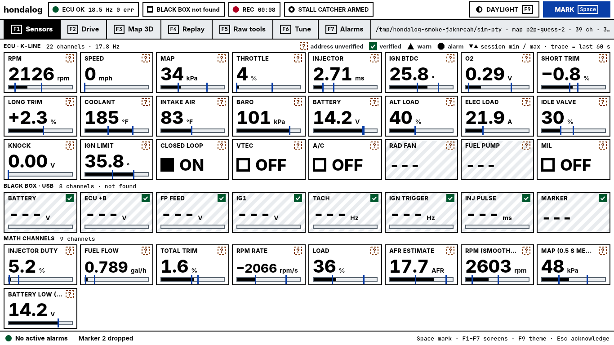

**Read this first.** Almost nothing has been run on the car yet. The laptop
software passes about a thousand tests against simulators, both firmwares
compile, and the hardware plans follow published pinouts. The address map
is a guess borrowed from another ECU (the kerpz P2T map): every channel
shows a `?` until you verify it. What is still unproven is
[listed in the docs](docs/README.md#what-is-not-verified-yet).

## Screens

The app at the ThinkPad T430's 1366x768, on demo data: the original
frames on the left, the same screens in today's Dracula theme on the right
(a darker variant is on F9).

| App (original frames) | Dracula theme |
|---|---|
|  | 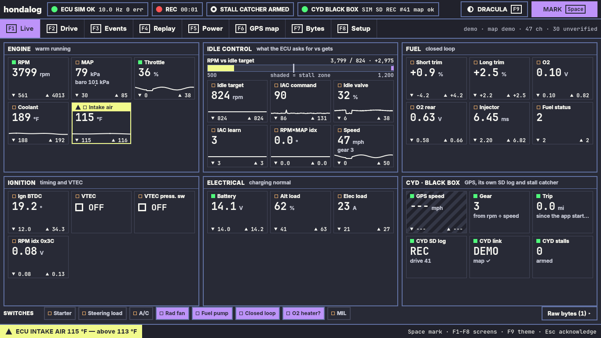 |
|  | 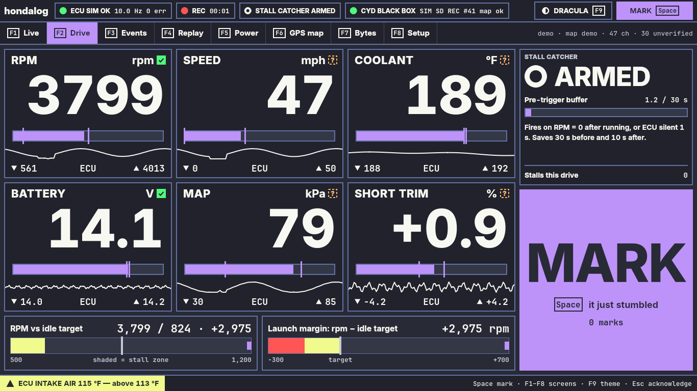 |
| 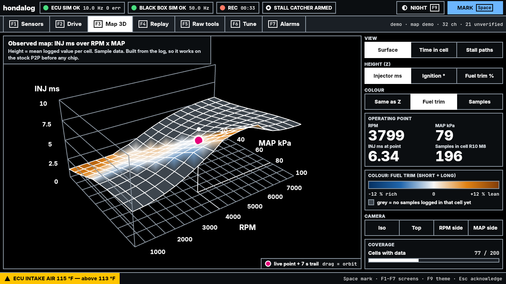 | 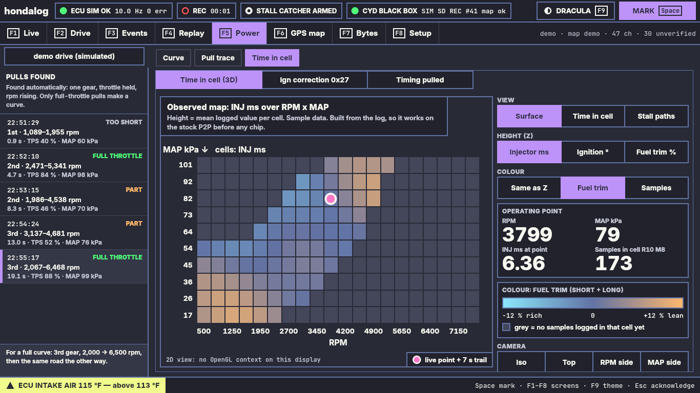 |
| 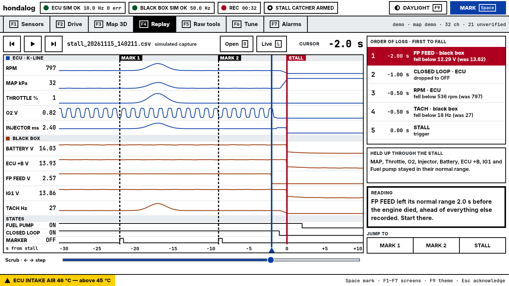 | 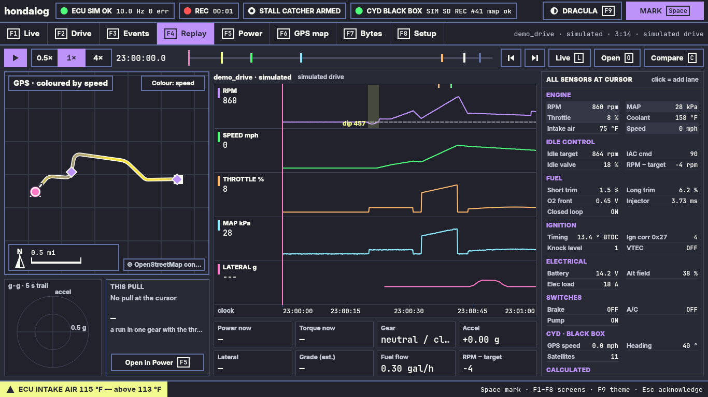 |
|  | 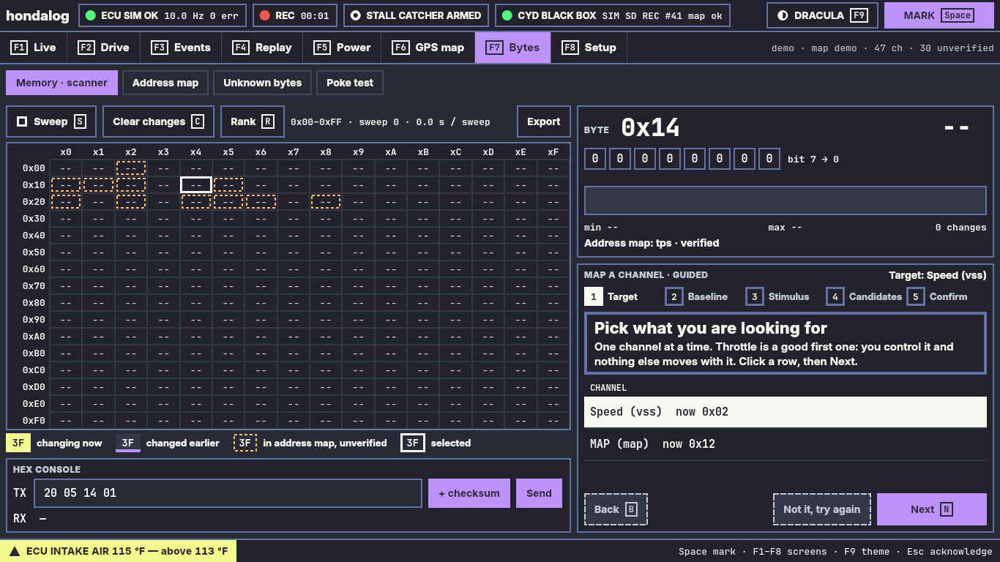 |
|  | 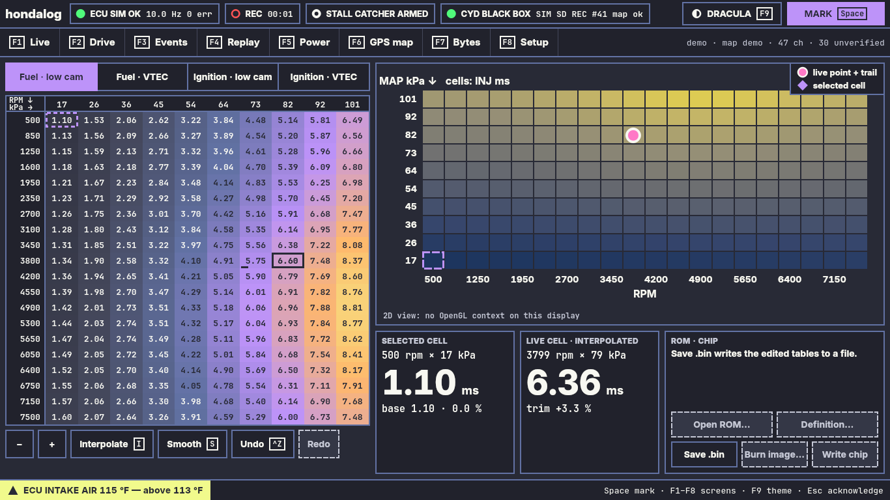 |
| 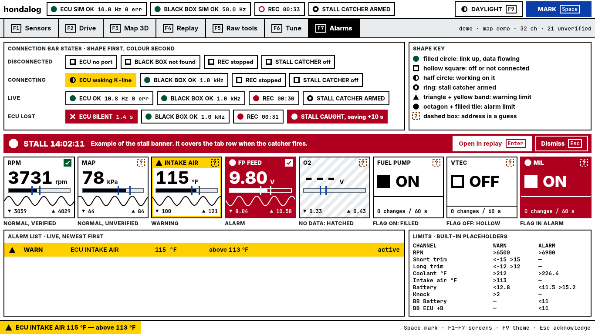 | 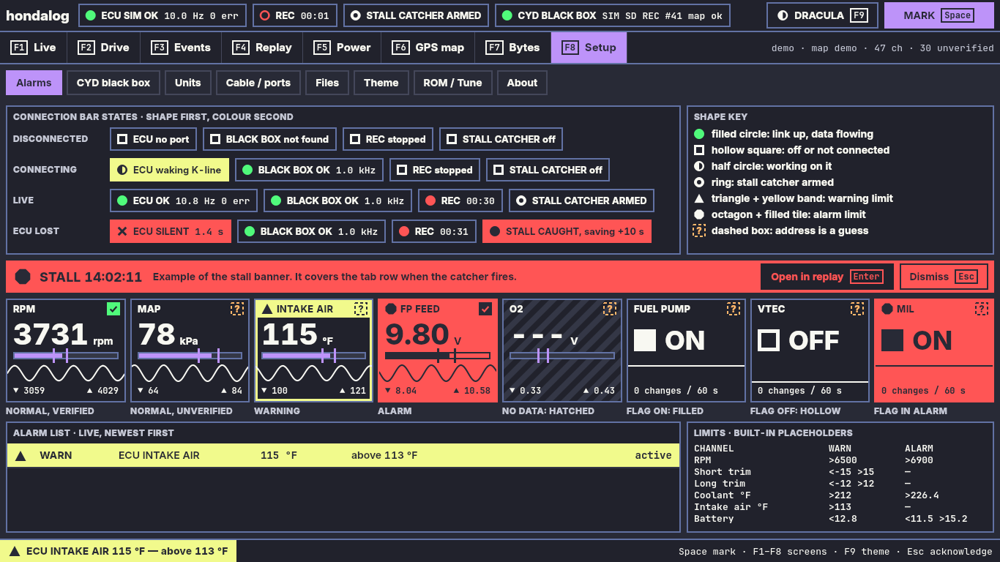 |

A stall caught on the simulated ECU, and the capture opened in Replay:


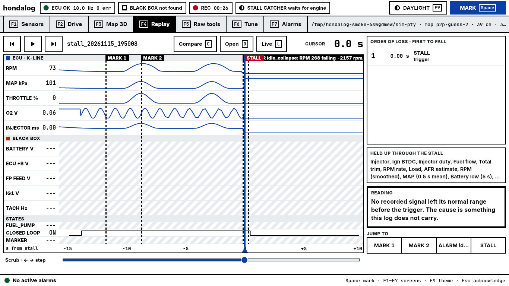

More: two cursors and a second stall laid over the first
([Replay compare](docs/screenshots/replay-compare-daylight.png)), the
address ranking ([Rank addresses](docs/screenshots/rawtools-rank-daylight.png)),
a ROM open on the Tune screen ([Tune with a ROM](docs/screenshots/tune-rom-daylight.png)),
time in cell and stall approach paths on Map 3D
([histogram](docs/screenshots/map3d-hist-daylight.png),
[stall paths](docs/screenshots/map3d-stall-daylight.png)), and every screen
in the [user guide](docs/user-guide.md).

The handheld, from its PC simulator:

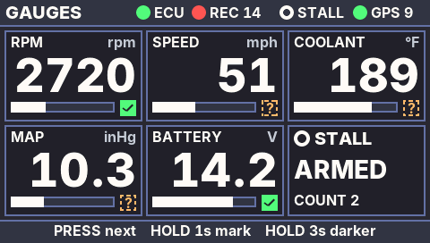

## What is in it

**The laptop app** (Track A; Python, PySide6, pyqtgraph, pyserial)

- Live ECU data over the Honda diagnostic protocol (`20 05 addr len cksum`,
  9600 baud), about 17 reads a second on the fast channels in the
  simulator, with adaptive timing and recovery from key-off or a pulled
  cable.
- Eight screens on F1 to F8: Sensors, Drive, Map 3D, Replay, Raw tools,
  Tune, Alarms, Map. Every action has a key.
- GPS track maps of drives (the handheld's GPS) on OpenStreetMap tiles,
  offline first, coloured by any channel; every stall on one map, to see
  whether they happen at the same places. GPX, KML and GeoJSON exports.
- Every drive in `~/hondalog/hondalog.db`, with the raw bytes of every
  read; plain SQL views; exports to MegaLogViewer (`.mlg`, `.msl`), CSV and
  NPZ.
- A stall catcher and a general trigger engine that save a capture around
  the event; math channels and alarms defined in the address map.
- Replay with two cursors, a second drive laid over the first, and stall
  forensics.
- Tools to verify the address map on the car: guided checks, a correlation
  finder, and a cross-check against standard OBD2 PIDs.
- Standard OBD2 (ISO 9141-2) on the same cable: codes, freeze frame,
  readiness.
- `hondalog-firstcontact`, a read-only first run on the car.
- Simulators for the ECU and the black box, and a demo mode.

**The black box** (Track B; ESP32-S3)

- Watches battery, ECU +B, fuel pump feed, IG1, tach, ignition trigger and
  an injector 1000 times a second; saves 30 s before and 10 s after a
  trigger to microSD; works with no laptop.
- On the laptop: live channels in the app on the same clock as the ECU,
  capture download, and a verdict on what fell first.
- Not built yet; firmware compiles, its core is tested on the PC.

**The handheld** (Sunton ESP32-4827S043N, "CYD")

- Reads the ECU through the same KKL cable on USB host (or an L9637D),
  shows live values on a 4.3 inch screen with one button, logs to SD with
  GPS, catches stalls, sleeps after key-off.
- The laptop compiles your address map onto its card and imports its
  drives into the same database.
- Not built yet; firmware compiles, its core is tested against the Python
  it was ported from.

**The ROM tools** (Track C; chipped OBD1 P28)

- TunerPro XDF and native definitions, a table editor with undo, checksum
  fixing, ROM diff, auto-tune from a wideband log, a `minipro` burner
  wrapper and an Ostrich driver.
- No P28 definition ships; no real ROM, burner or Ostrich has been tried.

## Quick start

On Debian 13 (trixie):

```sh
git clone https://github.com/olosnoks/hon-diy-data
cd hon-diy-data
./install.sh          # Debian packages, /opt/hondalog, dialout group, udev rule, menu entry
```

Log out and back in (for the `dialout` group). Then, with no car:

```sh
hondalog --demo                      # every screen, made-up data, nothing recorded
hondalog --port sim: --connect       # the real code path against a simulated ECU and black box
```

In the car, KKL cable in the OBD2 socket, key ON:

```sh
hondalog-firstcontact                # once: which protocol answers, and a report
hondalog --port /dev/hondalog --connect
```

Afterwards:

```sh
hondalog-log list                    # drives and stall captures
hondalog-log export last out.mlg     # for MegaLogViewer
hondalog-log sql "SELECT drive, minutes, stalls FROM drive_summary"
```

The firmware, on Linux or WSL:

```sh
scripts/build-firmware.sh            # host tests, simulator checks, both builds
scripts/build-firmware.sh handheld --flash /dev/ttyUSB0
```

## Querying your drives with SQL

The database is ordinary SQLite. Open it with `hondalog-log sql`, the
`sqlite3` shell or DB Browser for SQLite (read-only while the app records).
Times (`t`) are seconds since the app connected.

| name | what |
|---|---|
| `drive_2026_11_16_0712` | one view per drive: a row per RPM read, every channel as a column (slower channels hold their last value, black box channels show their one-second mean), plus `wall_time` |
| `drive_..._blackbox` | the same drive's black box streams, a row per second: `<channel>_min`, `_mean`, `_max` |
| `drive_summary` | a row per drive: when, how long, stalls, markers, status, notes |
| `stalls` | every stall capture of every drive: when, why, the window |
| `readings` | every K-line and math value in long form: drive, channel, t, value |
| `blackbox_1s` | every black box channel per second: min, mean, max |
| `ecu_reads` | the raw bytes of every K-line read, with its latency |
| `markers` | markers, trigger firings and alarms |

The queries below run as written (the test suite checks them). Tables,
more examples and Python access: [Data and SQL](docs/data-and-sql.md#querying-with-sql).

```sql
-- every drive, newest first
SELECT drive, started, minutes, stalls, markers, status, notes
FROM drive_summary ORDER BY started DESC;

-- the last 5 seconds before every stall: RPM as it was read, and ECU +B
-- from the black box (the lowest value in each second)
SELECT s.name AS stall, 'rpm' AS channel, round(r.t - s.t_trigger, 2) AS seconds, r.value
FROM stalls s JOIN readings r ON r.drive_id = s.drive_id AND r.channel = 'rpm'
WHERE r.t BETWEEN s.t_trigger - 5 AND s.t_trigger
UNION ALL
SELECT s.name, 'ecu +B', b.t - s.t_trigger, b.min
FROM stalls s JOIN blackbox_1s b ON b.drive_id = s.drive_id AND b.channel = 'bb_ecub'
WHERE b.t BETWEEN s.t_trigger - 5 AND s.t_trigger
ORDER BY 1, 2, 3;

-- one drive as a table: where was it lean at a warm idle?
SELECT t, wall_time, rpm, map, o2, stft
FROM drive_2026_11_16_0712
WHERE ect > 80 AND rpm < 1000 AND o2 < 0.2;

-- lowest battery voltage the ECU reported, per drive
SELECT drive, min(value) AS lowest_batt, count(*) AS reads
FROM readings WHERE channel = 'batt' GROUP BY drive;

-- the raw K-line bytes within a second of each marker
SELECT m.drive, m.text, e.t, e.block, e.raw_hex, e.latency_ms
FROM markers m JOIN ecu_reads e ON e.drive_id = m.drive_id
WHERE m.kind = 'marker' AND e.t BETWEEN m.t - 1 AND m.t + 1;
```

## Documentation

Start at the [documentation index](docs/README.md), which has a reading
order. The main pages:

| Page | For |
|---|---|
| [Getting started](docs/getting-started.md) | Installing, the simulators, WSL2 |
| [Hardware](docs/hardware.md) | What to buy and wire for each piece |
| [Cable day: first contact](docs/monday-first-contact.md) | The first time on the car |
| [User guide](docs/user-guide.md) | Every screen and key |
| [Mapping the P2P](docs/mapping-the-p2p.md) | Turning guessed addresses into verified ones |
| [Stall hunting](docs/stall-hunting.md) | What to record and how to read it |
| [Data and SQL](docs/data-and-sql.md) | The database, exports, queries |
| [Handheld](docs/handheld.md) | The CYD, including using it in the car without the laptop |
| [Tuning a P28](docs/tuning-p28.md) | Track C |
| [Troubleshooting](docs/troubleshooting.md), [FAQ](docs/faq.md), [Glossary](docs/glossary.md) | Look-ups |
| [Development](docs/development.md), [Firmware development](docs/firmware-dev.md), [Architecture](docs/ARCHITECTURE.md) | Changing the code |
| [CHANGELOG.md](CHANGELOG.md) | What changed since 0.1.0 |

Tests run locally (`QT_QPA_PLATFORM=offscreen python3 -m pytest`); the
GitHub Actions workflows are manual-only by choice.
