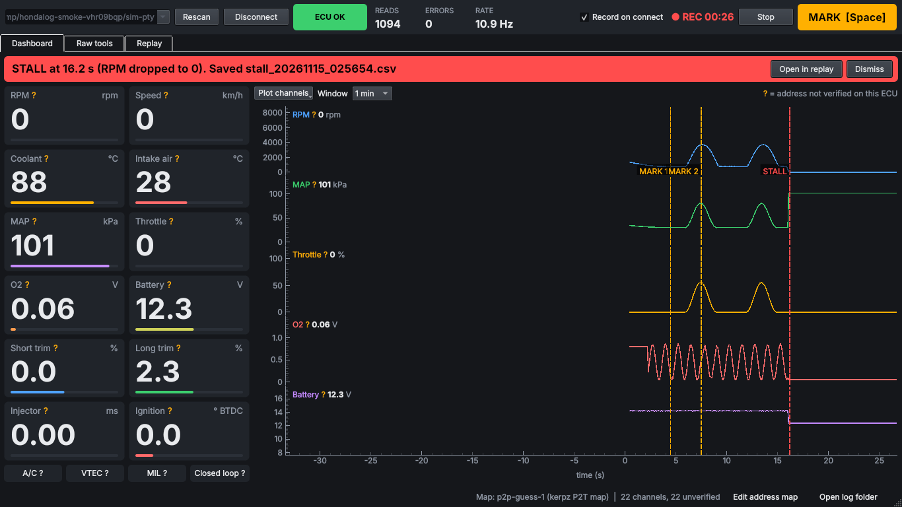

# hondalog

Live data logger for a 2000 Honda Civic EX (D16Y8, OBD2B) over a cheap
KKL 409.1 USB cable (FTDI FT232RL). Linux desktop app: Python, PySide6,
pyqtgraph, pyserial. Built for Debian 13 on an old ThinkPad.

It reads ECU RAM with the Honda diagnostic protocol on the K-line
(`20 05 addr len cksum`, 9600 8N1), shows it, logs it to CSV, and saves a
separate file when the engine stalls.



**Read this first:** the address map is a guess. It is the kerpz P2T map,
and nobody has checked it on a P2P. Every channel shows an amber `?` until
you mark it verified. Until then, treat the numbers as "probably".

## Quickstart

### 1. Install

```sh
tar xzf hondalog-0.1.0.tar.gz
cd hondalog-0.1.0
./install.sh
```

The installer uses sudo. It installs the Debian packages, copies the app to
`/opt/hondalog`, adds you to the `dialout` group, adds a udev rule so the
cable shows up as `/dev/hondalog`, and adds a launcher to the menu.

**Log out and back in afterwards.** The `dialout` group only applies to new
logins, and without it you cannot open the cable. The simulator works
straight away.

### 2. Try it with the simulator (no car)

Terminal 1:

```sh
hondalog-sim
```

Terminal 2:

```sh
hondalog --port /tmp/hondalog-sim --connect
```

The simulator is a fake ECU on a pseudo-terminal. It echoes like a real
K-line, warms up, idles around 750 rpm and revs every 20 seconds. Keys in
the simulator terminal:

| key | what happens |
|-----|--------------|
| `s` | stall: RPM drops to 0, ECU keeps answering |
| `p` | power cut: ECU goes silent (like a dead main relay) |
| `r` | restart |
| `v` | rev |
| `q` | quit |

`hondalog-sim --stall-after 30` stalls on a timer. `--help` lists the rest.
In a hurry, pick the `sim:` port in the app: that is the same fake ECU
without the pty.

### 3. In the car

1. Plug the cable into the laptop. Check that Linux sees it:

   ```sh
   lsusb | grep 0403        # want: 0403:6001 ... FT232 Serial (UART) IC
   sudo dmesg | tail        # want: FTDI USB Serial Device converter now attached to ttyUSB0
   ls -l /dev/hondalog      # the udev link
   ```

2. Plug the other end into the 16-pin OBD2 port under the dash.
3. Key to ON (II). The engine can be off or running.
4. Start `hondalog`. The port box should already show `/dev/hondalog`.
   Press **Connect**.
5. The status box turns green (`ECU OK`), READS counts up, and RATE shows
   about 17 Hz.

If it stays red, run `hondalog-firstcontact` (next section), then go to
Troubleshooting.

### 4. First contact

```sh
hondalog-firstcontact            # or: --port /dev/ttyUSB0, --port sim:
```

Run this the first time the cable is in the car, with the key ON and
hondalog itself disconnected. It takes about 15 seconds and only reads. It
checks the adapter (FTDI or not, clone or not, latency timer), tests the
echo, listens, tries a Honda read with and without the wake-up bytes, tries
other reply framings, reads the ECU id, finds the longest block the ECU
answers, measures its reply time, reads 0x00-0xFF once, and then tries the
standard OBD2 link (ISO 9141-2) for codes, freeze frame and readiness.

It ends with one of five verdicts: `Honda protocol OK`, `ISO only`,
`cable dead`, `ECU silent`, `no port`. Two files land in `~/hondalog/logs/`:
`firstcontact-DATE.md` (verdict, next steps, findings, suggested
`[protocol]` settings) and `firstcontact-DATE.hex.log` (every byte sent and
received, with times). Send both along when asking for help.

`hondalog-firstcontact --udev` prints the udev rule that sets the FTDI
latency timer to 1 ms on every plug-in. `install.sh` installs it.

## Using it

**Recording.** Starts on connect (untick "Record on connect" to stop that).
Logs go to `~/hondalog/logs/log_DATE_TIME.csv`. The header lines (starting
with `#`) hold the ECU id bytes, the address map version and the units.

**Marker.** Press **Space** or the big amber button when something happens
("it just stumbled"). The next row in the log gets `MARK n` in the `marker`
column and a line appears on the charts. Space types a normal space while
the cursor is in a text box.

**Stall catcher.** While recording, once RPM has been above 400:

- RPM reads 0, or
- the ECU stops answering for 1 second (power loss, cable pulled),

the app saves the 30 seconds before and the 10 seconds after to
`~/hondalog/logs/stall_DATE_TIME.csv`, shows a red banner and beeps.
"Open in replay" loads the file. Turning the key off with the engine
running counts as a stall too; ignore that one or press Stop first.

**Charts.** "Plot channels" picks what is drawn (up to 8). "Window" sets how
much history scrolls by.

**Replay tab.** Open any log or stall file. Drag the slider or click in a
chart to move the cursor. The table shows every channel at that moment.
Click a marker in the list to jump to it. Mouse wheel zooms the time axis.

**Raw tools tab.**

- *Hex console*: type bytes, e.g. `20 05 00 10`. "Add checksum" appends the
  last byte for you. It shows what came back after the echo and whether the
  checksum adds up.
- *Memory scanner*: sweeps an address range in chunks and shows a hex grid.
  Orange = changed in this sweep. Blue = changed earlier. Click a byte for
  its minimum, maximum and change count. "Export" writes a `.txt` dump and a
  `.csv` with every sweep.

### Mapping the P2P

1. Engine warm and idling. Raw tools, "Sweep continuously".
2. Press "Clear changes", then change one thing only: blip the throttle,
   switch on the headlights, turn on the A/C.
3. Watch which bytes turn orange. Compare with the guess in the map
   (RPM at 0x00-0x01, TPS at 0x14, battery at 0x17, and so on).
4. "Edit address map" (bottom right) opens
   `~/.config/hondalog/addressmap.toml`. Fix the address or formula, set
   `status = "verified"`, bump `version`, save.
5. Disconnect and connect again to load it.

The file explains its own fields. Formulas are plain arithmetic on `x`
(the raw number). If the file has an error the app tells you and uses the
built-in map until you fix it.

Temperatures are in °C, pressure in kPa, speed in km/h. Change the formula
and units in the map if you want others.

## Troubleshooting

**Permission denied on /dev/ttyUSB0.** You are not in `dialout` yet, or you
have not logged out since the installer added you. Check with `groups`.
Fix: `sudo usermod -aG dialout $USER`, then log out and in.

**The cable appears and vanishes; dmesg mentions `brltty`.** The braille
driver grabs FTDI adapters. `sudo apt remove brltty`, then replug.

**lsusb shows nothing new.** Dead cable or dead USB port. Try another port.

**lsusb shows `0403:0000`.** A clone FTDI chip that an old Windows driver
has zeroed. It still works on Linux if you tell the driver about it:

```sh
sudo modprobe ftdi_sio
echo 0403 0000 | sudo tee /sys/bus/usb-serial/drivers/ftdi_sio/new_id
```

It then appears as `/dev/ttyUSB0`. Type that into the port box (the
`/dev/hondalog` link only matches `0403:6001`).

**lsusb shows `1a86:7523` (CH340) instead of FTDI.** Some "KKL" cables use
that chip. It works the same. Pick its `/dev/ttyUSB0` entry in the port box.

**Clone FTDI chips in general** are fine on Linux. The kernel driver does
not care.

**Status says NO REPLY.** Hover over the status box to see the last error.

- *"no bytes at all, not even the echo"*: the cable's car side is dead.
  It is powered from the OBD2 plug (pin 16), so it only echoes when it is
  plugged into the car. Check the plug is fully seated and the car battery
  is connected.
- *"echo only, the ECU did not answer"*: the cable works, the ECU is quiet.
  - Key must be ON (II), not ACC.
  - Try it with the engine running, and with key on, engine off.
  - Check the ECU sticker (passenger footwell, behind the kick panel). This
    was written for a P2P. A different ECU may want different framing.
  - In Raw tools send `20 05 00 10` by hand and look at what comes back.
  - Edit the address map, `[protocol]` section: try `init_sequence = ""`
    (no wake-up bytes), or `reply_timeout_s = 0.5`.
- *"bad checksum"* or *"no reply frame"*: bytes arrive but do not fit the
  expected `00 len+3 data cksum` shape. Copy what the hex console shows.
  The framing constants are all in `hondalog/protocol.py` (class `Framing`)
  and can be overridden in the map's `[protocol]` section.

**ERRORS keeps climbing but data shows.** A few errors are normal on a noisy
line. Lots of them: bad ground or a poor cable. The log's `link` column is 0
for sweeps where nothing valid came back.

**Values look wrong.** Expected, the map is a guess. See "Mapping the P2P".

**Window does not start: `could not load the Qt platform plugin "xcb"`.**
`sudo apt install libxcb-cursor0 qt6-qpa-plugins`.

## Files

| what | where |
|------|-------|
| logs and stall captures | `~/hondalog/logs/` |
| address map (edit this) | `~/.config/hondalog/addressmap.toml` |
| shipped default map | `/opt/hondalog/hondalog/data/addressmap.toml` |
| program | `/opt/hondalog/` |
| udev rule | `/etc/udev/rules.d/99-hondalog.rules` |

To get the shipped map back, delete your copy and start the app.

Code layout: `protocol.py` (framing and checksum, no I/O), `transport.py`
(serial port, built-in simulator, request/reply `Link`), `link/` (read
planner, scheduler, adaptive timing, clocks), `poller.py` (worker thread),
`obd2.py` (ISO 9141-2 and OBD2 services), `diag/` (first contact, probes,
adapter check, DTC text), `addressmap.py`, `logger.py` (CSV, stall catcher,
log reader), `sim.py` (fake ECU), `ui/` (Qt).

## Link: how fast, and how it copes

**Rates.** Each channel has a rate class: fast (rpm, map, tps, inj, ign),
medium (o2, stft, ltft, vss), slow (the rest). Set `rate = "fast"` on a
channel in the address map to override. Targets are 20 / 5 / 1 reads per
second (`rate_fast_hz` etc. in `[protocol]`). The planner merges nearby
addresses into the fewest requests using the measured cost of a request
(5 echo bytes + 3 frame bytes + ECU reply time + gap, about 12 ms, the
same as 12 data bytes), and the scheduler interleaves them.

`python3 tools/bench_link.py` shows the result against the simulator at true
9600-baud byte timing (2 ms ECU reply time, 1 ms USB latency):

| channels | before (v0.1.0) | now |
|---|---|---|
| rpm, map, tps, inj, ign (+ vss, o2, baro in the same reads) | 11.4 Hz | 17.3 Hz |
| stft, ltft | 11.4 Hz | 4.6 Hz (target 5) |
| temperatures, battery, flags, knock | 11.4 Hz | 1.0 Hz (target 1) |
| rpm alone, burst mode | - | 66.7 Hz |

20 Hz on the fast class does not fit on a 9600 baud wire with this map
(it would need 109 % of the wire); the app reports the shortfall per
channel instead of hiding it. A full frame of every channel still arrives
about once a second at worst; lower `rate_fast_hz` or mark more channels
medium if you want it more even.

**Timestamps.** Every value carries the time its reply was complete
(monotonic clock), minus an estimate of how old the data was by then.
Channels from different reads no longer share one timestamp.

**Errors.** Response timeout, inter-byte timeout and the gap between
requests are measured and adapt. A bad reply is retried once after the line
has been drained. Counters (timeouts, checksum failures, echo mismatches,
resyncs, retries) are in `poller.stats`.

**Recovery.** Key off and on again, or the cable pulled and plugged back in:
the app notices within about 0.5 s, keeps trying, and carries on by itself
within about 2-3 s of the ECU or cable coming back. No restart needed.

**Read-only guard.** The hex console sends only read requests
(`20 05 addr len cksum`) and the wake-up bytes. Anything else is refused
until the expert unlock is switched on for the session
(`poller.set_expert_unlock(True)`); what was sent is kept in
`poller.link.unlocked_frames`.

## OBD2 (ISO 9141-2)

Standard OBD2 on the same pin at 10400 baud: 5-baud init at address 0x33
(by break toggling, the FT232 cannot do 5 baud), KWP2000 fast init as a
fallback, supported-PID discovery, live PIDs, stored and pending codes with
Honda P1xxx text, freeze frame, readiness, and clear codes. Clear needs the
literal confirmation `"CLEAR"`, refuses while the engine runs, and resets
the readiness monitors.

Limits:

- It is slow: about 8-10 PIDs per second in the simulator, likely fewer on
  the car. Use it for codes and cross-checks, not for logging.
- The two protocols cannot share the line. `poller.obd2(fn)` pauses Honda
  polling, runs the init (about 2.6 s), runs `fn`, and goes back. No power
  cycle is needed in the simulator: the ECU drops the ISO session after 5 s
  of silence and Honda reads resume. Expect a gap of about 8 s in the log.
  Whether the real P2P behaves the same is not known; if Honda reads do not
  come back, turn the key off and on.
- The ISO session dies after 5 s without a request; the code re-inits by
  itself, which costs another 2.6 s.
- It needs break and baud control, so it works on the real cable and on the
  built-in `sim:` port, not through the `hondalog-sim` pty.
- 10400 baud is non-standard; some clone FTDI chips and most CH340 cables
  get it wrong. If the init fails on a clone, suspect that first.

## Simulator extras

`hondalog-sim --faults flaky` (or `drop=0.01,cksum=0.01,junk=0.01,slow=0.005,
silent=0.005,echo=0.005`), `--seed N` (runs repeat exactly), `--turnaround-ms`,
`--max-read-len`, `--unplug-after SEC --unplug-for SEC`, `--cable-dead`,
`--iso-only`. Key `u` pulls the cable for 3 s. Bytes are paced at true 9600
baud unless `--fast`. In the app, the ports `sim:` and `sim:flaky` are the
same model in-process, with ISO 9141-2.

## Tests

```sh
cd /opt/hondalog
python3 -m pytest                                   # unit tests
QT_QPA_PLATFORM=offscreen python3 tools/smoke.py    # full run against the simulator
```

(If the installer had to build a venv, use `/opt/hondalog/.venv/bin/python`
instead of `python3`, and `pip install pytest` into it first.)

## Not verified yet

Everything was tested against the simulator only. Still to be proven on the
real car:

- that a P2P answers `20 05 addr len cksum` with `00 len+3 data cksum`
- whether it needs the wake-up bytes, and whether they do any harm
- every address and formula in the map
- the ECU id location (0x76, 10 bytes)
- the real polling rate: the ECU's reply time is assumed to be 2 ms in the
  simulator; the timing probe measures the real one
- the longest block the ECU answers (assumed 16; the probe tries up to 64)
- ISO 9141-2 on the real ECU: the break-toggled 5-baud init on this cable,
  the key bytes, which PIDs it supports, and whether Honda reads come back
  after an ISO session without cycling the key
- the FTDI latency timer actually reaching 1 ms on the ThinkPad
- unplug/replug recovery with a real cable (tested with the simulator's
  unplug only)

## Uninstall

```sh
/opt/hondalog/uninstall.sh
```

Logs, settings and the Debian packages stay.
