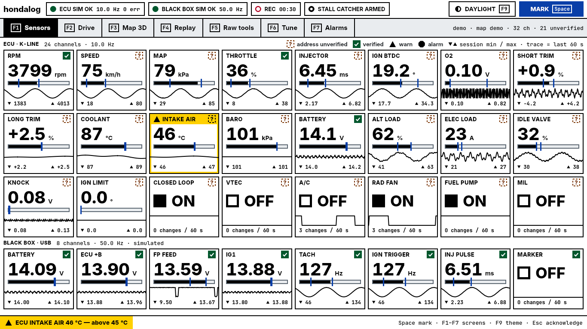

# hondalog

Live data logger for a 2000 Honda Civic EX (D16Y8, OBD2B) over a cheap
KKL 409.1 USB cable (FTDI FT232RL). Linux desktop app: Python, PySide6,
pyqtgraph, pyserial. Built for Debian 13 on an old ThinkPad.

It reads ECU RAM with the Honda diagnostic protocol on the K-line
(`20 05 addr len cksum`, 9600 8N1), shows it, logs it to CSV, and saves a
separate file when the engine stalls.



**Read this first:** the address map is a guess. It is the kerpz P2T map,
and nobody has checked it on a P2P. Every channel shows an amber `?` until
you mark it verified. Until then, treat the numbers as "probably".

## Quickstart

### 1. Install

```sh
tar xzf hondalog-0.1.0.tar.gz
cd hondalog-0.1.0
./install.sh
```

The installer uses sudo. It installs the Debian packages, copies the app to
`/opt/hondalog`, adds you to the `dialout` group, adds a udev rule so the
cable shows up as `/dev/hondalog`, and adds a launcher to the menu.

**Log out and back in afterwards.** The `dialout` group only applies to new
logins, and without it you cannot open the cable. The simulator works
straight away.

### 2. Try it with the simulator (no car)

Terminal 1:

```sh
hondalog-sim
```

Terminal 2:

```sh
hondalog --port /tmp/hondalog-sim --connect
```

The simulator is a fake ECU on a pseudo-terminal. It echoes like a real
K-line, warms up, idles around 750 rpm and revs every 20 seconds. Keys in
the simulator terminal:

| key | what happens |
|-----|--------------|
| `s` | stall: RPM drops to 0, ECU keeps answering |
| `p` | power cut: ECU goes silent (like a dead main relay) |
| `r` | restart |
| `v` | rev |
| `q` | quit |

`hondalog-sim --stall-after 30` stalls on a timer. `--help` lists the rest.
In a hurry, `hondalog --port sim: --connect` uses the same fake ECU without
the pty (and adds a simulated black box). `hondalog --demo` shows every
screen with a made-up car driving around; nothing is recorded.

### 3. In the car

1. Plug the cable into the laptop. Check that Linux sees it:

   ```sh
   lsusb | grep 0403        # want: 0403:6001 ... FT232 Serial (UART) IC
   sudo dmesg | tail        # want: FTDI USB Serial Device converter now attached to ttyUSB0
   ls -l /dev/hondalog      # the udev link
   ```

2. Plug the other end into the 16-pin OBD2 port under the dash.
3. Key to ON (II). The engine can be off or running.
4. Start `hondalog`. Click the **ECU** chip (top left) and pick
   `/dev/hondalog`. `hondalog --port /dev/hondalog --connect` does the same.
5. The chip shows a filled circle and `ECU OK`, with the poll rate
   (about 10 Hz) and the error count.

If the chip turns red (`ECU SILENT`), go to Troubleshooting.

## Using it

Built for a 1366x768 laptop in a car: every action has a key, nothing needs
the touchpad, and state is shown by shape as well as colour.

| Key | Does |
|-----|------|
| F1 to F7 | Sensors, Drive, Map 3D, Replay, Raw tools, Tune, Alarms |
| F9 | Daylight (black on white, for sun) / Night (white on black) |
| Space | MARK: tag this moment in the log ("it just stumbled") |
| Esc | Acknowledge alarms, dismiss the stall banner |
| Enter | Open the caught stall in Replay (while the banner shows) |
| Ctrl+R | Start / stop recording |
| F11 | Full screen |

**Sensors (F1).** Every channel on one screen. Each tile has the value, a
bar with the session minimum and maximum, the last 60 seconds as a trace,
and a marker: dashed `?` box = the address is a guess, green tick =
verified. A triangle and yellow band is a warning; an octagon on a filled
tile is an alarm; a hatched tile has no data. Click a tile to put it on the
Drive view; right-click for its limits and "mark verified".

**Drive (F2).** Six huge readouts, the stall catcher's state and a MARK
button the size of a hand. Right-click a readout to change what it shows.

**Recording.** Starts on connect (ECU chip menu, "Record on connect").
Logs go to `~/hondalog/logs/log_DATE_TIME.csv`. The header lines (starting
with `#`) hold the ECU id bytes, the address map version and the units.

**Stall catcher.** While recording, once RPM has been above 400:

- RPM reads 0, or
- the ECU stops answering for 1 second (power loss, cable pulled),

the app saves the 30 seconds before and the 10 seconds after to
`~/hondalog/logs/stall_DATE_TIME.csv`, shows a red banner over the tabs and
beeps. Enter opens the file in Replay. Turning the key off with the engine
running counts as a stall too; press Esc for that one.

**Map 3D (F3).** RPM x MAP surface built from what has been logged this
session: height is injector time, ignition or fuel trim; colour is trim or
sample count; grey cells have no samples yet. V switches to time-in-cell
bars or stall approach paths, Z and C change height and colour, arrows
orbit, 1 to 4 are camera presets. Without OpenGL 2.1 it draws the same data
as a 2D heat map (`--no-gl` forces that).

**Replay (F4).** O opens a log or stall file; with none open it follows
live data. Stacked lanes with one cursor: click or drag, arrows step 0.1 s
(Shift 1 s), `[` and `]` jump between events, P plays, `+` and `-` zoom, D
drops a second cursor for a time difference. For a stall file the right
side lists what left its normal range first.

**Raw tools (F5).** S sweeps all 256 bytes and keeps going. Yellow = changed
in the last sweep, underlined = changed earlier, dashed = in the address
map but unverified. Arrows move the selected byte; the inspector shows its
bits and history. The hex console sends raw frames (Enter). The guided
mapper (N next, B back) ranks bytes by how well they follow three timed
presses of whatever you are looking for.

**Tune (F6).** Table grid with a 3D surface beside it. Read-only sample
tables until the chipped P28 and the ROM tools are in.

**Alarms (F7).** The shape key, the live alarm list and the limits.

`hondalog --profile` shows frame time, CPU and latency in the bottom bar.
`tools/bench_ui.py` measures the same per screen (see docs/ui-adapters.md).

### Mapping the P2P

1. Engine warm and idling. Raw tools (F5), S to sweep.
2. Press C to clear, then change one thing only: blip the throttle,
   switch on the headlights, turn on the A/C.
3. Watch which bytes turn yellow. Compare with the guess in the map
   (RPM at 0x00-0x01, TPS at 0x14, battery at 0x17, and so on).
4. ECU chip menu, "Edit address map" opens
   `~/.config/hondalog/addressmap.toml`. Fix the address or formula, set
   `status = "verified"`, bump `version`, save.
5. Disconnect and connect again to load it.

The file explains its own fields. Formulas are plain arithmetic on `x`
(the raw number). If the file has an error the app tells you and uses the
built-in map until you fix it.

Temperatures are in °C, pressure in kPa, speed in km/h. Change the formula
and units in the map if you want others.

## Troubleshooting

**Permission denied on /dev/ttyUSB0.** You are not in `dialout` yet, or you
have not logged out since the installer added you. Check with `groups`.
Fix: `sudo usermod -aG dialout $USER`, then log out and in.

**The cable appears and vanishes; dmesg mentions `brltty`.** The braille
driver grabs FTDI adapters. `sudo apt remove brltty`, then replug.

**lsusb shows nothing new.** Dead cable or dead USB port. Try another port.

**lsusb shows `0403:0000`.** A clone FTDI chip that an old Windows driver
has zeroed. It still works on Linux if you tell the driver about it:

```sh
sudo modprobe ftdi_sio
echo 0403 0000 | sudo tee /sys/bus/usb-serial/drivers/ftdi_sio/new_id
```

It then appears as `/dev/ttyUSB0`. Pick it from the ECU chip menu, or use
"Other port" there (the
`/dev/hondalog` link only matches `0403:6001`).

**lsusb shows `1a86:7523` (CH340) instead of FTDI.** Some "KKL" cables use
that chip. It works the same. Pick its `/dev/ttyUSB0` entry in the ECU chip menu.

**Clone FTDI chips in general** are fine on Linux. The kernel driver does
not care.

**The ECU chip is red (`ECU SILENT`).** Click it: the menu shows the last error.

- *"no bytes at all, not even the echo"*: the cable's car side is dead.
  It is powered from the OBD2 plug (pin 16), so it only echoes when it is
  plugged into the car. Check the plug is fully seated and the car battery
  is connected.
- *"echo only, the ECU did not answer"*: the cable works, the ECU is quiet.
  - Key must be ON (II), not ACC.
  - Try it with the engine running, and with key on, engine off.
  - Check the ECU sticker (passenger footwell, behind the kick panel). This
    was written for a P2P. A different ECU may want different framing.
  - In Raw tools send `20 05 00 10` by hand and look at what comes back.
  - Edit the address map, `[protocol]` section: try `init_sequence = ""`
    (no wake-up bytes), or `reply_timeout_s = 0.5`.
- *"bad checksum"* or *"no reply frame"*: bytes arrive but do not fit the
  expected `00 len+3 data cksum` shape. Copy what the hex console shows.
  The framing constants are all in `hondalog/protocol.py` (class `Framing`)
  and can be overridden in the map's `[protocol]` section.

**ERRORS keeps climbing but data shows.** A few errors are normal on a noisy
line. Lots of them: bad ground or a poor cable. The log's `link` column is 0
for sweeps where nothing valid came back.

**Values look wrong.** Expected, the map is a guess. See "Mapping the P2P".

**Window does not start: `could not load the Qt platform plugin "xcb"`.**
`sudo apt install libxcb-cursor0 qt6-qpa-plugins`.

## Files

| what | where |
|------|-------|
| logs and stall captures | `~/hondalog/logs/` |
| address map (edit this) | `~/.config/hondalog/addressmap.toml` |
| shipped default map | `/opt/hondalog/hondalog/data/addressmap.toml` |
| program | `/opt/hondalog/` |
| udev rule | `/etc/udev/rules.d/99-hondalog.rules` |

To get the shipped map back, delete your copy and start the app.

Code layout: `protocol.py` (framing and checksum, no I/O), `transport.py`
(serial port, built-in simulator, request/reply), `poller.py` (worker
thread), `addressmap.py`, `logger.py` (CSV, stall catcher, log reader),
`sim.py` (fake ECU), `ui/` (Qt). `iso9141.py` is an empty stub for standard
OBD2 PIDs.

## Tests

```sh
cd /opt/hondalog
python3 -m pytest                                   # unit tests
QT_QPA_PLATFORM=offscreen python3 tools/smoke.py    # full run against the simulator
```

(If the installer had to build a venv, use `/opt/hondalog/.venv/bin/python`
instead of `python3`, and `pip install pytest` into it first.)

## Not verified yet

Everything was tested against the simulator only. Still to be proven on the
real car:

- that a P2P answers `20 05 addr len cksum` with `00 len+3 data cksum`
- whether it needs the wake-up bytes, and whether they do any harm
- every address and formula in the map
- the ECU id location (0x76, 10 bytes)
- the real polling rate (the simulator gives about 10 Hz)

## Uninstall

```sh
/opt/hondalog/uninstall.sh
```

Logs, settings and the Debian packages stay.
