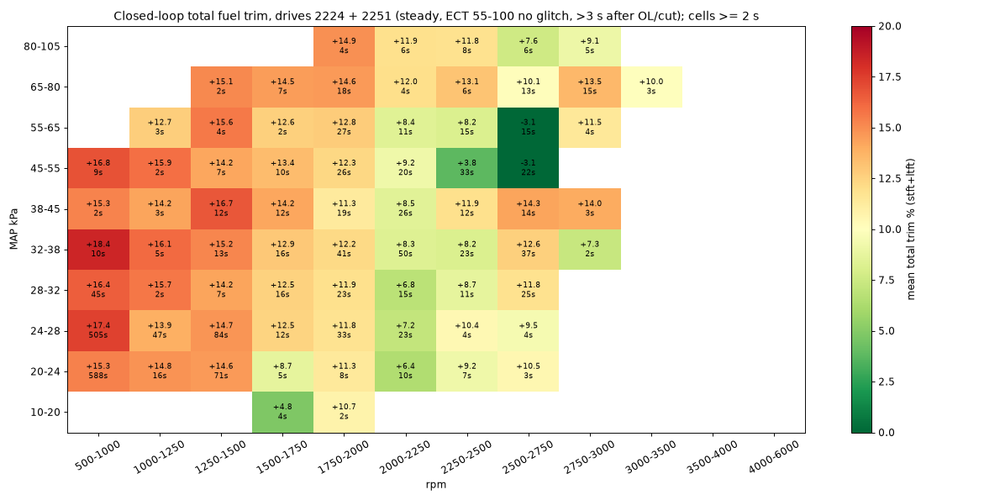
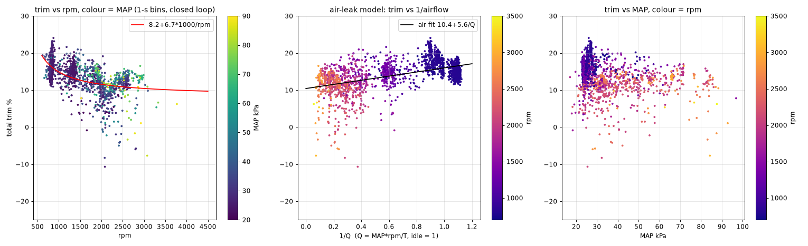

# Fueling deep-dive: first real driving, 2000 Civic EX (D16Y8, P2P, speed-density), 2026-11-26

Data: `drive_2026_11_26_2224` (20.8 min, city, up to 69 km/h) and `drive_2026_11_26_2251` (35.8 min, up to 107 km/h and 5,411 rpm), from a copy of hondalog.db. Idle drives from 11-25 and 11-26 (ids 6-37) are used for comparison.
Scripts, the npz extracts and all PNGs are in `work-fuel/`. `load.py` reads the raw samples and puts them on the rpm/MAP timebase (~12.5 Hz) with an age limit. It does not use the per-drive views.

Selection for "closed loop, warm":
- `closed_loop`=1, `fuel_status`=2, rpm>500, inj>0.5 ms
- more than 3 s since the last open-loop or fuel-cut sample
- |dMAP/dt|<15 kPa/s and |drpm/dt|<400 rpm/s
- ECT 55-100 °C, with ±20 s around any ECT jump >4 °C removed

That keeps 83 % of drive 2224 and 54 % of drive 2251. The fits use 1-s bins (2,175 bins).

**ECT caveat.** In these drives ECT read a steady 64-72 °C, not the ~80-85 °C seen at idle on 11-25. There was one rise to 74-79 °C (2251, minutes 45.4-47.7) and dips to 58-62 °C. A stuck-open thermostat cannot be ruled out; IAT was 18-22 °C on the interstate. So "ECT sane" here means "no jump", not "reads hot".

## Bottom line

- **The fixed-unmetered-air model (trim ∝ 1/(MAP·rpm/T)) loses.** At a fixed rpm the trim does not fall with MAP; it rises slightly (+0.5 %/10 kPa in 5 of 6 rpm bands). The air model predicts a fall there.
- **Trim depends on rpm and not on MAP.** The best fit is total ≈ 8.2 + 6.7·(1000/rpm) %, i.e. about +16-18 % at 800 rpm and +10-11 % at 2,500-3,000 rpm. On top of that sits a load-independent lean offset of about 7-10 % that is still there at MAP 65-100 kPa.
- **Why this argues against an intake leak.** On a MAP-based ECU a manifold vacuum leak is mostly *metered*: it raises MAP and the ECU fuels for it. So the lack of a 1/airflow term is expected.
- **What is left.**
  - (a) Something that makes the front O2 read lean mainly at low rpm: an exhaust leak before the front O2, idle misfire, or a lazy/biased front sensor.
  - (b) A roughly constant ~7-10 % fuel-side or sensor-side offset: fuel pressure, injector flow, front-O2 offset, or MAP gain.
- **The rear O2 at idle sits at 0.9-0.98 V** while the ECU adds +16-20 % fuel. If the rear's calibration matches the front's, that means the exhaust after the cat is *rich*, which favours false-lean at the front (a) over true lean.
- **0xA0 really is a second, physical O2 sensor.** It shows its own warm-up (3.3-3.9 V for 86 s after a restart while the front read normal) and stays flat at idle while the front switches.
- **The catalyst looks weak.** At driving flows the rear mirrors the front (r = 0.95, lag ≤0.1 s, same amplitude). At low flow it damps only after 2-3 minutes of idle.
- **Open loop behaves normally.**
  - WOT goes rich: front O2 0.87-0.94 V, fuel/air about ×1.25-1.29 the closed-loop value, so AFR ≈ 11.4-11.8.
  - Decel fuel cut: injector at 0, front O2 at 0.00 V within ~0.2 s, fuel back on at ~1,190 rpm.
  - The moderate false-cold ECT readings (58-68 °C) cause no measurable enrichment (<±3 %).
- **Large rich episodes at cruise.** Total trim reaches −10 to −25 % for 30-60 s at steady cruise (2251, minutes 57.6-58.7; also 2224, minute 16.3). They are not tied to rpm, MAP or ECT, which fits EVAP purge vapour. They pull down the averages "above 60 km/h" in the README (+7.8 %).

## 1. Trim map (stft+ltft, closed loop, steady; mean % and seconds per cell, cells ≥2 s)

| MAP kPa \ rpm | 500-1000 | 1000-1250 | 1250-1500 | 1500-1750 | 1750-2000 | 2000-2250 | 2250-2500 | 2500-2750 | 2750-3000 | 3000-3500 |
|---|---|---|---|---|---|---|---|---|---|---|
| 10-20 |  |  |  | +4.8 (4s) | +10.7 (2s) |  |  |  |  |  |
| 20-24 | +15.3 (588s) | +14.8 (16s) | +14.6 (71s) | +8.7 (5s) | +11.3 (8s) | +6.4 (10s) | +9.2 (7s) | +10.5 (3s) |  |  |
| 24-28 | +17.4 (505s) | +13.9 (47s) | +14.7 (84s) | +12.5 (12s) | +11.8 (33s) | +7.2 (23s) | +10.4 (4s) | +9.5 (4s) |  |  |
| 28-32 | +16.4 (45s) | +15.7 (2s) | +14.2 (7s) | +12.5 (16s) | +11.9 (23s) | +6.8 (15s) | +8.7 (11s) | +11.8 (25s) |  |  |
| 32-38 | +18.4 (10s) | +16.1 (5s) | +15.2 (13s) | +12.9 (16s) | +12.2 (41s) | +8.3 (50s) | +8.2 (23s) | +12.6 (37s) | +7.3 (2s) |  |
| 38-45 | +15.3 (2s) | +14.2 (3s) | +16.7 (12s) | +14.2 (12s) | +11.3 (19s) | +8.5 (26s) | +11.9 (12s) | +14.3 (14s) | +14.0 (3s) |  |
| 45-55 | +16.8 (9s) | +15.9 (2s) | +14.2 (7s) | +13.4 (10s) | +12.3 (26s) | +9.2 (20s) | +3.8 (33s) | −3.1 (22s)* |  |  |
| 55-65 |  | +12.7 (3s) | +15.6 (4s) | +12.6 (2s) | +12.8 (27s) | +8.4 (11s) | +8.2 (15s) | −3.1 (15s)* | +11.5 (4s) |  |
| 65-80 |  |  | +15.1 (2s) | +14.5 (7s) | +14.6 (18s) | +12.0 (4s) | +13.1 (6s) | +10.1 (13s) | +13.5 (15s) | +10.0 (3s) |
| 80-105 |  |  |  |  | +14.9 (4s) | +11.9 (6s) | +11.8 (8s) | +7.6 (6s) | +9.1 (5s) |  |

\* These cells are mostly the 57.6-58.7 min rich (purge-like) episode.

Reading the map:
- Down each rpm column the trim stays roughly constant from MAP 20 to 100 kPa. At 1,750-2,000 rpm it goes 11.3 → 14.9.
- Along each row it falls from idle to 2,000-2,250 rpm (17 → 7), then partly recovers at 2,500 rpm.
- rpm marginals: 800 rpm +16.3; 1,250-1,500 rpm +14.8; 1,750-2,000 rpm +12.3; 2,000-2,750 rpm +8 (median +9.4 to +11.7, because the purge episodes pull the mean down).

## 2. Model comparison (1-s bins; ΔBIC relative to the best model, lower is better)

Q = MAP·rpm/T(IAT), normalised to warm idle (25 kPa, 800 rpm, 313 K); P = MAP/T (air per cycle).

| model | physical meaning | coefficients (all bins) | RMSE | R² | ΔBIC all | ΔBIC without rich episodes |
|---|---|---|---|---|---|---|
| const | constant % error | 13.8 | 5.19 | 0 | 852 | 911 |
| **air: c + a/Q** | fixed unmetered air mass (intake leak, or exhaust air at the O2) plus a constant | c 8.85, a 7.24 | 4.42 | 0.27 | 166 | 239 |
| pure leak: a/Q | only fixed air, no constant | a 17.2 | 6.14 | −0.40 | 1584 | 2652 |
| dead time: c + b/P | fixed ms per injection (dead time or low voltage) → ∝ 1/pulse | c 6.1, b 8.8 | 4.71 | 0.18 | 440 | 630 |
| fuel delivery: c + f·Q | pressure falls with fuel flow → trim grows with flow | c 16.6, f −1.1 (wrong sign) | 4.45 | 0.26 | 198 | 409 |
| **rpm only: c + r·1000/rpm** | rpm-driven error that does not depend on load | c 6.2, r 8.4 (8.2 / 6.7 without episodes) | 4.26 | 0.33 | **0** | 6 |
| rpm + MAP | as above plus a load term | MAP term −0.007 … +0.02 %/kPa | 4.25 | 0.33 | 7 | **0** |
| air + dead | | | 4.40 | 0.28 | 151 | 113 |

Robustness checks:
- The result holds with 6 s and 10 s settle times after closed-loop re-entry (rpm model better than air by ΔBIC 140-160), and in each drive separately.
- **Within rpm bands, trim vs MAP** (1,250-3,000 rpm, MAP 18-97 kPa): the data slope is +0.46, +0.64, +0.51, +0.61, +0.69 and −0.32 %/10 kPa. The air model predicts −0.2 to −0.6 %/10 kPa there.
- **High load** (MAP > 60 kPa, closed loop): mean total trim +11.7 %. The air-plus-constant model predicts ~+9 %; a pure leak predicts ~+2 %.
- **Warm idle across 11-25/26** (463 chunks of 30 s; `idle_trim_vs_iat_rpm_batt.png`):
  - Trim follows rpm (r = −0.66): about +21-22 % at 670 rpm and +16-17 % at 810 rpm, at the same MAP (25-26 kPa).
  - IAT (−0.13 %/°C) and battery voltage (+5.5 %/V) both have the *wrong* sign for a heat-soak bias or a dead-time/voltage effect.
  - Battery voltage sits at 13.4-14.3 V throughout. **The voltage/dead-time model is rejected.**

**Verdict:**
- Neither pure intake-air nor pure fuel-delivery fits.
- The trims look like a **constant lean offset of ≈6-8 %**, present at every load including MAP 65-100 kPa, **plus an rpm-dependent term** of ≈+8-10 % at idle, ≈+3 % at 2,500 rpm and ≈+2 % at 4,000 rpm that does not depend on MAP.
- The rpm-only behaviour fits air entering the exhaust before the front O2 (exhaust leaks pull in air between pulses, mostly at low rpm and regardless of load) or idle misfire. It fits an intake vacuum leak poorly, since a speed-density ECU meters one.

**Leak size, if one insists on the air model:** the a/Q term is 5.6-7.2 % of idle airflow. Idle airflow is 1.5-1.9 g/s (from speed-density with VE 0.6-0.7, and from injector flow with 0.8-1.0 ms dead time). That gives ≈0.08-0.11 g/s, a choked orifice of **≈0.8-0.9 mm** (Cd 0.7). The pure-leak fit (17 %, which fits badly) would be ≈0.26-0.32 g/s, about a 1.4-1.6 mm hole. Both are small, and on this ECU an intake leak that size would show up as low IACV duty and high idle rather than as trim.

## 3. O2 behaviour

**Front O2** (8-s closed-loop windows; `o2_switching_vs_load.png`):

| airflow (idle = 1) | rpm | MAP | switching Hz | p5-p95 swing | mean V | time > 0.45 V | total trim |
|---|---|---|---|---|---|---|---|
| <1.3 | 818 | 24.7 | 0.12 | 0.70 (0.14-0.86) | 0.51 | 0.57 | +15.6 |
| 1.3-2 | 1171 | 29 | 0.25 | 0.78 | 0.49 | 0.57 | +14.7 |
| 2-3 | 1492 | 32 | 0.44 | 0.82 | 0.55 | 0.63 | +13.6 |
| 3-4.5 | 2181 | 35 | 0.94 | 0.71 | 0.57 | 0.66 | +11.6 |
| 4.5-6.5 | 2253 | 47 | 1.03 | 0.66 | 0.60 | 0.74 | +11.5 |
| 6.5-10 | 2373 | 61 | 0.94 | 0.43 | 0.64 | 0.86 | +12.2 |

- Full swing (0.06-0.87 V) at all loads, so the front sensor is not dead.
- Switching is slow at idle (0.12 Hz, an ~8 s limit cycle, as on 11-25) and about 1 Hz at cruise. The sample rate (12.5 Hz) is fine for both.
- The controller sits rich-biased per the front sensor (57 % of time rich at idle, 74-86 % at mid/high load), and the STFT sawtooth shows the usual Honda asymmetric PI.
- The idle limit cycle is lazy, but this does not prove a bad sensor.

**Rear O2 (0xA0).** It is a real separate sensor, not a copy:
- After the restart at 22:51 it read 3.3-3.9 V for 86 s and then decayed slowly to ~1.0 V, while the front switched normally from the first seconds. That looks like a cold sensor on a biased ECU input.
- During the long idles (drive 2158, and 2224 before driving) it stayed at 0.95-0.98 V with a std of 0.01 V while the front swung 0.1-0.85 V.

Behaviour (`rear_o2_rolling.png`, `zoom_hwy.png`):
- **Driving (2251 from minute 30.8 on, and 2224 at minute 17.5 above ~50 km/h):**
  - The rear mirrors the front: correlation 0.95 at a lag of +0.05-0.1 s, same std (0.27 vs 0.24 V at cruise), same 0-0.9 V swing.
  - A catalyst with working oxygen storage would hold the rear steady at ~0.6-0.8 V.
  - **The cat shows little oxygen storage at these flows.** Check P0420 and the catalyst readiness monitor.
- **Back at idle (2224, minutes 18.3-20.7):** the rear's swing shrinks over ~2.5 min (std 0.36 → 0.02 V) and its mean climbs 0.54 → 0.91 V. The cat still damps at low flow, and once damped the post-cat gas reads **rich** (0.9+ V) while the ECU is adding +18-19 % fuel. The 1.5-min idle at the end of 2251 was too short to settle.
- **Decel fuel cut** (34 cuts ≥1.5 s in 2251):
  - Front goes lean in 0.22 s; rear 0.89 s.
  - On refuel the front is rich again in 0.93 s; the rear in 1.6 s.
  - With ~1 Hz rear sampling (≈0.5 s average delay), the real extra lag is ≈0.2-0.5 s. A healthy cat would hold the rear lean for several seconds after a long cut.
- Caveat: the rear's scale is assumed to be the front's (x/51.3). Its 0.9-0.98 V idle level is "rich" only if that holds.

## 4. Open loop

**WOT / high load** (`zoom_wot.png`):
- With `fuel_status` = 4 and MAP > 85 kPa:
  - front O2 median 0.90 V, up to 0.94 V (rich, as it should be)
  - injector 10-12.4 ms; peak duty 55 % at 5,411 rpm, so plenty of injector headroom
- Fuel per unit air vs the closed-loop value at the same rpm (1.0 ms dead time):
  - ×1.25 at 1,500-3,000 rpm (AFR ≈ 11.8)
  - ×1.29 at 3,000-4,500 rpm (AFR ≈ 11.4)
- The front O2 stayed rich through every pull, including 2,756 → 5,411 rpm at minute 38.5. **No sign of fuel starvation at high flow** (a weak pump would show lean spikes).
- In open loop STFT is held at 0, so only LTFT (8.6 %) applies. Since the engine needs +12-15 % at high load, open-loop power fueling is ~4-6 % leaner than the ECU intends. That is harmless at AFR 11.5-12.
- Part-throttle lugging at MAP 86-95 kPa and TPS 22-36 % stays in closed loop (o2 ~0.7, trim normal).

**Decel fuel cut:**
- 2251: 55 cuts ≥0.5 s, 11 % of running time; median 2.3 s, longest 19 s. Entry with throttle closed (TPS ≤10 %) at a median of 2,200 rpm.
- Injector reads exactly 0 and the front O2 averages 0.05 V (minimum 0.00).
- Fuel returns at a median of 1,190 rpm (lowest 900 rpm) or on throttle. `fuel_status` goes 4 and `closed_loop` goes 0, as expected.
- After re-entry STFT starts high and ramps down over ~3-5 s, so 3-10 s after a cut is excluded from the map.
- 2224 cuts were short (median 0.8 s); the O2 often did not reach 0 before fuel returned.

**ECT glitches while driving:**
- Residual trim vs the rpm model, by ECT band: 60-65 °C +1.7, 65-70 °C −0.4, 70-75 °C +2.9 (n small), 75-80 °C −2.4.
- Across 12 ECT steps of 4-11 °C, the residual changed by −3.5 to +1.8 % with inconsistent sign; injector/MAP changed by less than 7 %.
- **Conclusion:** the 58-79 °C readings seen here cause no measurable warm-up enrichment. Closed loop absorbs any that exists. (The 35 °C-type drops from 11-25 did not occur in these drives.)
- **Side effect:** LTFT was frozen at 8.59 % for drives 36-39. Its only change (8.59 → 7.81) came at minute 46.9 of 2251, inside the one window where ECT read 74-79 °C. LTFT learning appears to be held off while ECT reads below ~74 °C, so the false-low ECT freezes it.

## 5. Highway cruise and fuel flow

Assumptions: 240 cc/min injectors, 1.0 ms dead time; steady 10-s windows of 2251.

| speed | rpm | MAP | inj ms | duty | fuel L/h (dead 0.8 / 1.2) | L/100 km | US mpg | air-based L/h (VE 0.80) | total trim |
|---|---|---|---|---|---|---|---|---|---|
| 51 km/h | 2179 | 36 | 3.39 | 6 % | 2.48 (2.69 / 2.27) | 4.9 | 48 | 3.19 | +11.6 |
| 69 km/h | 1989 | 51 | 4.64 | 8 % | 3.44 (3.63 / 3.25) | 4.9 | 48 | 4.06 | +12.0 |
| 90 km/h | 2506 | 50 | 4.02 | 8 % | 3.63 | 4.0 | 59* | 5.17 | −3.7* |
| 105 km/h | 2897 | 65 | 6.15 | 15 % | 7.18 (7.46 / 6.90) | 6.9 | 34 | 7.79 | +11.5 |

\* Inside the rich (purge-like) episode: fuel from the canister is not counted.

- Whole of 2251: 23.8 km by VSS (GPS 24.2 km, so VSS reads ~1.7 % low), ≈1.46 L, **≈6.1 L/100 km ≈ 38 US mpg**. 2224 (1.6 km, mostly idle) is meaningless.
- The injector-based fuel is ~15-25 % below the air-based estimate (VE 0.80), and 38 mpg mixed is optimistic. Either the dead time is below 1.0 ms or the injectors flow more than 240 cc/min. At 105 km/h, 34 mpg looks right.
- Fuel flow is sane within the ±20 % uncertainty of dead time, rating and VE. It cannot resolve a 7-10 % fuel-flow shortfall either way.
- Gearing: 27.7 rpm per km/h in 5th, 28.6 in 4th.
- **LTFT drift:**
  - 11-25: LTFT wandered 6.25 ↔ 12.5 % in 0.78 % steps, about one step per minute, following STFT between the 670 and 810 rpm idle states.
  - 11-26: 9.4 → 13.3 → 8.6 % in drives 32-35, then frozen as described in section 4.
  - No downward drift over the driving drives. Total trim stays in the +12 to +18 % band apart from the purge episodes.

## 6. What the mechanic should test (ranked by evidence)

1. **Tailpipe gas at warm idle and at 2,500 rpm (wideband or 4/5-gas analyser), before anything else.** This splits the two families.
   - λ < 1 or high CO at idle while trims are +16-20 % means the front O2 is being fooled lean: exhaust leak, misfire or sensor. The rear O2 at 0.9+ V points this way.
   - λ ≈ 1 with low CO means true lean, corrected by the trims: fuel side.
   - High HC plus O2 means misfire.
2. **Exhaust leak before the front O2, and the front O2 itself.**
   - Where to look: the manifold-to-head gasket, the manifold/downpipe flange, cracks in the manifold, and the O2 sensor boss.
   - How: listen for ticking on a cold start; briefly block the tailpipe; smoke the exhaust side.
   - Then check the front O2 response and bias (propane/snap test, or compare with a wideband).
   - Evidence: trim depends on rpm and not on MAP (ΔBIC 166-239 against the air model); the rear reads rich at idle.
3. **Fuel pressure at idle (regulator hose on and off) and under load/volume**, then injectors (balance or cleaning, O-rings).
   - Specs: 260-310 kPa hose off, 200-250 kPa hose on (PDF p.500).
   - Evidence: a constant ≈6-10 % lean offset at all loads, including MAP 65-100 kPa. Each 10 % of fuel flow is ≈19 % of pressure, i.e. ~40-50 kPa low.
   - Against: the front O2 stays rich at WOT up to 5,400 rpm (the pump keeps up), and trim does not grow with fuel flow.
4. **Ignition and misfire at idle:** plugs, wires, cap and rotor, rpm stability at 670 rpm. Fits the "worse at low rpm, regardless of load" shape; this is a hypothesis with no direct evidence.
5. **EVAP purge valve and canister:** purge-valve vacuum test, and block the purge line during a cruise log.
   - Evidence: 30-60 s rich slugs at steady cruise (−10 to −25 % total trim) not tied to rpm, MAP or ECT. Not harmful in itself, but they hide the true cruise trim.
6. **Catalyst efficiency:** read P0420 and readiness. The rear O2 mirrors the front at every driving speed (r = 0.95, ≤0.1 s lag, same amplitude). This does not cause the lean trim, but the cat looks weak.
7. **Intake smoke test:** PCV, brake booster, fast-idle thermo valve, IACV gasket, purge lines.
   - It is cheap, but on speed-density an intake leak shows mostly as high idle and low IACV, not as trim. The fit puts any fixed air term at ≤5-7 % of idle air (≈0.8-0.9 mm hole).
   - Worth doing for the 810 rpm idle and IACV 5-6 %, not as the fix for the trims.
8. **ECT connector (C122) and thermostat.**
   - ECT read 64-72 °C on the interstate (IAT 20 °C), so either the connector biases it low or the thermostat sticks open. Check real coolant temperature with an IR gun or scan tool.
   - It does not cause the lean trim, but it freezes LTFT learning and changes idle and timing.

## Plots (work-fuel/)

- `overview_38.png`, `overview_39.png`: whole drives (rpm/vss, MAP/TPS, O2 front and rear, trims, inj, ECT/IAT, loop flags)
- `trim_map.png`: the trim map
- `trim_models.png`: trim vs rpm (colour = MAP), vs 1/airflow, vs MAP (colour = rpm)
- `idle_trim_vs_iat_rpm_batt.png`: warm-idle trims across all drives
- `o2_switching_vs_load.png`: front O2 frequency, swing and rich fraction vs airflow
- `rear_o2_rolling.png`: rolling 60 s rear/front correlation and std, drives 2158/2224/2251
- `zoom_hwy.png`, `zoom_cruise2000.png`, `zoom_wot.png`: detail (interstate and purge episode, city cruise, WOT pulls)

Assumptions not verified: injector 240 cc/min and 1.0 ms dead time; rear O2 scale = front scale; VE 0.6-0.8 for the airflow cross-checks; `fuel_status` 4 = open loop for driving conditions (consistent with the data).
