# Handheld (the CYD)

A dashboard for when the laptop is not in the car. It is a Sunton
ESP32-4827S043N ("CYD": ESP32-S3, 4.3 inch 480x272 screen, no touch, microSD
slot). It reads the ECU over the K-line, shows live values, logs every drive
to the SD card with GPS position, and catches stalls. The laptop imports the
card afterwards.

**Status.** The firmware compiles and its logic is tested on the PC against
the Python code it was ported from. The screens below are rendered by the PC
simulator. What has and has not been confirmed on the board itself is listed
in [the hardware page](../firmware/handheld/HARDWARE.md#not-verified); treat
anything electrical on this page as unverified until you have measured it.

- [Using the CYD in the car without the laptop](#using-the-cyd-in-the-car-without-the-laptop):
  why no USB-C adapter, option 1 and option 2, GPS placement, the laptop
  link, flashing
- [Flashing](#flashing)
- [SD card setup](#sd-card-setup)
- [The road map](#the-road-map): building it, copying it to the card, attribution
- [The screens](#the-screens), [the Map screen](#the-map-screen)
- [Controls](#controls)
- [Stalls, alarms and marks](#stalls-alarms-and-marks)
- [Deep sleep](#deep-sleep)
- [What a power cut costs](#what-a-power-cut-costs)
- [Importing drives](#importing-drives)
- [Talking to the laptop over serial](#talking-to-the-laptop-over-serial)
- [Troubleshooting](#troubleshooting)

## Using the CYD in the car without the laptop

The CYD needs two things from the car: the K-line, and 5 V.

### Why a USB-C adapter cannot work

The obvious idea, plugging the KKL cable into the CYD's USB-C socket through
an adapter, does not work and cannot be made to. The USB-C socket is wired
to the board's CH340 serial chip, which is a USB *device*. The KKL cable is
a USB device too. Two devices cannot talk to each other; one side has to be
a host.

The ESP32-S3 can be a USB host, but its USB pins are GPIO19 and GPIO20, and
on this board those only come out on header **P3**. So the K-line always
arrives through P3, one way or the other.

### Option 1: the KKL cable on a USB-A pigtail (start here)

The KKL cable plugs into a USB-A female socket wired to the board. The
cable does the 12 V side, exactly as it does on the laptop.

| USB-A female pigtail | Goes to |
|---|---|
| White, D- | P3 pin 3 (GPIO19) |
| Green, D+ | P3 pin 4 (GPIO20) |
| Red, VBUS | 5 V: P1 pin 1 |
| Black, GND | GND: P1 pin 4 |

Power for the board: a USB car charger (1 A or more) into the CYD's USB-C
socket.

Settings: `backend = usb` (or `auto`) in `HANDHELD.CFG`.

Before wiring, **measure three things**:

1. **R3 and R4.** Board unpowered, ohms from GPIO19 to 3V3 and from GPIO20
   to 3V3. Open or megohms: go ahead. About 4.7 kΩ: the pull-ups are fitted
   and USB cannot work until both resistors are removed
   ([Hardware](hardware.md#check-r3-and-r4-before-wiring-usb-host)).
2. **5 V on P1 pin 1.** Board powered from USB-C, volts between P1 pin 1 and
   pin 4. P1's 5 V pin is described as an input; whether it gives 5 V *out*
   is **[unverified]**. If it reads 0 V, take the socket's 5 V from the
   charger lead instead (hardware page, "Power").
3. **Which end of P3 is pin 1.** **[unverified]**: two sources list the
   header pins in opposite orders. Find GPIO19 and GPIO20 by continuity or
   by the silk before soldering.

Keep the two data wires short (under 10 cm), the same length, and twisted
together.

**Buy a second KKL cable.** With one cable you unplug it from the CYD every
time the laptop needs it. A second one (about $12) stays with the laptop.

What is still unproven for option 1: that the cable's chip accepts the
latency-timer request the firmware sends over USB host, and that the
accessory socket is switched with the key.

### Option 2: a dedicated OBD2 harness

One plug into the OBD2 socket, no KKL cable, nothing in the accessory
socket. More soldering.

| OBD2 male pigtail | Goes to |
|---|---|
| Pin 7 (K-line) | An L9637D K-line driver, which goes to P3 GPIO19 (TX) and GPIO20 (RX) on UART2 |
| Pin 16 (+12 V, always live) | 1 A fuse, then a 12 V to 5 V buck converter, then the CYD's 5 V |
| Pins 4 and 5 | GND |

Settings: `backend = uart` in `HANDHELD.CFG`.

The L9637D circuit (a 510 Ω pull-up to 12 V, a protection diode, two
capacitors) is drawn in the
[hardware page](../firmware/handheld/HARDWARE.md#k-line-plan-b-l9637d-on-a-uart-fallback).
Its pin numbers there are from memory of the datasheet: check the datasheet
before soldering.

**Deep sleep matters here.** OBD2 pin 16 is live with the key out, so the
CYD is powered all the time. Left awake it would flatten the battery in a
few days. Leave `sleep_after_s` at its default (300) or lower; do not set it
to 0 with this harness. See [Deep sleep](#deep-sleep). A switch in the 5 V
wire is cheap insurance.

### Which one

| | Option 1: KKL on USB-A | Option 2: OBD2 harness |
|---|---|---|
| New parts | USB-A pigtail, second KKL cable | OBD2 pigtail, L9637D and passives, buck converter, fuse |
| Soldering | 4 wires | a small board, 12 V wiring |
| Plugs in the car | OBD2 and the accessory socket | OBD2 only |
| 12 V near the board | none | yes |
| Power at key-off | cut (charger is switched) | stays on: relies on deep sleep |
| Main risk | R3/R4 pull-ups; clone FTDI chips | none known; it is the standard circuit |

Both use the same two pins, so trying option 1 first costs nothing if you
later build option 2.

### GPS placement

The GPS (a NEO-6M) only talks: one wire, its TX, into a UART receive pin on
the CYD, plus power and ground.

#### Now: on P1, with the `--gps-p1` build

The GPS is plugged into **P1**, whose pin 3 is GPIO44 (RX0). That needs the
`--gps-p1` firmware build, and it has three costs:

- **One-way serial only.** UART0 is the board's USB serial port. With the
  GPS on its receive pin, the laptop cannot send anything to the CYD.
- **The console is off.** No boot messages or logs over USB.
- **Contention with the CH340.** The CH340's transmit pin drives the same
  GPIO44 through a 100 Ω series resistor, and so does the GPS. It works only
  if the GPS wins. Watch `GPS OK/BAD` on the Link screen.

#### Recommended: GPS on P3 (data pin 2, PPS pin 1), normal build

| NEO-6M | Goes to |
|---|---|
| TX | **P3 pin 2 (GPIO18)** |
| PPS | **P3 pin 1 (GPIO17)** |
| VCC | P1 pin 1 (5 V) |
| GND | P1 pin 4 (GND) |
| RX | not connected |

Nothing goes on P1 pins 2 and 3.

GPIO18 is what the normal build already listens on, so this uses the
standard firmware (no `--gps-p1`). It frees UART0 completely: the console
comes back, and the serial link to the laptop can be two-way.

P3 then carries four wires: GPS PPS on pin 1, GPS data on pin 2, the K-line
on pins 3 and 4. In the normal build GPIO17 is the PPS input and is no longer
the optional second button (it still is in the `--gps-p1` build, which has no
PPS). If P3 is wired the other way round (data on pin 1, PPS on pin 2), the
firmware sees the NMEA on the PPS pin and swaps the UART to it at run time.

#### What does not work

- **P4.** It has the right pins on paper (GND, 3V3, GPIO17, GPIO18), but its
  socket is a different connector from the GPS's stock cable, so the cable
  does not fit.
- **Moving the same cable between P1 and P4.** Even with a plug that fits,
  the two sockets have power and ground at opposite ends: P1 is 5 V, TX0,
  RX0, GND and P4 is GND, 3V3, IO17, IO18. The same cable in the other
  socket reverses the supply to the GPS module. Never do it without
  re-pinning the cable.
- **Sharing the SD card's pins.** P2 carries GPIO11, 12 and 13, but those
  are the SD card's SPI bus and are busy whenever the card is logging. The
  GPS cannot share them.

### The laptop link

In the car on its own, the CYD keeps everything on its SD card, and the
laptop [imports the card](#importing-drives) afterwards. Plugged into the laptop's USB, it also streams
live over its USB-C socket ([SERIAL.md](../firmware/handheld/SERIAL.md)); with
the GPS still on P1 that link can only send, never receive. Wi-Fi
access-point mode may follow. Details: [Talking to the laptop over
serial](#talking-to-the-laptop-over-serial).

### Flashing it for the car

On Linux or WSL: `scripts/build-firmware.sh handheld [--gps-p1] [--flash
PORT]` (`--gps-p1` only while the GPS is on P1). On Windows: esptool from
PlatformIO's Python, with `PYTHONUTF8=1` set, and
`python -m esptool --chip esp32s3 --port COMx write-flash 0x0 merged.bin`.
Both are spelled out under [Flashing](#flashing).

## Flashing

### On Linux or WSL

From the repository:

```sh
scripts/build-firmware.sh handheld                             # host tests, simulator checks, build
scripts/build-firmware.sh handheld --flash /dev/ttyUSB0        # ... and flash over the USB-C socket
scripts/build-firmware.sh handheld --gps-p1 --flash /dev/ttyUSB0   # the GPS-on-P1 build
```

The CYD's USB-C is a CH340 (`1a86:7523`), which appears as `/dev/ttyUSB0`.
The first run downloads the toolchain; details, and building with an
ESP-IDF you already have, are in
[Firmware development](firmware-dev.md).

If the flash does not start, put the board in flashing mode by hand: hold
**BOOT** while resetting or powering up the board, release it, and run the
command again.

### The GPS-on-P1 build

`--gps-p1` builds a second variant (PlatformIO environment
`esp32s3-gps-p1`, or an ESP-IDF build in `build-gps-p1/`): the GPS is read
on GPIO44 and the serial console is switched off. Flashing over USB-C still
works. Use it only while the GPS is on P1.

### Flashing from Windows

When the board is on the Windows PC and the firmware was built elsewhere
(WSL, another machine). **These commands have not been run as part of
writing this page.**

The build produces three files that go at fixed places in the flash:

| Flash offset | PlatformIO build (`firmware/handheld/.pio/build/esp32s3/`) | ESP-IDF build (`firmware/handheld/build/`) |
|---|---|---|
| `0x0` | `bootloader.bin` | `bootloader/bootloader.bin` |
| `0x8000` | `partitions.bin` | `partition_table/partition-table.bin` |
| `0x10000` | `firmware.bin` | `hondalog_handheld.bin` |

(For the GPS-on-P1 variant the folders are `.pio/build/esp32s3-gps-p1/` and
`build-gps-p1/`.)

The build script does not make a single-file image. Join the three into
`merged.bin` once, wherever esptool is installed:

```sh
python -m esptool --chip esp32s3 merge-bin -o merged.bin 0x0 bootloader.bin 0x8000 partitions.bin 0x10000 firmware.bin
```

The flash mode, speed and size stay as the build set them (esptool's
default is `keep`). This step was run with esptool 5.6 on an ESP-IDF build
of the handheld; the Windows write below was not.

Then on Windows, with PlatformIO's Python (or any Python with
`pip install esptool`), in PowerShell:

```powershell
$env:PYTHONUTF8 = "1"
python -m esptool --chip esp32s3 --port COM5 write-flash 0x0 merged.bin
```

- Replace `COM5` with the CYD's port (Device Manager, "USB-SERIAL CH340").
- **`PYTHONUTF8=1` is needed.** esptool's progress bar prints characters
  that the default Windows code page (cp1252) cannot encode, and without it
  the write crashes part-way with a `UnicodeEncodeError`. In `cmd.exe` the
  line is `set PYTHONUTF8=1`.
- `write-flash` and `merge-bin` are esptool 5 spellings. esptool 4 spells
  them `write_flash` and `merge_bin`.
- If it cannot connect: hold BOOT while resetting or powering up the board,
  release it, and run it again.

## SD card setup

A microSD card of 32 GB or smaller, formatted FAT32.

```sh
hondalog-handheld export-map /media/you/CARD
```

That compiles **your** address map (`~/.config/hondalog/addressmap.toml`)
into the form the handheld reads, and prepares the card:

| On the card | Is |
|---|---|
| `HANDHELD.MAP` | The compiled map: channels, formulas, alarm limits, link timing |
| `HANDHELD.CFG` | Settings. Written once with the defaults; then it is yours to edit |
| `DRIVES/` | Where the handheld writes drives (`Dnnnnnn.HHD`) |
| `CAPTURES/` | Where it writes stall captures (`Cnnnnnn.HHD`) |

Output:

```
/media/you/CARD/HANDHELD.MAP: map p2p-guess-2 (kerpz P2T map) #44979f9238b1
  22 channels, 5 math channels, 6 alarms; 3503 bytes for the handheld, 19019 with the map text
  left out: math rpm_rate: slope() needs history
  left out: math rpm_smooth: smooth() needs history
  left out: math map_avg: avg() needs history
  left out: math batt_min_5s: minw() needs history
  22 channel(s) not verified on the car: the handheld marks them
```

The handheld has no memory of earlier samples, so math channels and alarms
that use the functions over time are left out, and the command says which.

**Run `export-map` again every time you change the address map.** Without a
`HANDHELD.MAP` the handheld uses the map built into the firmware and notes
that in every file.

| Option | Does |
|---|---|
| `--map FILE` | Compile another map |
| `--variant NAME` | Another ECU variant of it |
| `--pre N`, `--post N` | Seconds kept before / after a stall (default 30 / 10) |
| `--rpm-run N`, `--rpm-zero N` | The stall trigger arms above / fires below this RPM (default 400 / 50) |
| `--c-array FILE` | Also write the map as the firmware's built-in default (for developers) |

`hondalog-handheld info /media/you/CARD/HANDHELD.MAP` shows what is in a
compiled map.

The Map screen needs one more thing on the card, a `MAP` folder: see
[The road map](#the-road-map).

### HANDHELD.CFG

`key = value` lines; `#` starts a comment. Edit, save, restart the handheld.
A wrong or missing line falls back to its default.

| Key | Default | Meaning |
|---|---|---|
| `backend` | `auto` | `usb`: KKL cable on the USB host socket. `uart`: L9637D on the UART. `auto`: USB |
| `gps_baud` | 9600 | 0 = no GPS |
| `iso_fallback` | 1 | Try plain OBD2 (ISO 9141-2) when Honda reads stay unanswered |
| `iso_after_s` | 8 | ... for this long |
| `drive_gap_s` | 120 | ECU silent this long ends the drive |
| `sync_ms` | 1000 | The card is synced this often: the most a power cut can take |
| `block_ms` | 250 | A log block is closed after this long |
| `prealloc_mb` | 16 | Space taken per drive file at its start (about 3 hours); 0 = none |
| `stall_pre_s`, `stall_post_s` | -1 | Capture window; -1 = the map's (30, 10) |
| `capture_files` | 1 | Also write `CAPTURES/Cnnnnnn.HHD` at a stall |
| `sleep_after_s` | 300 | Deep sleep this long after a drive ended; 0 = never |
| `sleep_probe_s` | 20 | Asleep: wake this often and ask the ECU |
| `usb_latency_ms` | 1 | FTDI latency timer |
| `utc_offset_min` | 0 | For the clock on the screen only; files are UTC |

## The road map

The Map screen draws an offline road map from a `MAP` folder in the root of
the SD card: roads by class with route numbers (`I-55`, `US 49`), lakes and
rivers, railways, towns and cities by size, fuel stations. The laptop makes
it from OpenStreetMap extracts, once; the handheld never goes online.

### Building it

1. Download the extracts for your area from Geofabrik
   (<https://download.geofabrik.de/north-america/us.html>), one `.osm.pbf`
   per state. Around Jackson: Mississippi and Louisiana (the 100-mile circle
   reaches both; add Arkansas for the small corner of it west of the river).
   Do not fetch map tiles from tile.openstreetmap.org instead: bulk
   downloading of tiles is against its usage policy.
2. Build (needs pyosmium: `sudo apt install python3-pyosmium`, or
   `pip install osmium`):

   ```sh
   hondalog-handheld map-build \
       --pbf mississippi-latest.osm.pbf --pbf louisiana-latest.osm.pbf \
       --center 32.2988,-90.1848 --radius-mi 100 \
       --out /media/you/CARD
   ```

   That writes `MAP/` into the card. About 2 minutes and 1 GB of RAM on a
   laptop for 100 miles around Jackson; the result is about 17 MB:

   ```
   /media/you/CARD/MAP: 17.3 MB (MAP.IDX 0.86 MB, MAP.DAT 16.4 MB) in 121 s
     level 0:  63070 tiles of 1.024 km,   10.4 MB,   1902722 points (simplified to 2 m; drawn at 4 m/px)
     level 1:   4940 tiles of 4.096 km,    4.7 MB,    971941 points (simplified to 5 m; drawn at 10 m/px)
     level 2:   1256 tiles of 8.192 km,    0.9 MB,    190669 points (simplified to 12 m; drawn at 25 m/px)
     level 3:     90 tiles of 32.768 km,    0.4 MB,     76892 points (simplified to 30 m; drawn at 60 m/px)
   ```

   | Option | Does |
   |---|---|
   | `--pbf FILE` | An extract; repeat for several. Roads across a state line are taken once |
   | `--center LAT,LON` | Middle of the map |
   | `--radius-mi N` | Radius in miles (default 100, at most 250) |
   | `--out DIR` | The SD card (or any folder): `MAP/` is written into it |
   | `--zip FILE` | Also write a zip holding the `MAP` folder, to unpack onto a card later |
   | `--no-rail`, `--no-fuel` | Leave railways / fuel stations out |

3. Or build it anywhere (`--out ~/maps --zip ~/maps/map.zip`) and copy the
   `MAP` folder (or unzip the zip) into the root of the card, next to
   `HANDHELD.MAP`:

   ```
   CARD/
     HANDHELD.MAP   HANDHELD.CFG   DRIVES/   CAPTURES/
     MAP/
       MAP.IDX   MAP.DAT   README.TXT
   ```

`hondalog-handheld info /media/you/CARD` reads the map back and checks every
tile. Rebuild when you want fresher roads: Geofabrik updates the extracts
daily. The format is in
[firmware/handheld/MAPFORMAT.md](../firmware/handheld/MAPFORMAT.md).

### Attribution

Map data © OpenStreetMap contributors, available under the Open Database
License (<https://www.openstreetmap.org/copyright>). A `MAP` folder is a
Produced Work of that database: the attribution is in its header and in
`MAP/README.TXT`, and the Map screen shows "© OpenStreetMap contributors" in
its corner at all times. Keep it there if you change the screen, and keep
`README.TXT` with the map if you pass the folder on.

## The screens

Every screen shares one frame: a top bar with the screen's name and four
chips (ECU, REC, STALL, GPS), the screen itself, and a hint strip at the
bottom that says what the button does right now.

| Gauges | Sensors |
|---|---|
| 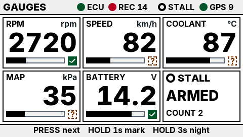 | 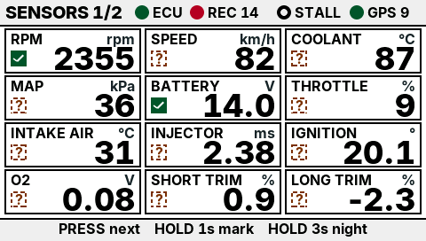 |
| Five big values (RPM, speed, coolant, MAP, battery) and the stall catcher | Every channel, 12 to a page (3 x 4). More channels, more pages |

| GPS trip | Map |
|---|---|
| 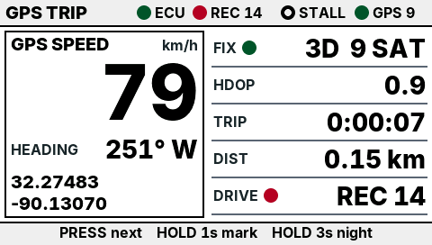 | 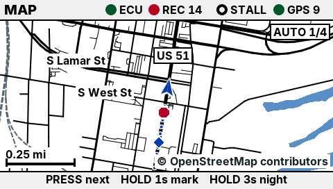 |
| Speed, heading, position, fix and satellites, HDOP, trip time and distance, drive number | Offline road map centred on the car, the drive's trail, stall and marker pins ([below](#the-map-screen)) |

| Link | |
|---|---|
| 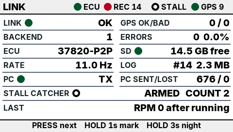 | |
| Link state, backend, ECU id, read rate, GPS OK/BAD, errors, SD card, log size, stall catcher, last stall | |

Night theme:

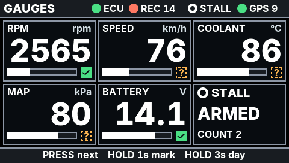

The order is Gauges, the Sensors pages, GPS trip, Map, Link, and round again.

Things to know:

- The handheld shows metric units (km/h, km, °C). It has no units setting.
- An unverified channel is marked, as on the laptop.
- On the Link screen, **BACKEND** is a number: 0 is the KKL cable on USB
  host, 1 is the L9637D on the UART.
- The link states are `OFF`, `CONNECTING`, `OK`, `ISO ONLY`, `ERROR`.

### The Map screen

| Downtown, 25 km/h (1/4) | I-55, 70 mph (4/4) |
|---|---|
|  | 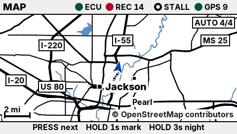 |
| 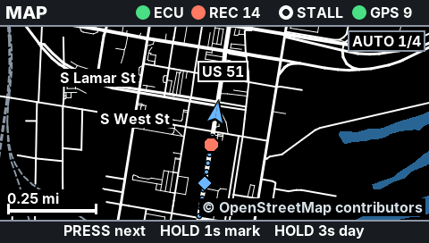 | 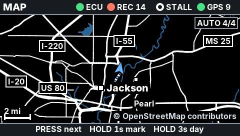 |

North is up and the car is in the middle. Roads are black on white (white on
black at night), wider and heavier the bigger the road; interstates have a
light centre line at the closer zooms. Water is blue, railways are dashed
grey lines, a fuel station is a small pump.

| On the map | Means |
|---|---|
| Blue arrow | The car, moving, pointing where it is going |
| Blue dot | The car, stopped (under 5 km/h) |
| Hollow square | No GPS fix: the last position known |
| Blue crumbs | This drive's trail (the last 12.8 km) |
| Red octagon | A stall caught on this drive, where it happened |
| Blue diamond | A MARK on this drive |
| Boxed `I-55`, `US 51` | Route numbers, on the road |
| Plain names | Street names (closest zoom), towns and cities |

The trail and the pins start again with each drive.

**Zoom** follows the speed: 1/4 below 30 km/h (a screen is 1.9 km across),
2/4 from 30 (4.8 km), 3/4 from 60 (12 km), 4/4 from 90 km/h (29 km). It
goes out after 2 s at a higher speed and back in after 6 s at a lower one,
so a red light on the highway does not zoom in. The chip in the corner reads
`AUTO 2/4`. With the optional second button, a short press on the Map
screen steps the zoom: `FIXED 1/4` ... `FIXED 4/4`, then `AUTO` again; on
this screen *holding* it 1 s steps back a screen.

The scale bar (bottom left) is in miles.

**No GPS fix.** A black band across the top says `NO GPS FIX`, the car is a
hollow square, and the map stays at the last fix. After a power-up without a
fix yet, it shows the position kept from the last drive (kept in the
handheld's own memory when a drive ends), or Jackson if there has never been
a fix.

| No fix | No map on the card |
|---|---|
| 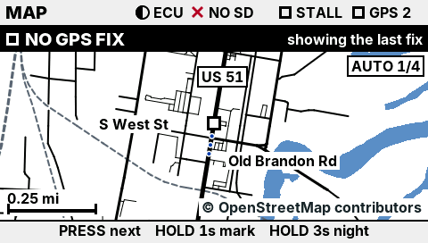 | 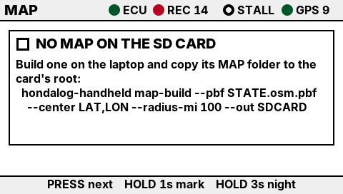 |

**No map.** Without `MAP/` on the card the screen says so and gives the
`map-build` command. Past the map's edge a band says `OUTSIDE THE MAP`.

**Speed.** The map is drawn off to the side, by a low-priority task on the
core the data side uses, from tiles cached in the handheld's PSRAM: the
screen never waits for the card. A new picture is drawn only when the car
has moved 24 pixels from the middle of the last one (every 15 s or so in
town, much less often on the highway), when the zoom or the theme changes,
or when a pin is added. In between only the car moves.

### The GPS OK/BAD counter

On the Link screen, `GPS OK/BAD` shows two counts since power-on: GPS
sentences that passed their checksum, and sentences that failed.

| Reads | Means |
|---|---|
| OK climbing by a few every second, BAD at 0 | The GPS is wired right and heard cleanly |
| Both 0 | Nothing is arriving: wiring, power, wrong header, or the wrong build for where the GPS is plugged in |
| BAD climbing | Bytes arrive damaged. On P1 that is the CH340 fighting the GPS for the line; otherwise a loose wire or the wrong baud rate |

A clean count with "NO" fix on the GPS screen is normal indoors: the module
is talking but cannot see the sky.

## Controls

**One button: BOOT.**

| Press | Does |
|---|---|
| Short (under 1 s) | Next screen |
| Hold 1 s, then release | **MARK**: tags this moment in the log |
| Hold 3 s | Acknowledge the alarm if one is blinking; otherwise switch Day / Night |
| Any press | Dismisses the stall-captured screen |

The hint strip shows which gesture is armed as you hold: `HOLD FOR MARK`,
then `RELEASE = MARK   KEEP HOLDING = NIGHT`.

| Held 0.6 s | Held 1.8 s |
|---|---|
| 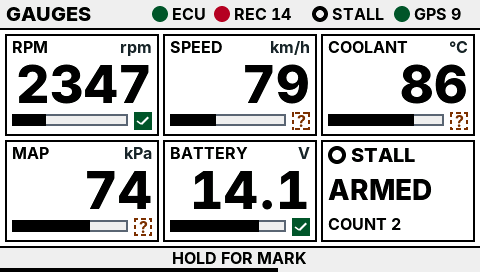 | 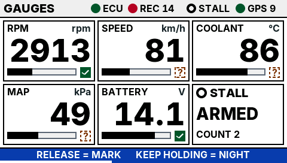 |

The mark is placed at the moment the button went down, not when it was
released.

**Do not hold BOOT while the board powers up.** It is the chip's boot-mode
pin: held at reset, the board enters the flashing mode and the screen stays
dark. Power-cycle to recover.

**Optional second button** (only in the `--gps-p1` build; in the normal build GPIO17 is the GPS PPS input): a momentary switch from GPIO17 (P3 pin 1) to
GND. A short press steps *back* a screen. On the Map screen a short press
steps the zoom instead, and a 1 s hold steps back.

## Stalls, alarms and marks

The handheld runs the same two stall rules as the laptop: once RPM has been
above 400, a stall is RPM below 50, or no reply from the ECU for 1 second.

| Stall captured | Afterwards |
|---|---|
| 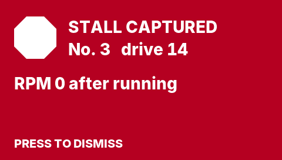 | 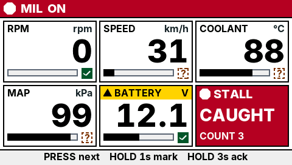 |

At a stall it writes the last 30 seconds from memory to
`CAPTURES/Cnnnnnn.HHD` at once, then carries on for 10 more. The drive file
holds the same data; the capture is a second copy in case the drive file is
lost, and a small file to hand to someone.

Alarms are the `[[alarm]]` rules of your map (the ones without history). A
warning or alarm replaces the top bar with a banner:

| Warning | Alarm |
|---|---|
| 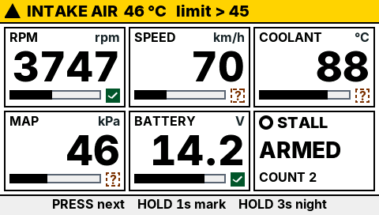 | 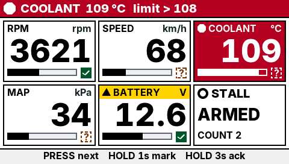 |

When the ECU stops answering:

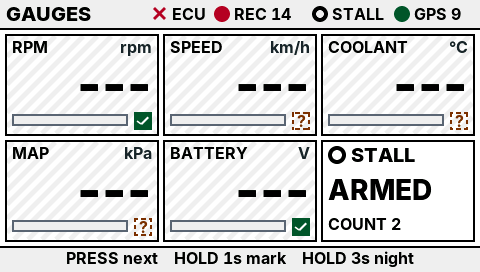

If Honda reads stay unanswered for `iso_after_s` seconds, the handheld tries
standard OBD2 (ISO 9141-2) instead and logs PIDs. The link then reads
`ISO ONLY`.

## Deep sleep

When a drive has ended (the ECU silent for `drive_gap_s`, 120 s) and a
further `sleep_after_s` (300 s) has passed, the handheld closes its files,
turns the screen off and goes into deep sleep. So by default it sleeps
about seven minutes after key-off.

Asleep, it wakes every `sleep_probe_s` (20 s), asks the ECU for about
5 seconds without lighting the screen, and goes back to sleep if nothing
answers. Turn the key on and it is up within that time. Pressing BOOT wakes
it at once.

| Power | Set `sleep_after_s` to |
|---|---|
| Car charger in a socket that is switched with the key (option 1) | Anything. Power is cut at key-off anyway. 0 (never sleep) is fine |
| OBD2 pin 16, always live (option 2) | 300 or less. **Never 0**: awake, the board draws enough to flatten the battery in days |

Current drawn asleep and awake is **[unverified]**.

## What a power cut costs

With the charger in a switched socket, the board loses power with no
warning at every key-off. The log format is built for that:

- Files are append-only; nothing already written is ever changed.
- A block is closed every 250 ms and each has its own checksum.
- The card is synced every second, and at once after a mark, an alarm or a
  stall.
- Space for a drive is taken in advance (16 MB), so logging does not touch
  the card's file tables.

A power cut therefore costs at most the last second. A drive file with no
end marker is normal and reads fine; `hondalog-handheld info` says "no end
marker (power was cut)". Whether a particular card survives twenty key-offs
in a row is bring-up step 14 and **[unverified]**.

Format details: [FORMAT.md](../firmware/handheld/FORMAT.md).

## Importing drives

Put the card in the laptop:

```sh
hondalog-handheld import /media/you/CARD
```

Every drive on the card becomes a drive in `~/hondalog/hondalog.db`, the
same as a laptop recording: the raw bytes of every read, the decoded
values, a `gps` stream, markers, alarms, and stall captures. Open them in
Replay or query them with SQL ([Data and SQL](data-and-sql.md)).

- **Importing the same card twice adds nothing.** A drive is recognised by
  the identity its file carries. `--force` imports again anyway.
- **The map is found by its hash.** The handheld stores the hash of the map
  it ran; the importer looks for a map with that hash in the card's own
  `HANDHELD.MAP` (it carries the full text), then in the database, then
  your map, then the shipped one. `--map FILE` names it; `--other-map` decodes with
  a map whose hash differs.
- A capture file is imported only if the drive it was cut from is missing.
- `--db FILE` imports into another database. One `.HHD` file can be given
  instead of the card.
- A drive that started before the first GPS fix takes its date and time
  from the first fix. With no fix at all, the time is unknown: the handheld
  has no battery clock.

Because the raw bytes are kept, `hondalog-log redecode` works on imported
handheld drives.

```sh
hondalog-handheld info /media/you/CARD/DRIVES/D000001.HHD
```

prints one drive's summary: when, how long, which map, how many reads, GPS
fixes and events, damaged or missing blocks, and how it ended.

The card is not cleared by the import. Delete old `DRIVES/` files yourself
when it fills.

## Debugging it over the USB cable

`tools/cyd_debug.py` watches the handheld over its USB-C serial link. It is a
single file that needs only Python 3 and pyserial, so it runs on Windows with
PlatformIO's Python as well as on Linux; no hondalog install is needed.

```sh
python tools/cyd_debug.py /dev/ttyUSB0            # Linux; COM17 etc. on Windows
python tools/cyd_debug.py COM17 --gps             # GPS fixes, counters and diagnostics only
python tools/cyd_debug.py COM17 --reset --seconds 15   # reset the board and watch it boot
```

Every 2 s the firmware logs a `gps diag` line: whether the GPS reader is
running, its UART and pin, bytes received, how many times the RX pin was
pulled low on the data pin and on the PPS pin (hardware pulse counters,
independent of the UART), PPS rising edges as time-stamped by an ISR, the sentence
counts and the last bytes received. **Falling edges 0** means nothing ever
pulls the line low: the GPS has no power, its TX goes to another pin, or
something else holds the line high.

## Turning the picture upside down

If the board is mounted the other way up, set `rotate = 180` in
`HANDHELD.CFG` on the SD card (it is commented out in the file
`export-map` writes; uncomment it). Without a card or the line, the firmware's
built-in default is used: 0, or 180 for a build made with
`-DHH_ROTATE_DEFAULT=180`. The panel cannot flip itself, so the firmware reads
each frame backwards while sending it to the glass; if rotated mode shows
flicker or a sideways shift that the normal mode does not, report it.

## Talking to the laptop over serial

Plug the CYD's USB-C into the laptop. The handheld streams every ECU read,
GPS fix, alarm, marker and stall over its USB serial (CH340, 921600 baud,
falling back to 460800 and 115200). The laptop decodes the reads with its own
address map and records them as a normal drive (source `cyd`). The full
protocol is in [firmware/handheld/SERIAL.md](../firmware/handheld/SERIAL.md).

| | normal build (GPS on GPIO18) | `--gps-p1` build (GPS on P1) |
|---|---|---|
| Live stream, GPS, alarms, stalls | yes | yes |
| Commands, file sync, push map, set time | yes | no (one-way) |

In the app, pick **CYD (serial)** in the connection menu, or run it from a
terminal:

```sh
hondalog --port cyd: --connect          # finds /dev/hondalog-cyd or any CH340
hondalog-log record --port cyd:         # record without the GUI
hondalog-handheld status                # what the CYD reports
hondalog-handheld sync                  # two-way only: copy SD drives into the database (resumable)
hondalog-handheld push-map              # two-way only: send your address map
hondalog-handheld set-time              # two-way only: set the CYD's clock from the laptop
hondalog-cydsim --variant p1            # simulator, for trying it without hardware
```

The Link screen on the CYD shows the link state: `PC` (laptop answering),
`NO PC`, `TX` (one-way, streaming) or `OFF`, plus frames sent and lost. If the
app warns that the map hash differs, run `hondalog-handheld push-map` (two-way)
or re-run `hondalog-handheld export-map` onto the card.

Not yet verified on the real board: the CH340 at 921600, and whether the GPS
still reads cleanly on P1 while a laptop is plugged in (watch GPS OK/BAD).

Wi-Fi access-point mode is a possible later transport. Running the radio can
glitch the display, so it may end up as a download mode rather than something
that runs while driving.

## Troubleshooting

**Red and blue are swapped** (the alarm colour looks blue). The public pin lists for this board disagree about which pin group
is red and which is blue. Rebuild with the swap switched on, by adding
`-DHH_LCD_SWAP_RB=1` to the build flags: in
`firmware/handheld/platformio.ini`, under `[env:esp32s3]`, add

```ini
build_flags = -DHH_LCD_SWAP_RB=1
```

(the `esp32s3-gps-p1` environment has its own `build_flags` line: append
` -DHH_LCD_SWAP_RB=1` to it). For an ESP-IDF build (`HH_IDF_ENV`), set
`#define HH_LCD_SWAP_RB 1` in `firmware/handheld/main/port/port_esp32.c`
instead. Then build and flash again.

**The picture tears, drifts or flickers.** The panel timing in
`firmware/handheld/include/board_pins.h` follows one source; others differ.
Try the alternative sync values listed beside each `HH_LCD_*` line there
(pulse widths 1 instead of 4, front porches 1 and 3 instead of 8), then the
12 MHz pixel clock. The hardware page has the
[comparison table](../firmware/handheld/HARDWARE.md#panel-timing). To
measure rather than guess, build the `esp32s3-perf` environment, which
overlays frame rate and render time.

**The backlight flickers or whines.** `HH_BL_PWM_HZ` in `board_pins.h` is a
first guess (1 kHz). Try 5 kHz, then 200 Hz.

**The screen stays dark after power-up.** BOOT was held (or is stuck) at
reset: the chip is in flashing mode. Release it and power-cycle.

**No GPS.**

1. Link screen, `GPS OK/BAD`. Both 0: nothing arrives.
2. Is the build right for where the GPS is? On P1 it needs `--gps-p1`; on
   P3 pin 2 (or P4) it needs the normal build.
3. Is `gps_baud = 9600` in `HANDHELD.CFG` (not 0)?
4. Is the module powered? Most have an LED that blinks once it has a fix.
5. BAD climbing on P1: the CH340 is winning. Move the GPS to P3 pin 2.
6. OK climbing but no fix: it needs sky. Give it a few minutes outdoors,
   antenna up, away from the display's ribbon cable.
7. If it never gets a fix on 3.3 V, feed the module from 5 V.

**Link stays CONNECTING or ERROR** (option 1).

1. R3 and R4: measured? USB cannot enumerate with them fitted.
2. Is the KKL cable in the car, key ON? Its K-line side is powered from the
   car.
3. D- and D+ swapped: white is D-, green is D+.
4. Is 5 V really on the socket's red wire?
5. Does the same cable work on the laptop?

**`NO SD` / `NO CARD`.** FAT32, 32 GB or smaller, pushed fully in. Live data
still works without a card; nothing is logged.

**The Map screen says `NO MAP ON THE SD CARD`.** The `MAP` folder must be in
the root of the card, holding `MAP.IDX` and `MAP.DAT` (not `MAP/MAP/...`, and
not renamed). `hondalog-handheld info /media/you/CARD` checks it on the
laptop. `THE MAP CANNOT BE READ` names what is wrong; build it again.
The handheld looks for the card's map when it starts: restart after copying.

**The laptop says a drive's map is unknown on import.** The card's
`HANDHELD.MAP` is gone or was replaced. Give the map the drive was recorded
with: `hondalog-handheld import CARD --map that-map.toml`.

**Flashing fails or crashes on Windows.** See the notes under
[Flashing from Windows](#flashing-from-windows): `PYTHONUTF8=1`, the BOOT
button, the esptool 4 or 5 spelling.
