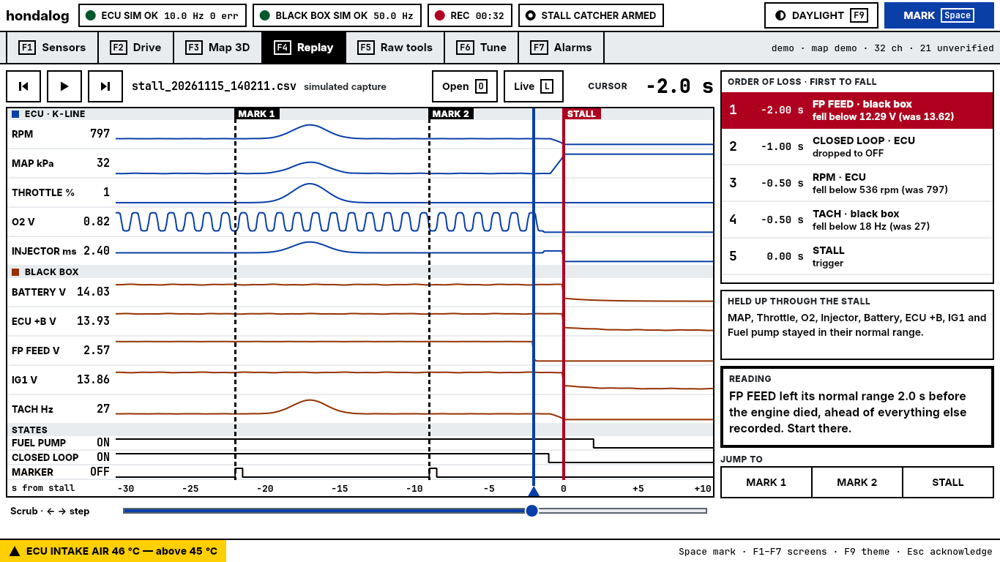

# Stall hunting

The car dies at random while driving. The usual forum fixes have been tried.
This page is the method for finding out what actually goes first, using two
records of the same moment: what the ECU reported over the K-line, and what
the black box measured on the wires.

**Status.** The method, the trigger rules and the verdict logic are all
tested against simulated faults. No real stall has been captured yet, and
the black box has not been built. Wire colours, pins and thresholds are
**[unverified]**; the list is at the end of
[the black box hardware page](../firmware/blackbox/HARDWARE.md#not-verified).

- [The idea](#the-idea)
- [Stage 1: the laptop alone](#stage-1-the-laptop-alone)
- [Stage 2: the black box](#stage-2-the-black-box)
- [What each signature means](#what-each-signature-means)
- [hondalog-bb: fetching and reading captures](#hondalog-bb-fetching-and-reading-captures)
- [Reading a capture in Replay](#reading-a-capture-in-replay)
- [Combining the two timelines](#combining-the-two-timelines)
- [After several stalls](#after-several-stalls)
- [Try it with no hardware](#try-it-with-no-hardware)

## The idea

An engine needs power to the ECU, fuel pressure, and spark. On this car
those run through a short list of parts:

| Suspect | Feeds |
|---|---|
| PGM-FI main relay, ECU half | ECU +B: the ECU's own power |
| PGM-FI main relay, pump half | the fuel pump |
| Ignition switch | IG1: everything switched by the key |
| Igniter (ICM) and coil, in the distributor | spark |
| ECU, or its crank / cam sensors | the commands for fuel and spark |
| Battery terminals, main fuse, grounds | everything |

When the engine dies, all of them go quiet within a second. **The one that
went quiet first is the cause; the rest are consequences.** So the whole job
is to record the order, with enough time resolution to tell.

## Stage 1: the laptop alone

Do this from the first day the cable works. It costs nothing.

1. Connect and let it record every drive
   ([User guide](user-guide.md#recording-and-drives)).
2. When the car stumbles without dying, press **Space**.
3. When it dies, the stall catcher saves a capture by itself: 30 seconds
   before, 10 after. A red banner appears. Leave the laptop running, restart
   the car, carry on.

What the K-line can tell you:

| The ECU log shows | Means |
|---|---|
| **The ECU went silent** while RPM was still normal (capture reason `link`, message "link lost") | The ECU lost power or the K-line. Points at ECU +B: the main relay, the ignition switch, or wiring |
| **RPM fell to 0 and the ECU kept answering** (reason `rpm`) | The ECU stayed powered. Points at fuel or spark: the pump half of the relay, the igniter, or the ECU's inputs |
| Battery voltage sagging in the seconds before | Charging, battery, or a bad connection |
| Fuel trims climbing and O2 going lean before it dies | Fuel starvation |
| Nothing unusual at all until the last read | The fault is faster than the K-line can see |

That first split, silent or still answering, already halves the suspects.

What it cannot tell you:

- The slow channels (battery, temperatures) are read about once a second.
  The fast ones about 17 times a second. A dropout of 5 ms is invisible.
- When the ECU loses power it just stops answering. The log shows *that*,
  not *why*.
- Every address is still a guess until verified
  ([Mapping the P2P](mapping-the-p2p.md)). At least verify RPM and battery
  before drawing conclusions from them.

Turning the key off with the engine running looks exactly like the first
row. Dismiss those with Esc and, if you like, delete the capture.

## Stage 2: the black box

The black box watches the wires directly, 1000 samples a second (5000 for
the lowest and highest reading inside each millisecond), with no laptop
needed.

### Its channels

| Channel | In the data | Measures | Why |
|---|---|---|---|
| Battery | `bb_vbat` | Constant battery voltage at the box | Did the whole car lose power? |
| ECU +B | `bb_ecub` | The main relay's output to the ECU (ECU pin B1) | Did the ECU lose its feed? |
| Fuel pump feed | `bb_pump` | The main relay's output to the pump | Did the pump lose its feed? |
| IG1 | `bb_ig1` | Ignition-switched power | Did the switch drop? |
| Tach | `bb_rpm_tach` | Pulses on the tach line (ECU A19) | Was the coil still being switched? |
| Ignition trigger | `bb_rpm_ign` | The ECU's command to the igniter (ECU B13) | Was the ECU still asking for spark? |
| Injector | `bb_inj_pw`, `bb_inj_duty` | One injector's pulses (ECU B11) | Was the ECU still fuelling? |
| Marker button | `bb_button` | A button you press | "It just did it" |

For each rail a capture also has `..._min` and `..._max`: the lowest and
highest of the five readings in each millisecond. A 1 ms dropout barely
moves the mean but takes `bb_ecub_min` to zero. There is an optional fifth
analog input (`bb_alt`), for the alternator or, more usefully, the ECU's
pump control line.

### What triggers a capture

Each rule fires once, then has to re-arm. Defaults:

| Reason | Fires when |
|---|---|
| `tach_stop` | No tach pulse for 250 ms with IG1 on, after the engine was running |
| `ign_stop` | No ignition trigger pulse for 250 ms with IG1 on |
| `ig1_drop` | IG1 below 6 V for 10 ms while running |
| `ecub_drop` | ECU +B below 6 V for 10 ms with IG1 on |
| `ecub_glitch` | ECU +B falling faster than 3 V per ms while running |
| `pump_drop` | Pump feed below 6 V for 20 ms while running |
| `vbat_dip` | Battery below 9 V for 20 ms while running |
| `button` | The marker button held 30 ms |
| `host` | The laptop asked (its own stall catcher fired) |
| `brownout` | Battery at the box below 6.5 V for 3 ms: the box is about to lose power itself |

`inj_stop` (no injector pulse for 2 s while the tach keeps going) only marks
an event, because that is also what normal overrun fuel cut looks like. The
rules are lines in `BLACKBOX.CFG` on the card and can be changed:
[file format](../firmware/blackbox/FORMAT.md#rules).

A capture is 30 s before and 10 s after, about 1 MB, written newest data
first so that if the box itself loses power the stretch nearest the stall is
already on the card.

## What each signature means

The verdict is a fixed table of electrical facts about this car, not
statistics. `hondalog-bb info` and Replay both apply it.

| What went first | Verdict | Suspect |
|---|---|---|
| **ECU +B fell**, IG1 and battery stayed up | "ECU +B dropped while IG1 and battery stayed up" | The **PGM-FI main relay** (cracked solder joints are the classic fault), then its connector and the ECU power wiring |
| **Tach stopped**, ignition trigger kept pulsing | "Tach stopped while the ECU kept sending ignition pulses" | The **igniter (ICM)** or the coil in the distributor, or their wiring. The ECU was powered and still commanding spark |
| **Pump feed fell**, the engine died a moment later | "Fuel pump feed dropped, the engine died after it" | The **pump half of the main relay**, or the ECU's pump control line. The engine runs on briefly, then starves |
| **Ignition trigger and tach stopped together**, ECU +B stayed up | "Ignition trigger and tach stopped together, ECU still powered" | The **ECU** itself, or it lost its crank / cam signals (CKP / TDC / CYP sensors in the distributor). The K-line log shows whether the ECU kept answering |
| **IG1 fell** before ECU +B | "IG1 dropped first" | The key was turned off, or the **ignition switch** or its wiring lost contact. If you did not touch the key, suspect the switch |
| **Battery fell** before or with everything else | "Battery supply dropped first" | **Battery terminals, main fuse, engine and body grounds** |
| Injector pulses stopped well before the ignition did | "Injector pulses stopped before the ignition did" (low confidence) | The ECU stopped fuelling. On the overrun that is normal |
| Nothing fits | "No clear order" | Read the timeline by hand |

Each verdict comes with a confidence (high, medium, low) and the timeline
it was read from.

Two refinements:

- **Main relay or ECU asking?** The pump half of the relay is switched by
  the ECU grounding a control wire (ECU pin A16). If that wire is on the
  spare analog input, a capture distinguishes "the ECU stopped asking for
  the pump" (A16 rises to 12 V) from "the relay dropped out although asked"
  (A16 stays low, pump feed falls).
- **A glitch is evidence too.** "ecub dipped below 6 V and came back
  (2 times)" before the final drop is an intermittent contact announcing
  itself. The verdict lists these as notes.

## hondalog-bb: fetching and reading captures

The box is a USB serial device (`/dev/hondalog-bb` with the udev rule).
Every subcommand that talks to it takes `--port`.

| Command | Does |
|---|---|
| `hondalog-bb live [--seconds N]` | Print the live values and events |
| `hondalog-bb list` | The captures on the SD card: number, size, reason |
| `hondalog-bb fetch [NUMBERS...] [--dest DIR]` | Download captures over USB. Default: all listed, into `~/hondalog/logs/` |
| `hondalog-bb info FILE...` | A capture's events, the order things fell in, and the verdict |
| `hondalog-bb csv FILE [-o OUT]` | A capture as CSV |
| `hondalog-bb config [--set KEY=VALUE] [--save]` | Show or change settings; `--save` writes them to the card |
| `hondalog-bb selftest` | Run the box's self-test |
| `hondalog-bb cal RAIL --low METER SHOWN --high METER SHOWN` | Work out scale and offset from two meter readings (`RAIL`: `vbat`, `ecub`, `pump`, `ig1`, `alt`) |
| `hondalog-bb sim` | The simulator, same as `hondalog-bbsim` |

After a stall, with the laptop on the box's USB:

```sh
hondalog-bb list
hondalog-bb fetch
hondalog-bb info ~/hondalog/logs/bb_*_EV000001.bbx
```

Fetched files are named `bb_DATE_TIME_EVnnnnnn.bbx`. You can also take the
card out and copy `EVENTS/EVnnnnnn.BBX` by hand.

`info` on a simulated main relay failure:

```
bb_20261115_215639_EV000001.bbx: event 1, ecub_glitch (ECU +B fell faster than the set slope)
  box SIM fw sim; 17601 ms of data, 710 edges, complete
  trigger at 2026-11-15T21:56:39.785
     -7292.0 ms  ig1_on       value 12336
     -4913.0 ms  running      value 751
        +0.0 ms  ecub_glitch  value -11648
      +250.0 ms  ecub_glitch  value -11660
      +408.0 ms  ecub_drop    value 0
      +418.0 ms  pump_drop    value 0
      +623.0 ms  tach_stop    value 251
      +623.0 ms  ign_stop     value 251

ECU +B dropped while IG1 and battery stayed up  (confidence: high)
The ECU lost its power feed with the ignition still on. That feed comes through the PGM-FI
main relay: suspect the relay (cracked solder joints), then its connector and the ECU power wiring.

       +0.0 ms  ecub      dipped below 6 V and came back (2 times)
     +400.0 ms  ecub      fell below 6 V
     +400.0 ms  pump      fell below 6 V
     +406.3 ms  ign       first missing pulse
     +407.8 ms  inj       first missing pulse
note: ecub dropped out briefly +0.0 ms: an intermittent contact
```

Read it in two parts. The first list is what the box's own rules flagged,
relative to the trigger. The second is the order of loss worked out from the
samples: ECU +B glitched twice, fell for good at +400 ms, and the pulses
stopped 6 ms later. "complete" means the whole capture reached the card; an
incomplete one is still readable and says how many milliseconds it holds.

"first missing pulse" is an estimate good to a fraction of a pulse period.
A rail falling is exact to the millisecond.

## Reading a capture in Replay

Open the capture: press Enter on the stall banner, or F4, O and pick it. A
`.bbx` file opens the same way (`hondalog --open FILE.bbx`).



1. **Read the "Reading" card first.** One sentence: what left its normal
   range first and how long before the engine died. With a black box capture
   the box's verdict leads.
2. **Check it against "Order of loss".** Each row is a signal, when it left
   its normal range relative to the trigger, and how (fell below, rose
   above, dropped to OFF). Click a row to put the cursor there.
3. **Look at the lanes at that moment.** Zoom with `+`. Is it a clean step,
   or did it flicker first?
4. **Read "Held up through the stall".** What stayed normal is as useful as
   what fell: if battery and IG1 held while ECU +B fell, the fault is
   between them.
5. **Step through with `[` and `]`**: markers, trigger firings, alarms and
   each loss in order.
6. **Drop a second cursor** (D) on the first loss and move the first to the
   stall. The header shows the time between them.

How the order of loss is computed: for each channel, its normal band is
what it did in the first two thirds of the 30 seconds before the trigger,
widened by 8 % of its range. The first time it leaves that band and stays
out for 0.2 s is its row. Changes in the last 0.15 s before the trigger are
ignored: those are effects of the stall, not causes.

That means a slow drift (coolant creeping up, battery sagging over a
minute) will not show in this card. Look at the lanes for those.

## Combining the two timelines

The ECU log counts seconds since the app connected; the box counts
microseconds since it booted. They are put on one axis in one of three
ways, best first:

| Method | When | Good to |
|---|---|---|
| Clock | The laptop was on the box's USB: it sets the box's clock about once a second | a few milliseconds |
| Markers | A mark pressed in the app goes to both with the same number | about ±50 ms |
| RPM | Matching the box's tach RPM against the ECU's RPM | about ±100 ms |

**With the laptop plugged into the box while driving** there is nothing to
do: the box's live frames are recorded into the drive on the ECU's clock,
MARK goes to both, and a trigger on either side saves both. The capture in
Replay already shows ECU lanes and black box lanes together.

**With the box alone in the car**, fetch the capture later and open the
`.bbx`. If a drive was being recorded at that time it is found and merged;
otherwise the capture opens by itself.

What the combination adds:

| Black box says | ECU log says | Conclusion |
|---|---|---|
| ECU +B fell | ECU went silent at the same moment | Consistent: the ECU lost power. Main relay side |
| Pulses stopped, ECU +B up | ECU kept answering, RPM fell to 0 | The ECU was alive and saw the engine stop. Igniter, or crank / cam sensors |
| Pulses stopped, ECU +B up | ECU went silent | The ECU stopped working with power applied: the ECU itself, or its ground |
| Pump feed fell | Trims rose and O2 went lean for a second, then RPM fell | Fuel starvation confirmed from both sides |
| Nothing fell before the tach stopped | Nothing unusual | Mechanical, or a signal neither records |

Remember the ECU's limit: a K-line value was read up to a second before
its row for the slow channels. For ordering events, trust the box.

## After several stalls

One capture is an anecdote. Three that agree are a diagnosis.

- **Compare two stalls** in Replay: open one, press C, pick the other. Two
  stall captures are lined up on the stall. Same order of loss both times?
- **Map 3D, "Stall paths"** (F3, then V twice) draws the last 30 seconds
  before each saved stall across the RPM x MAP map. Always at idle? Always
  on the overrun? Always under load?
- **SQL** across every stall: [examples](data-and-sql.md#examples). When did
  they happen, what was the coolant temperature, how long had the engine
  been running? A fault that only appears warm, twenty minutes in, is a
  different part from one that appears over bumps.
- **Marks** that did not end in a stall are the near misses. Search them
  with `hondalog-log list -q`.

Then fix one thing and keep recording. No stalls for a month with the box
still armed is the proof.

## Try it with no hardware

The black box simulator behaves like the box, including faults:

```sh
hondalog-bbsim --fault main_relay --fault-after 15     # terminal 1
```

```sh
hondalog-bb live --port /tmp/hondalog-bbsim            # terminal 2: watch it happen
hondalog-bb list --port /tmp/hondalog-bbsim            # wait about 15 s after the fault
hondalog-bb fetch --port /tmp/hondalog-bbsim
hondalog-bb info ~/hondalog/logs/bb_*_EV000001.bbx
```

`--fault` is one of `main_relay`, `igniter`, `fuel_pump`, `key_off`,
`battery`. Keys in the simulator's terminal inject them by hand: `m` main
relay, `i` igniter, `f` fuel pump, `k` key off, `b` battery dip, `r`
restart, Space the marker button, `q` quit.

The whole path with both simulators, no window:

```sh
hondalog-log record --port sim: --bb bbsim:main_relay@14 --seconds 45
hondalog-log list
```

`bbsim:main_relay@14` is the built-in box with that fault after 14 seconds.
The result is a drive with a stall capture; open it with
`hondalog --open stall_...` and read the cards.

In the app, `hondalog --port sim: --connect` attaches a healthy simulated
box automatically.
