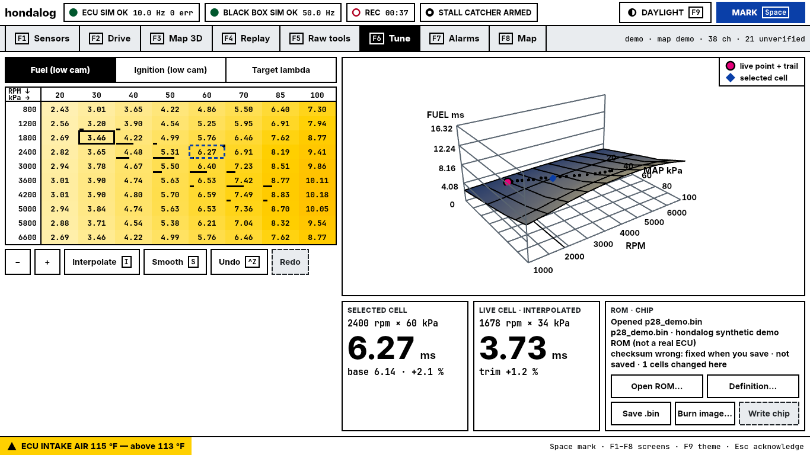

# Tuning a P28 (Track C)

The stock P2P ECU cannot be retuned with hondalog: its program is not in a
socketed chip, and hondalog only ever *reads* it. Track C is the usual
D-series route instead: run the engine on an older OBD1 **P28** ECU whose
program lives on a chip you can replace, and edit that program's fuel and
ignition tables.

**Status: file tools only.** Everything on this page works on ROM *files*
and has been tested on a synthetic ROM. No real P28 ROM, no real
definition, no chip burner and no emulator has been tried. Nothing here has
run an engine. Read [Safety](#safety) before burning anything.

- [The swap path](#the-swap-path)
- [Parts](#parts)
- [Definitions, and why no P28 definition ships](#definitions-and-why-no-p28-definition-ships)
- [hondalog-tune](#hondalog-tune)
- [The Tune screen](#the-tune-screen)
- [Checksums](#checksums)
- [Burning a chip](#burning-a-chip)
- [The Ostrich emulator](#the-ostrich-emulator)
- [Auto-tune from a wideband](#auto-tune-from-a-wideband)
- [Safety](#safety)
- [Not verified](#not-verified)

## The swap path

In outline. This part is general Honda practice, not something this project
has done; check each step against a current guide for your exact car.

1. **Get a P28** (the 1992-95 Civic Si / EX ECU, D16Z6 VTEC) and have it
   **chipped**: a socket, a latch and a few small parts are soldered in so
   it runs from a removable EPROM instead of its internal program.
2. **Fit an OBD2B-to-OBD1 conversion harness** between the car's ECU plugs
   and the P28. The car's wiring stays as it is.
3. **Put a base program on a chip** and confirm the car starts and runs as
   before.
4. **Log.** The P28 does not speak the P2P's K-line protocol. Its data comes
   from a datalogging header on the board, with a different protocol.
   **hondalog does not have that link yet**: on a P28 today it edits ROM
   files and nothing else. The address map already has a `P28` variant as a
   placeholder for it.
5. **Tune**: edit tables, burn, drive, log, repeat. A wideband oxygen sensor
   is what makes fuel tuning measurable.

Consequences to weigh first:

- The OBD2 diagnostic socket no longer answers a scan tool. Where an
  emissions inspection reads OBD2 readiness, the car cannot pass with the
  P28 in.
- Keep the P2P. Swapping it back is two plugs.
- None of this is needed for the stall hunt. Find the stall first.

## Parts

Rough guide. Prices vary too much to quote.

| Part | For |
|---|---|
| P28 ECU, chipped (or a chip kit: 28-pin socket, 74HC373 latch, capacitors, resistor) | The tunable ECU |
| OBD2B-to-OBD1 conversion (jumper) harness | Plugging it into a 1999-2000 car |
| SST27SF512 EEPROMs, a few | The chips. 64 KB, electrically erasable, the type the tools here assume |
| TL866II+ or T48 programmer | Burning them; driven by the open-source `minipro` tool |
| Wideband oxygen sensor and controller | Knowing the real air/fuel ratio |
| Moates Ostrich 2.0 (optional) | An EPROM emulator: change tables with the engine running instead of burning a chip each time |

On the laptop:

```sh
sudo apt install minipro        # if your Debian has it; otherwise build it from its source
```

`hondalog-tune burn` looks for `minipro` on the PATH (`--minipro PATH` or
the `HONDALOG_MINIPRO` variable names another).

## Definitions, and why no P28 definition ships

A ROM file is 32 KB of bytes. A **definition** says where the tables are in
it: "the fuel table is 8 by 10 cells at this address, stored like this,
with these axes". Without one a ROM is unreadable.

hondalog reads two kinds:

| Kind | Is |
|---|---|
| TunerPro `.xdf` | The common community format (XML). Tables, axes, scalars, flags, patches |
| hondalog `.toml` | The native format. Also holds what XDF cannot: checksum rules, signature bytes, verification notes |

`hondalog-tune convert` goes either way.

**No P28 definition ships with hondalog, on purpose.** Three reasons:

1. **The addresses depend on the base ROM.** A stock P28 program and the
   rewritten bases the community tunes (the Crome family) put their tables
   in different places. A definition is only right for the exact base it
   was made for.
2. **None could be checked.** No real P28 ROM and no trustworthy definition
   for one were available when the tools were written. The XDF reader was
   checked against public BMW definitions, because no Honda ones could be
   fetched.
3. **A wrong definition is worse than none.** It would show plausible
   tables, let you edit them, and write your changes over whatever really
   lives at those addresses. On an engine that means a lean or over-advanced
   cell you never saw.

What ships instead is **`demo`**: an invented layout with a matching
made-up ROM, for learning the tools. It is not a P28. **Never burn an image
made with it.**

To tune a real P28 you need: the ROM you will actually run (read from your
chip, or the base your chip was burned from) and a definition written for
that base, from a source you trust. Then verify it before believing it:

- Does `hondalog-tune info` report the checksum as correct?
- Do the tables look like fuel and ignition tables (smooth, rising with
  load)? Garbage means a wrong definition.
- Change one cell, save, and `hondalog-tune diff` the two files: only that
  cell's bytes (and the checksum) should differ.

The native format is documented by example in
`hondalog/tuning/data/demo.toml`.

## hondalog-tune

```sh
hondalog-tune demo-rom demo.bin                 # a made-up ROM to practise on
hondalog-tune info demo.bin -d demo             # size, layout, hash, checksum
hondalog-tune list -d demo                      # tables, scalars, flags in a definition
hondalog-tune show demo.bin -d demo fuel        # print one table
hondalog-tune diff stock.bin tuned.bin -d p28.toml
hondalog-tune convert p28.xdf p28.toml          # XDF <-> native
hondalog-tune checksum tuned.bin -d p28.toml --fix fixed.bin
hondalog-tune burn-image tuned.bin -d p28.toml chip.bin
hondalog-tune burn tuned.bin -d p28.toml --dry-run
```

`-d` (`--definition`) takes an `.xdf`, a `.toml`, or the word `demo`.

| Command | Does | Options |
|---|---|---|
| `demo-rom OUT` | Writes the synthetic 32 KB ROM that pairs with `-d demo` | |
| `info ROM` | File size, container layout, SHA-256, and with `-d` the definition's summary and the checksum | `--half lower` or `upper` |
| `list` | Every table, scalar, flag and patch in a definition, by category, with addresses | |
| `show ROM TABLE` | Prints one table with its axes, in real units | `--raw`: stored numbers |
| `diff A B` | What differs: per table how many cells and by how much; bytes outside any table | `--table ID`: the cell differences of one table; `--bytes`: every changed byte range |
| `convert SRC DST` | XDF to native TOML or back, by file extension | |
| `checksum ROM` | Checks the ROM checksum | `--fix OUT`: write a corrected copy |
| `burn-image ROM OUT` | Writes the chip-ready 64 KB file | `--layout doubled` (default) or `upper`; `--ignore-signature` |
| `burn ROM` | Burns an SST27SF512 with `minipro` | `--dry-run`, `--minipro PATH`, `--device NAME`, `--no-erase`, `--ignore-id`, `--layout`, `--ignore-signature` |

`--force` on any command lets it overwrite an existing output file.

A ROM file may be 32 KB, or a 64 KB chip image. For a 64 KB file with two
*different* halves, hondalog will not guess: say which with `--half`.

Example session on the demo:

```
$ hondalog-tune demo-rom demo.bin
wrote demo.bin (synthetic; use with -d demo; never burn it)
$ hondalog-tune info demo.bin -d demo
file:     demo.bin
layout:   32 KB image
definition: hondalog synthetic demo ROM (not a real ECU): 4 tables, 2 scalars, 2 flags, 1 patches
checksum: ok: checksum 0x97 is correct (rule unverified)
$ hondalog-tune show demo.bin -d demo fuel
Fuel (low cam)  [ms]   columns: rpm, rows: kPa
         800  1200  1800  2400  3000  3600  4200  5000  5800  6600
    20  2.43  2.56  2.69  2.82  2.94  3.01  3.01  2.94  2.88  2.69
    30  3.01  3.20  3.46  3.65  3.78  3.90  3.90  3.84  3.71  3.46
```

## The Tune screen

F6 in the app. Keys and buttons are listed in the
[User guide](user-guide.md#f6-tune).



Open a ROM from the screen ("Definition…" then "Open ROM…"), or from the
command line:

```sh
hondalog --rom demo.bin --definition /opt/hondalog/hondalog/tuning/data/demo.toml
```

(`--definition` takes a file path; the `demo` shorthand belongs to
`hondalog-tune`.)

- The table list, the grid and the 3D surface are rebuilt from the
  definition. With more than four tables the list becomes one button with a
  menu; **T** steps through them.
- The definition is remembered for the next ROM. Loading another definition
  reads the open ROM again with it.
- **The ROM card** shows which file and definition are open, whether the
  checksum is right, and whether there are unsaved edits. Opening something
  else with unsaved edits asks first.
- **Edits** go through one undo history for the whole ROM (Ctrl+Z, Ctrl+Y).
- **Save .bin** (Ctrl+S) writes a *new* file with the checksum fixed. It
  refuses to overwrite the ROM that was opened.
- **Burn image…** (Ctrl+B) writes the chip-ready 64 KB file, only if the
  checks pass. Save first: an edit makes the checksum wrong until saved.
- **Write chip** is not wired up. Burn from the terminal.
- With live data, the current cell is outlined with a 7 second trail, on
  the grid and on the surface. Useful only once there is live data from the
  P28, which needs the link that does not exist yet; on the simulator it
  shows how it will look.

Without a ROM, or if the ROM cannot be read with the definition, the screen
shows read-only sample tables and the terminal says why.

## Checksums

Many ECU programs add up their own bytes at start-up and refuse to run, or
run in a fallback mode, if the sum is wrong. A definition can describe the
rule (`[checksum]` in the native format): which bytes are summed, how, and
where the balancing byte is stored.

```sh
hondalog-tune checksum tuned.bin -d p28.toml              # ok, or what is wrong
hondalog-tune checksum tuned.bin -d p28.toml --fix fixed.bin
```

- Saving from the Tune screen fixes the checksum automatically.
- A burn image is refused if the definition says the checksum is wrong.
- A rule marked `status = "unverified"` in the definition is reported as
  such every time. **The real P28 checksum rule has not been confirmed.**
- Some rewritten bases do not check it at all (`disabled = true`).

## Burning a chip

Two steps: build the image, then burn it.

```sh
hondalog-tune burn-image tuned.bin -d p28.toml chip.bin
hondalog-tune burn tuned.bin -d p28.toml --dry-run      # show what would run
hondalog-tune burn tuned.bin -d p28.toml                # do it
```

**The image.** The program is 32 KB; the SST27SF512 holds 64 KB. By default
the 32 KB goes on twice (`--layout doubled`), so the ECU sees the program
whichever way its top address line is driven. `--layout upper` puts it at
0x8000 only, with 0xFF below.

A burn image is **refused** if:

- the ROM is the wrong size, or blank;
- the definition says the checksum is wrong;
- the ROM's signature bytes do not match the definition (it is probably the
  wrong definition for this ROM). `--ignore-signature` overrides that one.

**The burn.** `hondalog-tune burn` runs `minipro` five times and checks
each:

```
minipro -p SST27SF512 -E                    erase
minipro -p SST27SF512 -b                    blank check
minipro -p SST27SF512 -w <image.bin> -e     write
minipro -p SST27SF512 -m <image.bin>        verify
minipro -p SST27SF512 -r <readback.bin>     read back, then compare byte for byte
```

Success is judged by exit status and by the read-back compare, never by
reading `minipro`'s messages. Every burn is appended to
`~/hondalog/roms/burns.jsonl`.

`--dry-run` prints the commands and sends nothing. Always run it first.

**Not confirmed:** the exact device name `minipro` wants for this chip (it
is looked up at run time), and the whole sequence on a real programmer.

## The Ostrich emulator

A Moates Ostrich 2.0 plugs into the ECU's chip socket and pretends to be
the chip, with its contents changeable over USB while the engine runs.

`hondalog.tuning.Ostrich` is a serial driver for it (921600 baud): identify,
upload, download, verify, bank select, and rewriting one 256-byte page,
which is how a single cell change is sent. `OstrichSim` speaks the same
protocol for tests.

It is a **Python class only**: there is no command and no button for it
yet. It was written from an open-source driver, not from Moates' own
documentation, and **has never been connected to a real Ostrich**. Where a
32 KB image must sit in the emulator's 64 KB for a Honda ECU is also
unconfirmed; the default mirrors it at both halves.

## Auto-tune from a wideband

`hondalog.tuning.analyze_log` turns a log into suggested fuel-table
corrections. For every sample it compares measured lambda with target
lambda (1.05 means 5 % lean, so the cell needs 5 % more fuel), shares the
sample between the four cells around its RPM and MAP point, and averages
per cell. Then:

1. cells with too few samples are dropped (`min_samples`, default 10);
2. corrections inside the dead band are dropped (`deadband_pct`, 0.5 %);
3. corrections are optionally smoothed between neighbours;
4. each is limited (`max_correction_pct`, 10 % per pass).

Nothing touches the ROM until you apply the result, and the result is one
undoable edit.

**It is a library function**: no command and no screen for it yet. From
Python:

```python
import numpy as np
from hondalog import tuning

definition = tuning.load_definition("p28.toml")
session = tuning.RomSession.open("tuned.bin", definition)
fuel = session.table("fuel")

# columns of a log as arrays: RPM, MAP in kPa, measured lambda
log = {"rpm": rpm, "map": map_kpa, "lambda": lam}

result = tuning.analyze_log(log, fuel, lam="lambda", lambda_target=1.0)
print(result.summary())        # "4000 of 4000 samples used; 30 cells to change, ..."
result.apply(fuel)             # one undoable edit
session.save("tuned-2.bin")    # a new file, checksum fixed
```

Other error signals: `afr="afr"` for a channel in AFR (converted with
14.7), or `stft="stft", ltft="ltft"` to use the ECU's own fuel trims where
there is no wideband.

What it assumes, and what it does not do:

- The table's value must be proportional to fuel delivered (injector time,
  VE, a fuel multiplier). The correction multiplies the cell.
- It does not filter the log. Feed it steady-state samples only: warm
  engine, no acceleration enrichment, no overrun fuel cut. Use
  `hondalog-log export --filter` to cut the log first.
- It does not compensate for the wideband's delay.
- Getting wideband data into a hondalog log at all is not built: there is
  no wideband input yet.

So today this is a calculation you can run on arrays, not a tuning
workflow.

## Safety

Rules the tools enforce:

- **The ROM file you open is never written.** Saving goes to a new file.
- The first time a ROM is opened, an exact read-only copy goes to
  `~/hondalog/roms/backups/`.
- Every save also leaves a timestamped snapshot in
  `~/hondalog/roms/snapshots/`.
- A burn image is refused on a wrong size, a blank image, a wrong checksum,
  or signature bytes that do not match.
- Every burn is logged with the image's hash.

Rules only you can enforce:

- **Never burn the demo ROM or anything made with the demo definition.**
- **Keep the stock chip and a known-good chip** in the car. A bad burn is
  then an inconvenience, not a tow.
- **Do not trust a definition you have not verified** against the ROM it is
  for ([above](#definitions-and-why-no-p28-definition-ships)).
- **Change a little at a time.** The auto-tune limit of 10 % per pass is
  there for a reason. Lean under load and too much ignition advance destroy
  engines quickly and quietly, and nothing in the ECU will save you once the
  tables are yours.
- **Tune fuel with a wideband, not by feel**, and add timing last, in small
  steps, listening for knock.
- **Diff before you burn.** `hondalog-tune diff last-good.bin new.bin -d
  p28.toml` should show exactly the cells you meant to change.
- If you are not sure what a table does, do not edit it.

## Not verified

- Any real P28 ROM or definition, stock or Crome-based.
- The P28 checksum rule.
- The `minipro` device name and the burn sequence on a TL866II+ or T48.
- Whether `doubled` or `upper` is the right chip layout for a chipped P28.
- The Ostrich driver against a real Ostrich, and the image placement in it.
- XDF features taken from TunerPro lore and not seen in a sample file
  (LSB-first and column-major flags, float type, linked variables).
- The swap itself: parts, harness and procedure are described from general
  practice, not from doing it on this car.
