# User guide: the laptop app

`hondalog` is one window with eight screens, built for a 1366x768 laptop in
a car: every action has a key, nothing needs the touchpad, and every state
is shown by a shape as well as a colour.

All screenshots on this page are the app itself at 1366x768 on demo data
(`tools/screenshots.py`). Numbers in them are made up.

- [Starting it](#starting-it)
- [The frame around every screen](#the-frame-around-every-screen)
- [F1 Sensors](#f1-sensors)
- [F2 Drive](#f2-drive)
- [F3 Map 3D](#f3-map-3d)
- [F4 Replay](#f4-replay)
- [F5 Raw tools](#f5-raw-tools)
- [F6 Tune](#f6-tune)
- [F7 Alarms](#f7-alarms)
- [F8 Map](#f8-map)
- [Recording and drives](#recording-and-drives)
- [Marks](#marks)
- [The stall catcher and triggers](#the-stall-catcher-and-triggers)
- [Alarms](#alarms)
- [Themes](#themes)
- [Units](#units)
- [The link: rates, timing, recovery](#the-link-rates-timing-recovery)
- [OBD2 (ISO 9141-2)](#obd2-iso-9141-2)
- [Keyboard map](#keyboard-map)

## Starting it

```sh
hondalog                                   # then click the ECU chip to pick a port
hondalog --port /dev/hondalog --connect    # connect at once
```

| Option | Does |
|---|---|
| `--port PORT` | Serial port: `/dev/hondalog`, `/dev/ttyUSB0`, `/tmp/hondalog-sim`, `sim:`, `sim:flaky`. Without `--connect` it only becomes the default in the port menu |
| `--connect` | Connect to `--port` on start |
| `--bb PORT` | Black box port. Default: `/dev/hondalog-bb` if it exists; next to a simulated ECU, the simulated box. `--bb off` uses none |
| `--open DRIVE` | Open a drive or capture by name, a `.csv` / `.msl` / `.mlg` log, or a black box `.bbx` capture in Replay |
| `--rom BIN`, `--definition FILE` | Open a ROM image and its definition on the Tune screen |
| `--demo` | Simulated car and black box; no port, nothing recorded |
| `--theme daylight` or `night` | Start in that theme |
| `--profile` | Frame time, CPU and latency in the bottom bar; a JSON summary on exit |
| `--no-gl` | Never create an OpenGL view: Map 3D and Tune use the 2D heat map |
| `--version` | Print the version |

## The frame around every screen

**Status bar (top).** Four chips, then the theme button and MARK.

| Chip | Shows |
|---|---|
| **ECU** | `ECU OK` with the read rate and error count; `ECU waking K-line` while connecting; `ECU SILENT` with the seconds of silence; `ECU PORT LOST`. `SIM` is added for a simulated ECU. **Click it for the connection menu** |
| **BLACK BOX** | The same for the box, or `BLACK BOX not found` |
| **REC** | `REC` with the elapsed time, or `REC stopped`. Click to start or stop |
| **STALL CATCHER** | `off`, `waits for engine`, `ARMED`, `STALL CAUGHT, saving +N s`, `STALL CAUGHT` |

**Tab bar.** F1 to F8, and on the right the port, the address map's name,
the number of channels and how many are unverified, and the link's health.

**Alarm strip (bottom).** The worst active alarm and warning, or
`No active alarms`, messages from the app, and the key hints.

**The ECU chip menu** is where the connection lives:

| Entry | Does |
|---|---|
| Last error | Shown when the ECU is silent or the port is lost |
| Link health | Reads per second per rate class against target, share of the wire used, timeouts, checksum errors, retries |
| Connect ... | One entry per port found: the udev link, FTDI adapters, the `hondalog-sim` pty, other USB serial ports, `sim:` and `sim:flaky` |
| Other port… | Type a device path |
| Run first contact… | Only while disconnected. See [Cable day](monday-first-contact.md) |
| Disconnect | While connected |
| Record on connect | On by default. Remembered |
| Start / stop recording | Ctrl+R |
| Settings > Units | See [Units](#units) |
| Settings > Map tiles | Downloads on or off, the tile server, the tile cache. See [F8 Map](#map-tiles) |
| Edit address map | Opens `~/.config/hondalog/addressmap.toml` in your editor |
| Open log folder | Opens `~/hondalog/logs` |

## F1 Sensors

Every channel on one screen, no scrolling: the ECU's channels, the black
box's eight, then the math channels.

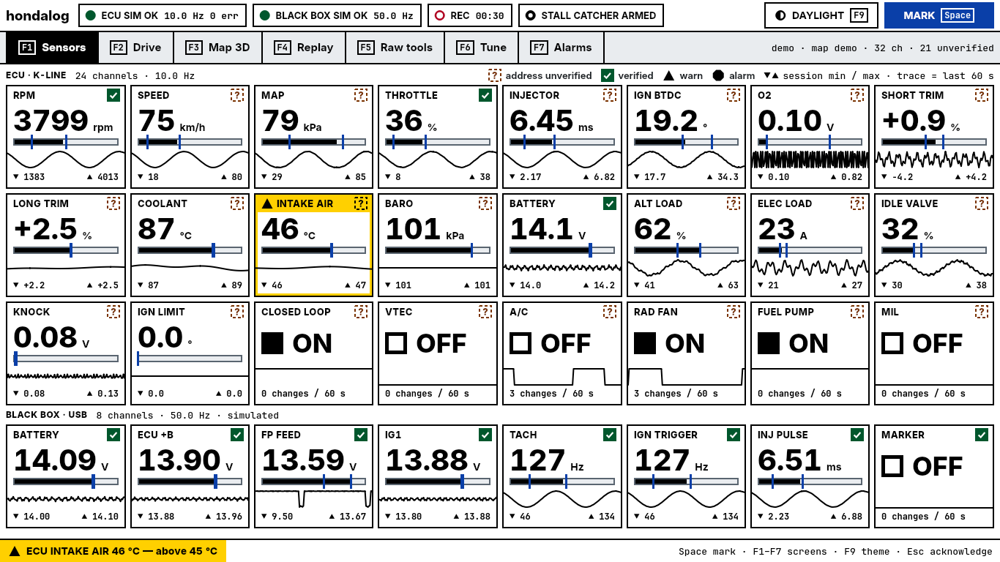

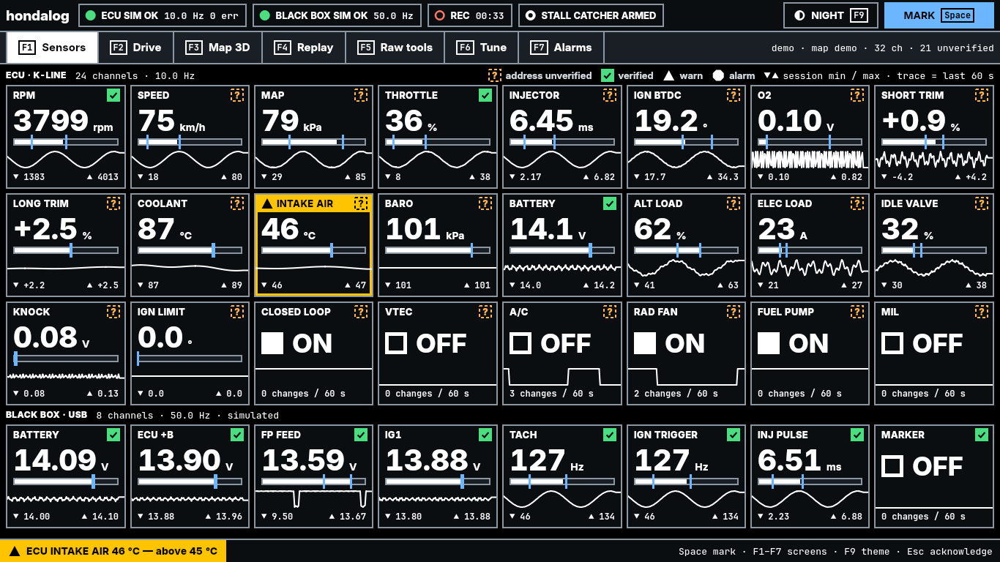

Each tile has:

- the value and its unit;
- a bar across its range, with two small marks for the lowest and highest
  value this session;
- the last 60 seconds as a trace;
- a marker in the corner: a **dashed box with `?`** means the address is a
  guess, a **green tick** means you have verified it.

Tile states:

| Looks like | Means |
|---|---|
| Triangle and a yellow band | Warning |
| Octagon on a filled tile | Alarm. It blinks until acknowledged (Esc) |
| Hatched | No data: not connected, or the channel has stopped arriving |
| Flag tile filled / hollow | On / off |

Actions:

| Do | Get |
|---|---|
| Click a tile | It is pinned to the Drive screen |
| Right-click a tile | "Pin to Drive view", "Mark verified" / "Mark unverified", its warning and alarm limits, and a link to the address map |

"Mark verified" writes `status = "verified"` into your address map with the
method `manual`. The guided checks in [Mapping the P2P](mapping-the-p2p.md)
do the same with measured evidence, which is better.

Two tiles, **Rad fan** and **Fuel pump**, are placeholders: they stay empty
until the address map has channels named `fan` and `fuel_pump`.

The black box tiles are Battery, ECU +B, FP feed, IG1 (volts), Tach and Ign
trigger (pulse frequency in Hz), Inj pulse (ms) and Marker. The four rails
alarm below 11 V.

## F2 Drive

Six huge readouts for a glance while driving, the stall catcher's state, and
a MARK button the size of a hand.

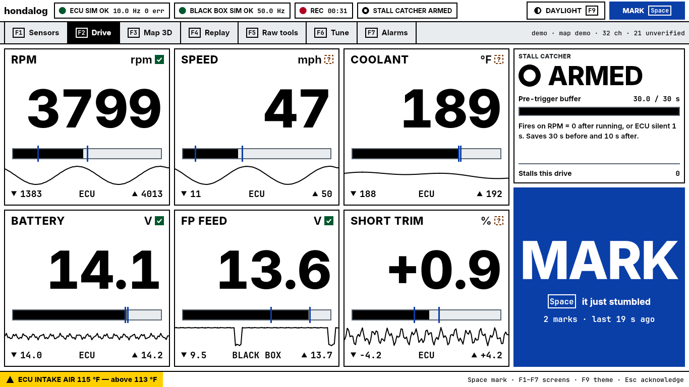

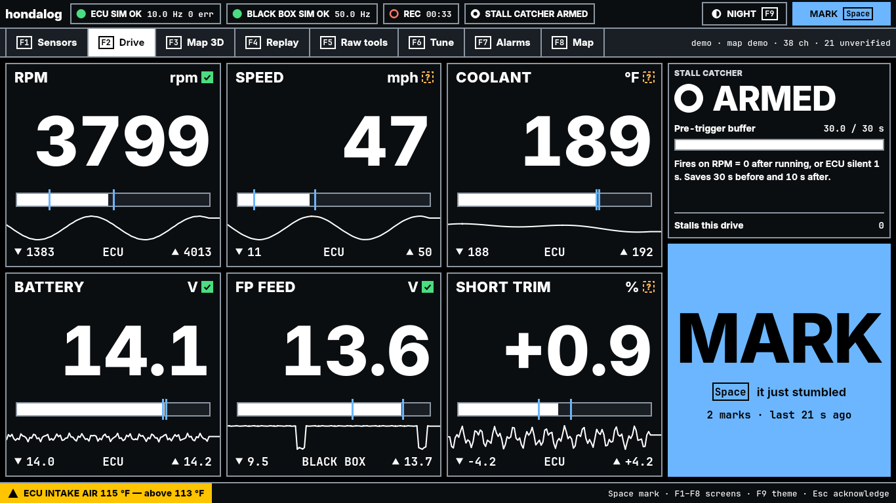

The six default slots are RPM, speed, coolant, battery, the black box's fuel
pump feed, and short-term trim.

| Do | Get |
|---|---|
| Right-click a readout | "Slot N shows" with every ECU and black box channel, and a "4-up layout" switch |
| Click a tile on Sensors (F1) | That channel takes a Drive slot |
| Click MARK, or press Space | A mark in the log |

The stall card says what the catcher is doing: `OFF` (not recording),
`STANDBY` (recording, engine not seen running yet), `ARMED`, `SAVING`
(counting the seconds after a trigger), `TRIGGERED`. It also shows how much
of the pre-trigger buffer is filled and how many stalls this session has
caught.

## F3 Map 3D

An RPM x MAP surface built from what has been logged this session. It needs
no ROM and no chip: it shows what the stock ECU did.

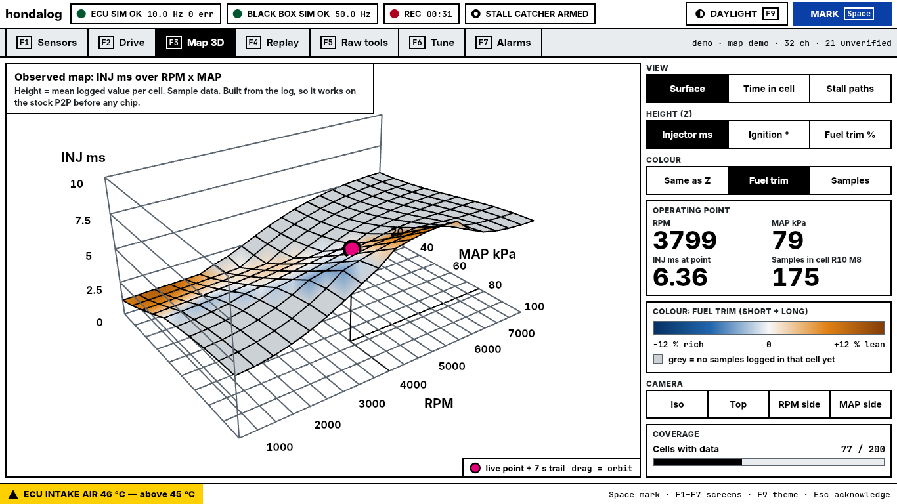

| Control | Key | Choices |
|---|---|---|
| View | V | Surface; Time in cell; Stall paths |
| Height (Z) | Z | Injector ms; Ignition degrees; Fuel trim % |
| Colour | C | Same as Z; Fuel trim; Samples |
| Camera | 1 2 3 4 | Iso; Top; RPM side; MAP side |
| Orbit | arrows | 5 degrees a press |
| Zoom | PgUp / PgDn | in / out |

Grey cells have no samples yet. The right side shows the live operating
point (RPM, MAP, the value there, samples in that cell) and how many cells
have data.

**Time in cell** draws a bar per cell: where the engine actually spends its
time.

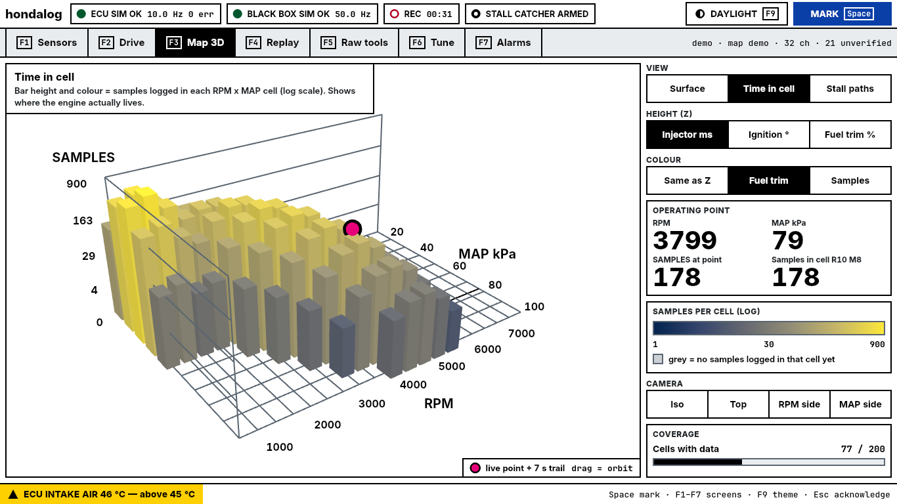

**Stall paths** draws the last 30 seconds before each saved stall as a line
across the map, one colour per stall. If every stall approaches from the
same corner of the map, that is a clue.

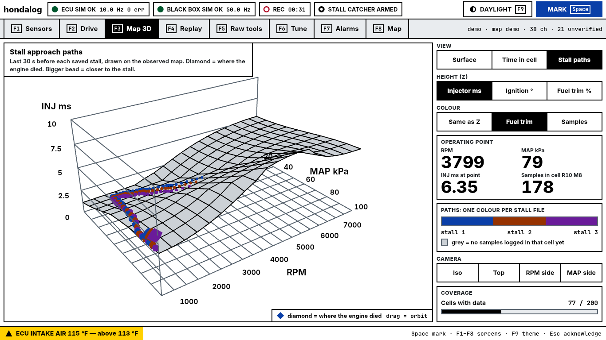

With a ROM open (`--rom`, or opened on the Tune screen) the cells are the
fuel table's own cells instead of the default bins.

Without OpenGL 2.1, or with `--no-gl`, the same data is drawn as a flat heat
map; the camera has nothing to turn.

## F4 Replay

Stacked lanes on one time axis: ECU channels and black box channels
together. With nothing open it follows live data; press **O** to open a
drive.


### Opening

**O** (or the Open button) shows the drive picker:

- every drive in the database, newest first, with its stall captures under
  it;
- black box capture files (`.bbx`) from the log folder;
- a search box over names, notes, tags and marker texts;
- **Import file…** reads an old 0.1.0 `.csv` or a MegaLogViewer `.msl` /
  `.mlg` into the database as a new drive and opens it;
- **Delete…** (or the Delete key) and **Keep**, described in
  [Data and SQL](data-and-sql.md#deleting-and-keeping).

Enter or a double click opens. **L** goes back to live.

### Moving

| Do | Key or mouse |
|---|---|
| Move the cursor | click or drag; Left / Right step 0.1 s; Shift+Left / Right step 1 s |
| Start / end of the drive | Home / End |
| Previous / next event | `[` / `]` (markers, triggers, alarms and, for a stall, each signal that fell) |
| Jump to the stall | the **STALL** button under "Jump to" |
| Play / pause | P |
| Zoom in / out around the cursor | `+` / `-` |
| Zoom around the pointer | mouse wheel |
| Pan | Ctrl+Left / Right (a quarter of the window), Shift+wheel, or drag with the right button |
| Show the whole drive | `0` |
| Scrub | drag the bar under the lanes |

However long the drive, each lane is drawn as one minimum/maximum pair per
pixel column. An hour of 1 kHz black box data scrolls like a minute, and a
dropout one sample long still shows as a spike.

### Two cursors

**D** drops a second cursor (B) where the first is; **Shift+click** moves
it; D again removes it. The header then shows the time between the two and
every lane shows how much it changed between them.

### Comparing two drives

**C** lays a second drive or capture over the first in grey.

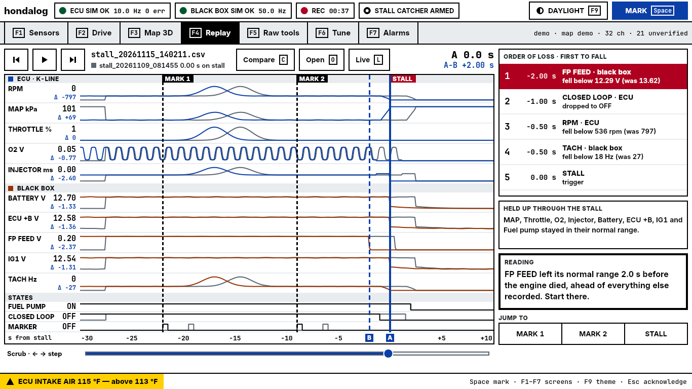

| Do | Key |
|---|---|
| Pick the second drive, or open the compare menu when one is laid over | C |
| Change what the two are lined up on | A (cycles: the first sample, the first marker, the stall, RPM rising through 400) |
| Slide the grey one 0.1 s earlier / later | `,` / `.` |
| Slide it 1 s earlier / later | `<` / `>` |
| Remove it | Shift+C |

Two stall captures are lined up on the stall by default; anything else on
the first sample.

### Stall forensics

When a stall capture is open, the right side has three cards:

| Card | Says |
|---|---|
| **Order of loss · first to fall** | Each signal that left its normal range before the trigger, earliest first, with how long before the stall. Click a row to put the cursor there |
| **Held up through the stall** | The signals that stayed normal |
| **Reading** | One sentence: what fell first and where to start looking |

How to interpret them is in
[Stall hunting](stall-hunting.md#reading-a-capture-in-replay).

A stall caught on the simulated ECU, and the capture opened in Replay:

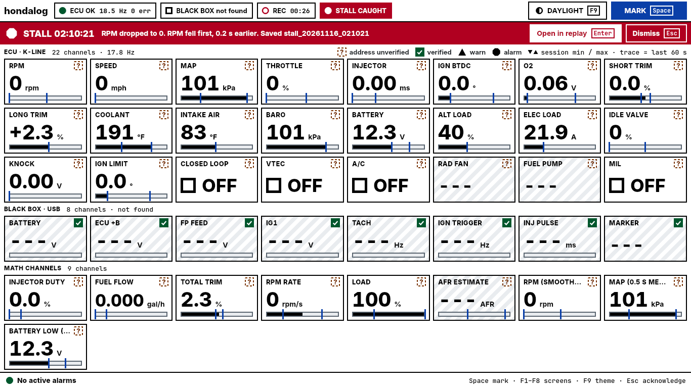

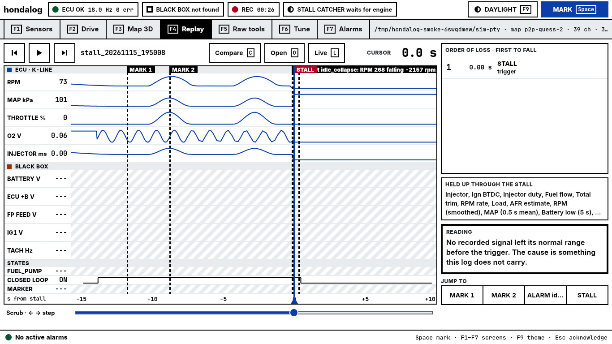

## F5 Raw tools

For finding out what the ECU's memory really holds. Three parts: the hex
grid with the byte inspector, the hex console, and on the right either the
guided mapper or the address ranker.

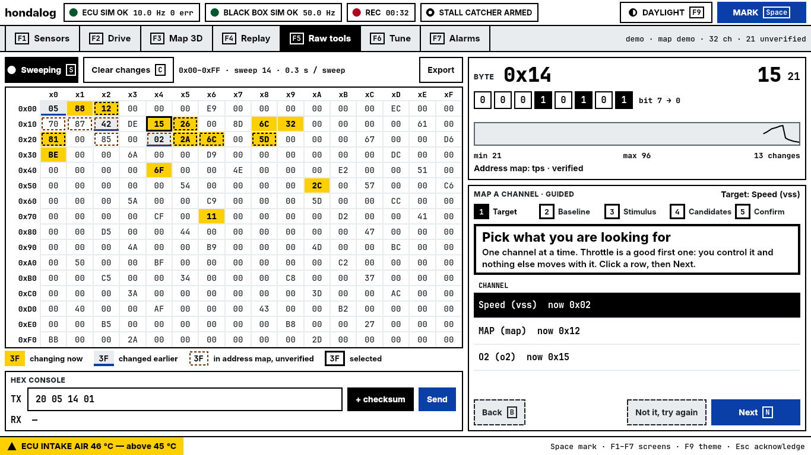

### Sweep

**S** starts sweeping all 256 addresses and keeps going until you press S
again. In the grid:

| Looks like | Means |
|---|---|
| Yellow | Changed in the last sweep |
| Underlined | Changed earlier |
| Dashed | In the address map, but unverified |

Arrows move the selected byte. The inspector shows its bits, minimum,
maximum, how many times it changed and what the address map calls it.
**C** clears the change marks; **Export** saves the sweep as text.

The method: sweep, press C, change exactly one thing on the car (blip the
throttle, switch the headlights on), and see which bytes turn yellow.

### Hex console

Type hex bytes and press Enter (or Send). With **+ checksum** on, the
checksum byte is added for you, so `20 05 14 01` reads one byte at address
0x14.

**The console is read-only by default.** Only read requests
(`20 05 addr len cksum`) and the wake-up bytes go out. Anything else is
refused with `!! blocked`.

**Expert** removes that guard for the session. Every frame sent that way is
written into the drive's record (`unlocked_frames`), so a log always says
whether something other than a read was sent to the ECU. Nobody knows what
other commands this ECU accepts or what they do. Leave Expert off unless you
know exactly what you are sending.

### Guided mapper

The card on the right walks through one verification check per channel:

1. Pick the channel (click it in the list). **N** is Next.
2. Do what each step says while it records. N moves on when the step's
   minimum time is up.
3. Read the verdict: PASS, PLAUSIBLE, FAIL or SKIP.
   - PASS: **Mark verified** writes the mark and the evidence into your map.
   - PLAUSIBLE: **Accept anyway** does the same, but the check proved little.
   - FAIL: it lists the addresses that did behave as the check expects.
     Click one to inspect it; **Use 0xNN** moves the channel there, still
     unverified.

**B** goes back; "Not it, try again" restarts the check. Details and the
terminal version are in [Mapping the P2P](mapping-the-p2p.md).

### Rank addresses

**R** swaps the mapper for the ranker: which addresses followed a signal in
the sweeps so far.

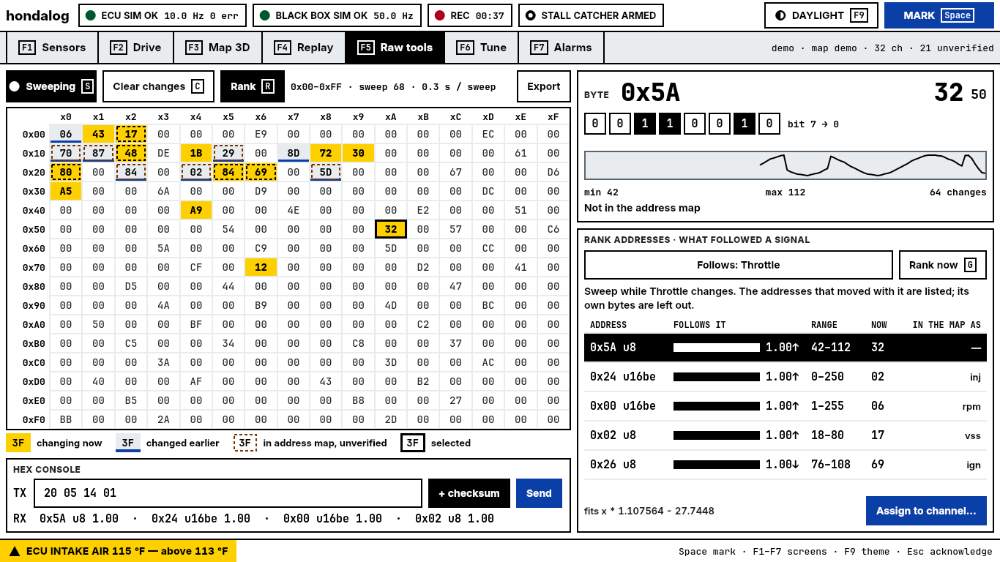

1. Start a sweep (S).
2. Click **Follows: ...** and choose what to rank against: a channel of the
   map (a verified one is the best reference; its own bytes are left out),
   or a shape you make by hand, such as "rises steadily".
3. Move that thing on the car while it sweeps.
4. **G** ranks. Each row is an address as a byte or a 16-bit value, how
   closely it followed and in which direction, the range it covered, its
   value now, and what the map already has there.
5. Click a row to select the byte. **Assign to channel…** writes the
   address, length and byte order into your map after asking. The channel
   becomes unverified, old evidence is dropped and the map version moves on.
   The formula is left for you.

## F6 Tune

The table editor for a chipped P28. On the stock ECU there is nothing to
edit; without a ROM it shows read-only sample tables.

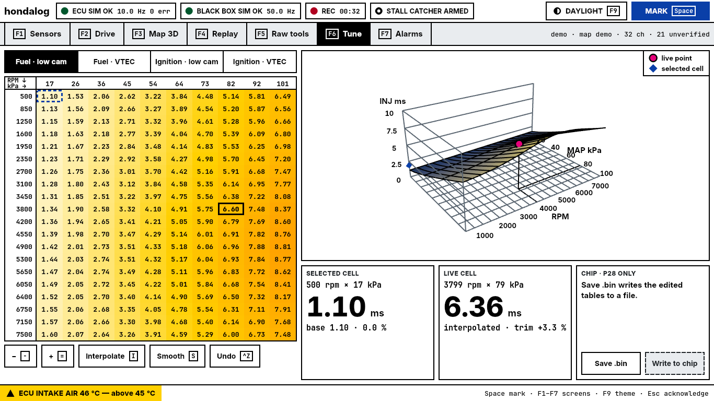

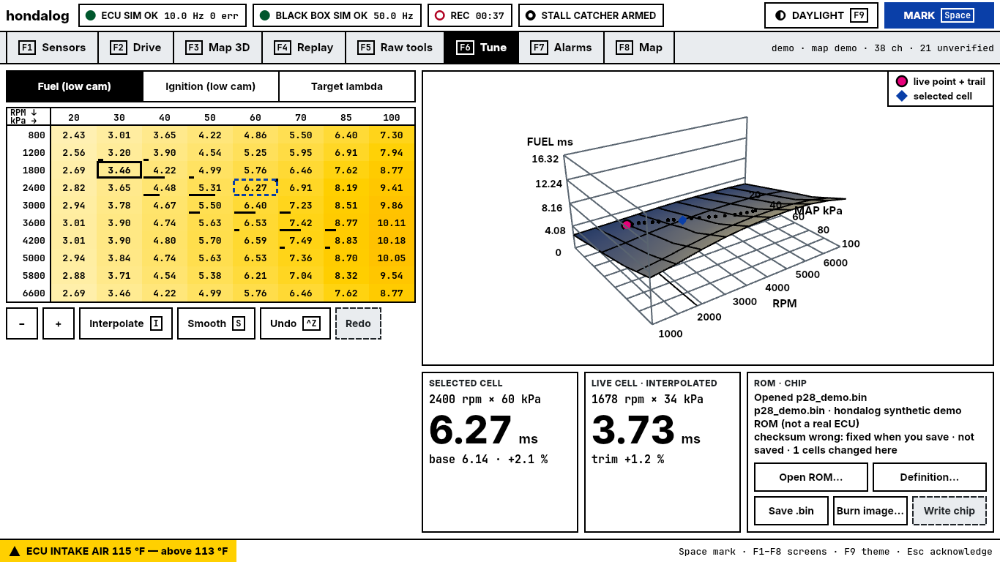

| Do | Key or button |
|---|---|
| Load a definition (TunerPro `.xdf` or hondalog `.toml`) | Ctrl+D, "Definition…" |
| Open a ROM image | Ctrl+O, "Open ROM…" |
| Next table | T |
| Move the selection | arrows; Shift+arrows extend it; Shift+click extends it |
| Raise / lower the selected cells one step | `=` / `-` |
| Raise / lower five steps | `+` / `_` |
| Interpolate across the selection | I |
| Smooth the selection | S |
| Undo / redo | Ctrl+Z / Ctrl+Y (or Ctrl+Shift+Z) |
| Save a new `.bin` | Ctrl+S, "Save .bin" |
| Build the chip-ready 64 KB file | Ctrl+B, "Burn image…" |

While the engine runs, the live cell is outlined, the cells it passed
through in the last 7 seconds carry a bar that shortens with age, and the 3D
surface shows the point and its trail. "at edge" means RPM or MAP is off the
table.

The **Write chip** button is not connected to anything yet: burning is done
from the terminal with `hondalog-tune burn`. Everything else about this
screen, the safety rules, and why no P28 definition ships is in
[Tuning a P28](tuning-p28.md).

## F7 Alarms

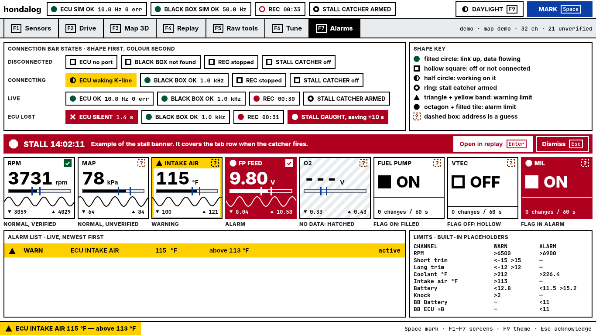

| Card | Shows |
|---|---|
| Connection bar states | What each state of the ECU and black box chips looks like |
| Shape key | Sample tiles for every state: normal, unverified, warning, alarm, no data, flags |
| Alarm list | Live, newest first |
| Limits | Every limit in force, in the display units |
| The stall banner | The current one, or an example |

There is nothing to operate here. The limits are edited in the address map
(see [Alarms](#alarms)).

## F8 Map

Where the drive went, and where the stalls happened. The GPS comes from the
handheld: a drive imported from its SD card, or recorded live over `cyd:`.
A K-line-only drive has no track, and the map says so.

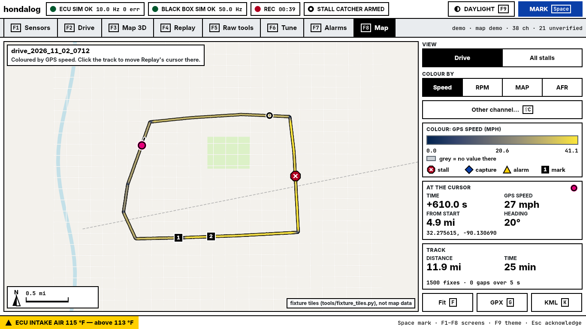

Two views, **V** switches:

**Drive** shows the track of whatever Replay has open: a drive, or a
capture (its 40 seconds). Open one with **O** here or in Replay.

- The line is coloured by the channel picked under **Colour by**: Speed,
  RPM, MAP, AFR (**C** cycles them), or **Other channel…** (**Shift+C**) for
  any channel of the drive, black box rails like ECU +B included. The legend
  gives the range (the 2nd to 98th percentile; fuel trims are blue-to-orange
  around zero). Grey: no value there. Speed is the ECU's vehicle speed when
  the drive has it, else the GPS's.
- Pins: **octagon** = stall, **diamond** = another capture (manual, alarm),
  **triangle** = alarm, **inverted square** with its number = MARK, a ring
  = where the track starts.
- **Click the track** and Replay's cursor jumps to that moment. Replay's
  cursor is the **magenta dot** on the map, with a tick for the heading; it
  moves when you scrub, step or play in Replay. A click on a pin moves the
  cursor to it; `[` and `]` step from pin to pin.
- *At the cursor* shows the time, the GPS speed, the colouring channel's
  value (or the distance from the start) and the position; *Track* the
  distance, the time and the gaps (no fix for more than 5 s breaks the line).
- **G** writes a GPX, **K** a KML of the drive (the KML in the colours on
  screen). See [Data and SQL](data-and-sql.md#gps-tracks-and-where-the-stalls-happen).

While Replay shows the **live** lanes, the map shows the car now (the dot)
and the last ten minutes behind it, and follows it. Dragging the map stops
the following; **F** starts it again.

**All stalls** puts every stall capture of the database on one map, to
answer the question the black box alone cannot: do the stalls happen at the
same place? A cluster on one stretch of road (a bumpy one, a railroad
crossing) points at something shaken loose.

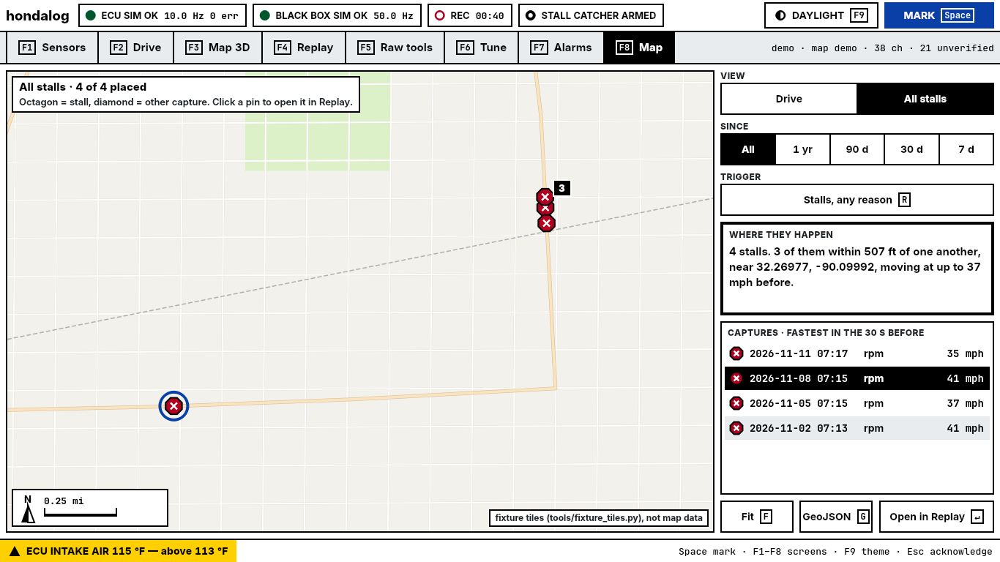

- **Since**: all, the last year, 90, 30 or 7 days. **Trigger** (**R**):
  stalls of any reason, every capture, or one reason (`rpm`, `link`, ...).
- Pins that lie on top of each other carry their count.
- *Where they happen* names the biggest group: "4 stalls. 3 of them within
  500 ft of one another, near 32.26977, -90.09992, moving at up to 37 mph
  before." Stalls within 150 m of another count as one place.
- The list has every capture with the fastest speed in the 30 s before it.
  A click selects one (and shows it on the map), a double click or **Enter**
  opens it in Replay; **a click on a pin opens that capture in Replay**.
- **G** writes the stalls as GeoJSON.

### Map tiles

The base map is OpenStreetMap's raster tiles, used the way the
[OSM tile usage policy](https://operations.osmfoundation.org/policies/tiles/)
asks: hondalog names itself and its repository in every request, asks only
for the tiles on the screen (two at a time, nothing in advance), keeps them
as long as the server says, and shows "© OpenStreetMap contributors".

It is **offline first**: in the car there is usually no internet.

- Tiles are kept in `~/.cache/hondalog/tiles`, up to 300 MB; the least
  recently used go first. A tile seen once shows again offline, however old
  it is, and is checked with the server (a small conditional request) the
  next time there is a connection.
- A tile that is neither cached nor reachable borrows the tile of a lower
  zoom (one already shown), scaled up; failing that, a plain grid. The
  track, the pins, the scale bar and the north arrow never need tiles. After a failed connection the map
  waits a minute before trying the network again.
- To have the map in the car, look at the places you drive once at home,
  at the zoom levels you use: they are then in the cache.
- At night the tiles are inverted and dimmed; by day they are washed out a
  little so the coloured track stands out.

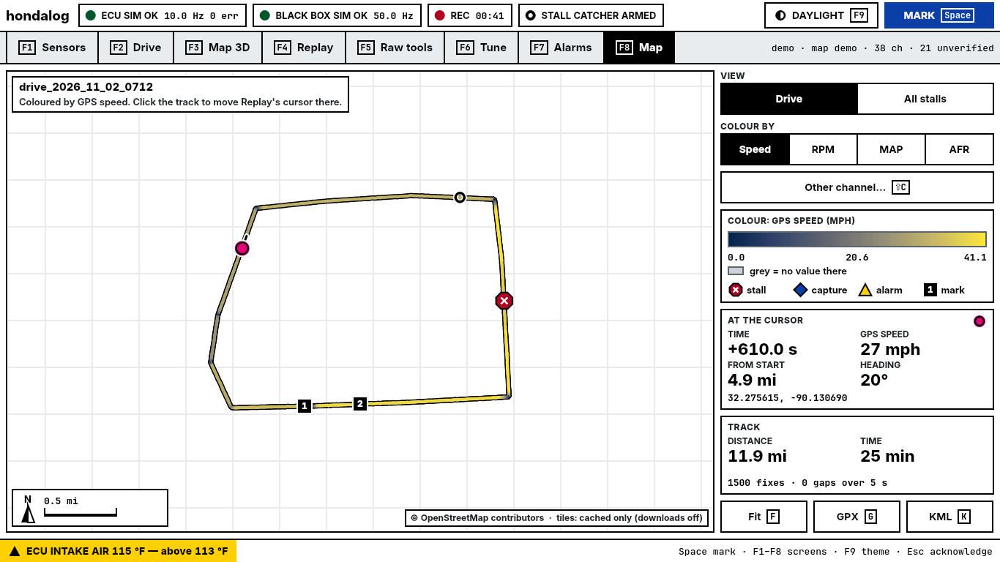

ECU chip menu > Settings > Map tiles:

| Entry | Does |
|---|---|
| Download map tiles | On by default. Off: only what is cached is shown, nothing goes on the network |
| Tile server… | Another server, or your own: a URL with `{z}`, `{x}` and `{y}` (`{s}` is filled with `a`), and the attribution its terms ask for (it is shown on the map) |
| Back to OpenStreetMap | Undo the above |
| Cache | How much is cached, and where |
| Clear the tile cache… | Delete the cached tiles of the server in use |

`HONDALOG_TILES=offline` in the environment keeps the app off the network
whatever the setting (the tests and tools use it); `HONDALOG_TILE_CACHE`
moves the cache.

## Recording and drives

Recording starts when the ECU connects, unless you switched "Record on
connect" off. Ctrl+R (or the REC chip) starts and stops it by hand.

- Every drive goes into one database, `~/hondalog/hondalog.db`, under a name
  like `drive_2026_11_16_0712`.
- It is committed every half second. A crash or a dead laptop battery costs
  at most the last second; the next start marks that drive `crashed` and
  keeps everything up to the last commit.
- A drive ends when you stop recording, or when the ECU has been silent for
  two minutes (key off). The next answer from the ECU starts a new drive.
- With the black box connected, the drive stays open for as long as the box
  sees the key on (IG1 up, ECU +B up, or the engine turning). A stall with
  the key on and the ECU dead is therefore all in one drive.

What is stored, and how to get it out, is in
[Data and SQL](data-and-sql.md).

## Marks

**Space**, the MARK button in the status bar, and the big MARK on the Drive
screen all do the same: tag this moment in the log. If the black box is
connected the mark goes to it too, with the same number, so the two records
can be lined up on it later.

Press it when the car does something: a stumble, a flicker of the dash, a
noise. In Replay, `[` and `]` jump between marks. `hondalog-log list -q`
searches their text.

Holding Space does not repeat. While a text field has focus (the hex
console, a search box) Space types a space; press Esc first.

## The stall catcher and triggers

While recording, once RPM has been above 400:

- RPM reads below 50, or
- the ECU gives no valid reply for 1 second (power loss, cable pulled),

the app marks the 30 seconds before and the 10 seconds after as a
**capture** named `stall_DATE_TIME`, shows a red banner over the tabs and
beeps twice.

| Key | Does |
|---|---|
| Enter | Opens the capture in Replay |
| Esc | Dismisses the banner |

A capture is a row in the database that points into the drive, not a copy.
Several triggers inside one window share one capture. With the black box
connected, a trigger on either side saves both: the box writes its own
1 kHz capture to its SD card and the laptop capture holds the ECU reads and
the box's live frames.

Turning the key off with the engine running is a stall as far as the catcher
can tell. Press Esc for that one.

The catcher is two rules of a general trigger engine. Three more rules ship
**switched off**, because they read channels nobody has verified yet:

| Rule | Condition | Window |
|---|---|---|
| `low_battery` | `batt < 11.0` for 0.5 s | 30 s before, 10 s after |
| `lean_spike` | `o2 < 0.1 and tps > 50 and rpm > 2500` for 0.3 s | 10 s / 5 s |
| `overtemp` | `ect > 105` for 2 s | 60 s / 10 s |

There is no settings file for trigger rules yet: enabling those or adding
your own is done in code (`hondalog/triggers/presets.py`). What you *can* do
from the address map is give an alarm the `"capture"` action, which saves a
capture when the alarm is raised.

## Alarms

Alarms are the `[[alarm]]` rules in the address map. The shipped ones:

| Alarm | Condition | Severity |
|---|---|---|
| Coolant hot | above 105 °C for 2 s | critical, latching |
| Battery low | below 12.0 V for 3 s with the engine running | warn |
| Overcharging | above 15.2 V for 2 s | warn |
| Over-rev | above 6800 rpm | warn |
| Idle collapsing | RPM below 600 and falling faster than 400 rpm/s | warn |
| Lean under load | O2 below 0.2 V with throttle over 60 % above 3000 rpm for 0.5 s | critical |

These limits are starting points, not Honda figures, and every one reads a
channel that is not verified yet. The alarm text carries a `?` until its
channel is.

An alarm colours its tile, appears in the bottom strip and in the list on
F7, and is written into the log. A critical alarm also beeps twice when it is
raised. **Esc acknowledges.** A latching alarm stays up until acknowledged even if the
value has recovered.

Writing your own is covered in
[Mapping the P2P](mapping-the-p2p.md#alarms).

## Themes

**F9** switches between two themes. The choice is remembered.

| Theme | Is | For |
|---|---|---|
| Daylight (default) | Black on white | The car by day. A TN panel in sun loses its blacks first, so a white ground reads best |
| Night | White on true black | Dusk and the garage |

All text meets a 7:1 contrast ratio or better in both. Warning and alarm
states always use a shape as well as a colour.

## Units

The address map, the database and every export are in metric units:
°C, kPa, km/h, L/h. That never changes.

The **screen** converts for display, and the default is **US units**:
mph, °F, gal/h, miles. MAP and baro stay in kPa in both presets, because
that is what Honda tables and tuning guides use.

ECU chip menu > Settings > Units:

| Entry | Choices |
|---|---|
| Presets | US: mph, °F, gal/h (MAP stays kPa); Metric: km/h, °C, L/h |
| Speed | km/h, mph |
| Temperature | °C, °F, K |
| Pressure (MAP, baro) | kPa, psi, inHg, bar, mmHg |
| Mixture | AFR, lambda |
| Fuel flow | L/h, gal/h |
| Distance | km, mi |

The choice applies to the tiles, the Drive screen, the Replay readouts,
alarm texts and the limits table. Volts, %, ms and rpm have nothing to
convert. The axes of Map 3D and Tune are the tables' own breakpoints and
stay in kPa. A marker that an alarm drops into the log is written in the
map's (metric) units.

## The link: rates, timing, recovery

**Rates.** Each channel has a rate class: fast (rpm, map, tps, inj, ign),
medium (o2, stft, ltft, vss) or slow (the rest). Set `rate = "fast"` on a
channel in the address map to override. The targets are 20, 5 and 1 reads
per second (`rate_fast_hz`, `rate_medium_hz`, `rate_slow_hz` in
`[protocol]`). The planner merges nearby addresses into the fewest requests,
using the measured cost of a request (5 echo bytes, 3 frame bytes, the ECU's
reply time and the gap: about 12 ms, the same as 12 data bytes), and the
scheduler interleaves them.

`python3 tools/bench_link.py` measures the result against the simulator at
true 9600 baud byte timing (2 ms ECU reply time, 1 ms USB latency). Last run
2026-11-16:

| Channels | 0.1.0 | Now |
|---|---|---|
| rpm, map, tps, inj, ign (and vss, o2, baro, which share their reads) | 11.4 Hz | 17.3 Hz |
| stft, ltft | 11.4 Hz | 4.7 Hz (target 5) |
| temperatures, battery, flags, knock | 11.4 Hz | 1.0 Hz (target 1) |
| rpm alone, burst mode | - | 66.7 Hz |

20 Hz on the fast class does not fit on a 9600 baud wire with this map; the
ECU chip menu shows the shortfall per rate class instead of hiding it. On
the car the numbers depend on the ECU's real reply time, which
`hondalog-firstcontact` measures (**[unverified]** until then).

**Timestamps.** Every value carries the time its reply was complete
(monotonic clock), minus an estimate of how old the data was by then.
Channels from different reads do not share one timestamp.

**Errors.** The reply timeout, the inter-byte timeout and the gap between
requests are measured and adapt. A bad reply is retried once after the line
has been drained.

**Recovery.** Key off and on again, or the cable pulled and plugged back in:
the app notices within about half a second, keeps trying, and carries on by
itself within about 2 to 3 seconds of the ECU or cable coming back. Tested
with the simulator's unplug only.

**Read-only.** Only read requests (`20 05 addr len cksum`) and the wake-up
bytes go out. Anything else is refused until the expert unlock is switched
on for the session (Raw tools, Expert); what was sent that way is written
into the drive.

## OBD2 (ISO 9141-2)

Standard OBD2 runs on the same pin at 10400 baud: a 5-baud init to address
0x33 (made by toggling break, because the FT232 cannot send at 5 baud), with
KWP2000 fast init as a fallback, then supported PIDs, live PIDs, stored and
pending codes with Honda P1xxx text, freeze frame, readiness, and clearing
codes. Clearing needs the typed confirmation `CLEAR`, is refused while the
engine runs, and resets the readiness monitors.

Limits:

- It is slow: about 8 to 10 PIDs per second in the simulator, likely fewer
  on the car. Use it for codes and cross-checks, not for logging.
- The two protocols cannot share the line. The app pauses Honda polling,
  runs the init (about 2.6 s), does the OBD2 work, and goes back. In the
  simulator the ECU drops the ISO session after 5 s of silence and Honda
  reads resume without a power cycle; expect a gap of about 8 s in the log.
  Whether the real P2P does the same is **[unverified]**: if Honda reads do
  not come back, turn the key off and on.
- The ISO session dies after 5 s without a request; hondalog re-inits by
  itself, which costs another 2.6 s.
- It needs break and baud control, so it works on the real cable and on the
  built-in `sim:` port, not through the `hondalog-sim` pty.
- 10400 baud is non-standard. Some clone FTDI chips and most CH340 cables
  get it wrong; if the init fails on a clone, suspect that first.

## Keyboard map

### Everywhere

| Key | Does |
|---|---|
| F1 ... F8 | Sensors, Drive, Map 3D, Replay, Raw tools, Tune, Alarms, Map |
| F9 | Daylight / Night |
| F11 | Full screen on / off |
| Space | MARK |
| Esc | Leave a text field; dismiss the stall banner; acknowledge alarms |
| Enter | Open the caught stall in Replay (while the banner shows) |
| Ctrl+R | Start / stop recording |

While a text field has focus, only the F keys and Esc act; everything else
is typed.

### F3 Map 3D

| Key | Does |
|---|---|
| Left / Right / Up / Down | Orbit |
| PgUp / PgDn | Zoom in / out |
| 1 / 2 / 3 / 4 | Camera: iso, top, RPM side, MAP side |
| V | Next view: surface, time in cell, stall paths |
| Z | Next height value |
| C | Next colour value |

### F4 Replay

| Key | Does |
|---|---|
| O | Open the drive picker |
| L | Back to live |
| Left / Right | Cursor 0.1 s (Shift: 1 s) |
| Ctrl+Left / Right | Pan a quarter of the window |
| Home / End | Start / end of the drive |
| `[` / `]` | Previous / next event |
| P | Play / pause |
| `+` (or `=`) / `-` | Zoom in / out |
| `0` | Whole drive |
| D | Second cursor on / off |
| C | Compare with another drive |
| Shift+C | Remove the compared drive |
| A | Cycle what the two are lined up on |
| `,` / `.` | Slide the compared drive 0.1 s |
| `<` / `>` | Slide it 1 s |

In the drive picker: type to search, Up / Down move, Enter opens, Delete
deletes after asking.

### F5 Raw tools

| Key | Does |
|---|---|
| S | Sweep on / off |
| C | Clear the change marks |
| Arrows | Move the selected byte |
| Enter | Send the console's frame |
| N / B | Guided mapper: next / back |
| R | Show or hide Rank addresses |
| G | Rank now |

### F6 Tune

| Key | Does |
|---|---|
| Arrows | Move the selection (Shift: extend) |
| `=` / `-` | One step up / down |
| `+` / `_` | Five steps up / down |
| I | Interpolate |
| S | Smooth |
| T | Next table |
| Ctrl+Z / Ctrl+Y | Undo / redo (Ctrl+Shift+Z also redoes) |
| Ctrl+O | Open ROM |
| Ctrl+D | Load a definition |
| Ctrl+S | Save .bin |
| Ctrl+B | Build the burn image |

### F8 Map

| Key | Does |
|---|---|
| V | Drive / All stalls |
| Arrows | Pan a quarter of the map |
| `+` (or `=`, PgUp) / `-` (PgDn) | Zoom in / out (also the wheel; a double click zooms in) |
| F | Fit the drive or the stalls; when live, follow the car |
| C / Shift+C | Next colour preset / pick any channel |
| `[` / `]` | Previous / next pin (Drive: moves Replay's cursor; All stalls: selects) |
| Enter | All stalls: open the selected capture in Replay |
| R | All stalls: pick the trigger reason |
| G | GPX of the drive; All stalls: GeoJSON |
| K | KML of the drive |
| O / L | Open a drive (in Replay) / Replay back to live |

Drag to pan; a click on the track moves Replay's cursor.
